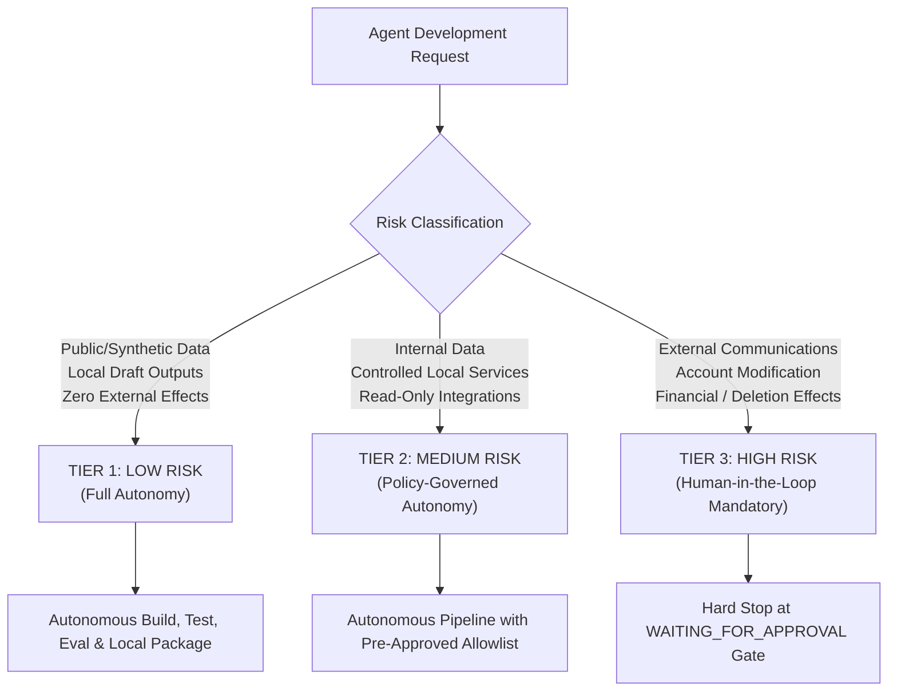

# Factory Autonomy Policy

**Document Version:** 1.0.0  
**Date:** 2026-11-03  
**Author:** Antigravity 2.0 (Supervising Principal Platform Architect)  
**Status:** BASELINED & APPROVED  

---

## 1. Principles of Governed Autonomy

Autonomous operation is a capability to be earned through verified quality and safety, not an unconstrained default. The Agent Development Factory enforces a **Risk-Based Autonomy Policy** designed to maximize engineering velocity for safe, low-risk workloads while ensuring ironclad human governance over high-risk or consequential operations.

---

## 2. Three-Tier Risk Classification

Every agent development request is classified at the `INTAKE` stage into one of three risk tiers based on its intended domain, data sensitivity, and operational side-effects:

### Tier 1: Low Risk (Full Autonomy)
* **Scope:** Read-only analysis of public or synthetic data, data transformation, local draft generation, internal anomaly detection, unit testing.
* **Permitted Effects:** `READ_PUBLIC`, `WRITE_LOCAL_DRAFT`.
* **Autonomy Level:** **100% Autonomous.** The factory progresses autonomously from intake, specification generation, code synthesis, testing, evaluation, bounded remediation, and release packaging.
* **Release Approval:** Automatically signed with `AUTO_APPROVED_LOW_RISK` when all deterministic evaluation gates pass.

### Tier 2: Medium Risk (Policy-Governed Autonomy)
* **Scope:** Controlled read access to private local repositories, internal tool calls, non-destructive workflow automation.
* **Permitted Effects:** `READ_PRIVATE`, `WRITE_LOCAL_DRAFT`.
* **Autonomy Level:** Autonomous within explicit pre-approved allowlists (e.g. explicitly defined file path patterns). Any deviation halts execution immediately.
* **Release Approval:** Requires operational owner sign-off on the generated manifest before deployment.

### Tier 3: High Risk (Human-in-the-Loop Mandatory)
* **Scope:** External communications (sending messages/emails), modifying system state, pushing commits to remote git repositories, accessing financial endpoints, deleting files outside scratch space.
* **Permitted Effects:** `CHANGE_ACCOUNT`, `SEND_PUBLISH`, `SPEND_DELETE`.
* **Autonomy Level:** **Supervised Only.** Code and tests may be generated in the isolated workspace, but packaging and execution cannot proceed without an explicit, cryptographically verifiable Human Approval Token.

---

## 3. Autonomous Execution Guardrails & Hard Stop Rules

The factory immediately halts autonomous execution and transitions to `BLOCKED` under any of the following conditions:

1. **Remediation Ceiling Exceeded:** More than 3 remediation attempts on a failing test suite.
2. **Permission Violation Attempt:** Agent code attempts to execute a tool or effect not permitted in its `agent.yaml` policy.
3. **Budgetary Cap Exceeded:** Paid API spend exceeds $0.00 without explicit financial authorization.
4. **Execution Timeout:** Single test run exceeds 60 seconds wall-time or cumulative project build exceeds 10 minutes.
5. **Fixture Tampering:** The SHA-256 hash of any golden test fixture or grader rule is modified during build or repair.
6. **Unknown / Unverified Dependency:** A required tool or model is missing from the active Capability Registry.
