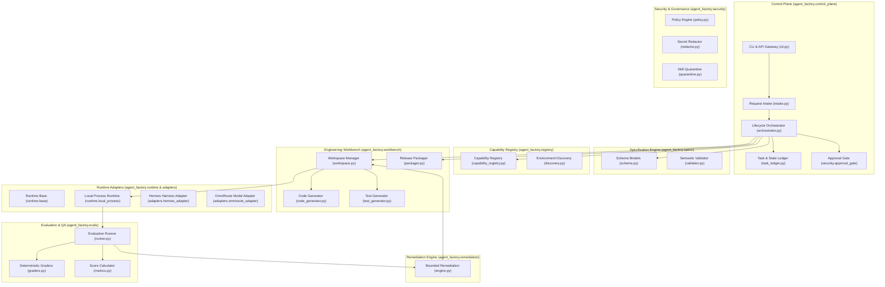

# Factory Component Architecture

**Document Version:** 1.0.0  
**Date:** 2026-11-03  
**Author:** Antigravity 2.0 (Supervising Principal Platform Architect)  
**Status:** BASELINED & APPROVED  

---

## 1. Architectural Component Overview

The Agent Development Factory is organized into cohesive, loosely coupled Python modules located within the `agent_factory` package. Each component exposes a strict programmatic interface, enforces type safety via Pydantic/mypy standards, and maintains deterministic boundary protections.



---

## 2. Component Specifications and Contracts

### 2.1 Control Plane Components

#### 1. `RequestIntake` (`agent_factory.control_plane.intake`)
* **Purpose:** Ingests raw business requests, decomposes requirements into functional units, determines project feasibility, and assigns an initial Risk Classification.
* **Core Method:**
  ```python
  def ingest_request(self, raw_prompt: str, owner: str = "Admin") -> ProjectIntakeResult:
      """Parses requirement, checks constraints, and constructs initial Project spec."""
  ```
* **Outputs:** `ProjectIntakeResult` containing unique `project_id`, goal summary, input/output definitions, and risk level (`LOW`, `MEDIUM`, `HIGH`).

#### 2. `LifecycleOrchestrator` (`agent_factory.control_plane.orchestrator`)
* **Purpose:** Drives the 11-stage factory state machine. Verifies entry/exit criteria for each stage, triggers workbench activities, and coordinates approval gates.
* **Stage Sequence:**
  1. `INTAKE` $\rightarrow$ 2. `SPEC_DRAFT` $\rightarrow$ 3. `SPEC_REVIEW` $\rightarrow$ 4. `BUILD` $\rightarrow$ 5. `TEST` $\rightarrow$ 6. `EVALUATE` $\rightarrow$ 7. `REMEDIATE` $\rightarrow$ 8. `PACKAGE` $\rightarrow$ 9. `RELEASE` $\rightarrow$ 10. `OPERATION` $\rightarrow$ 11. `RETIRED`.
* **Core Method:**
  ```python
  def advance_stage(self, project_id: str) -> StageTransitionResult:
      """Validates current stage exit criteria, transitions to next stage, and records evidence."""
  ```

#### 3. `TaskLedger` (`agent_factory.control_plane.task_ledger`)
* **Purpose:** Durable state management for active workflows, task claims, and execution checkpoints. Implemented using atomic SQLite persistence and JSON Line event streams.
* **Core Data Model:**
  ```python
  class TaskRecord(BaseModel):
      task_id: str
      project_id: str
      stage: str
      status: str  # QUEUED, RUNNING, COMPLETED, FAILED, BLOCKED
      input_hash: str
      output_hash: Optional[str] = None
      evidence_ref: Optional[str] = None
      error_message: Optional[str] = None
      created_at: str
      updated_at: str
  ```

---

### 2.2 Specification & Validation Engine

#### 1. `UniversalAgentSpec` (`agent_factory.specs.schema`)
* **Purpose:** Pydantic model defining the portable contract format (`agent.yaml`).
* **Attributes:**
  * `schema_version`: Integer (default: 1).
  * `agent_id`: Machine-readable unique identifier.
  * `owner`: Name or role of the owning engineer/stakeholder.
  * `purpose`: Concrete single-sentence operational objective.
  * `inputs`: Typed dictionary of expected input parameters.
  * `outputs`: Typed dictionary of generated output artifacts.
  * `policy`: Permission boundaries (`mode`, `data_class`, `permitted_tools`, `effects`, `on_denial`).
  * `limits`: Numeric bounds (`max_steps`, `max_wall_time_seconds`, `paid_spend_ceiling`).
  * `acceptance`: Target evaluation suite and required passing thresholds.
  * `targets`: Declared runtime targets (`local_process`, `hermes`, `docker`).

#### 2. `SpecValidator` (`agent_factory.specs.validator`)
* **Purpose:** Performs syntactic JSON Schema validation and deep semantic policy validation. Rejects specs requesting unauthorized effect levels (e.g., `SPEND_DELETE` without human authorization) or referencing non-existent tools.

---

### 2.3 Capability Registry & Environment Discovery

#### 1. `CapabilityRegistry` (`agent_factory.registry.capability_registry`)
* **Purpose:** Strongly typed catalog of infrastructure capabilities.
* **Entities:**
  * `Capability`: Unique ID, Kind (`MODEL`, `PROVIDER`, `HARNESS`, `RUNTIME`, `TOOL`, `MCP`, `SKILL`, `EVALUATION`), Provider, Version, Security Classification, Status (`ACTIVE`, `UNVERIFIED`, `DEPRECATED`).
* **Core Methods:**
  ```python
  def register(self, capability: Capability) -> None: ...
  def resolve(self, kind: CapabilityKind, criteria: dict) -> List[Capability]: ...
  def verify_capability(self, capability_id: str, probe_fn: Callable) -> bool: ...
  ```

#### 2. `EnvironmentDiscovery` (`agent_factory.registry.discovery`)
* **Purpose:** Probes the live system for CPU, RAM, GPU, listening ports (20128, 31415), installed Hermes version, MCP servers, and Ollama weights, registering verified capabilities automatically.

---

### 2.4 Autonomous Engineering Workbench

#### 1. `WorkspaceManager` (`agent_factory.workbench.workspace`)
* **Purpose:** Provisions isolated project workspaces under `workspaces/<project_id>/` with clean subdirectories:
  * `src/`: Generated agent source code.
  * `tests/`: Automated test suites.
  * `fixtures/`: Deterministic input test data.
  * `artifacts/`: Generated outputs.
  * `evidence/`: Raw logs, trace events, and checksums.

#### 2. `CodeGenerator` (`agent_factory.workbench.code_generator`)
* **Purpose:** Synthesizes executable Python code adhering to standard architecture patterns (e.g., Anomaly Analyzer, Data Pipeline, Document Processor) strictly matching the Universal Agent Specification.

#### 3. `TestGenerator` (`agent_factory.workbench.test_generator`)
* **Purpose:** Generates comprehensive, automated pytest test files validating:
  * Input schema validation and rejection of malformed payloads.
  * Core functional logic correctness.
  * Output schema and file artifact generation.
  * Guard and boundary denial handling.

#### 4. `ReleasePackager` (`agent_factory.workbench.packager`)
* **Purpose:** Bundles verified agent code, spec, fixtures, requirements lockfile, and manifest into a reproducible ZIP distribution with cryptographic SHA-256 digests.

---

### 2.5 Runtime Adapters

#### 1. `AgentRuntime` (`agent_factory.runtime.base`)
* Abstract base class defining runtime execution:
  ```python
  class AgentRuntime(ABC):
      @abstractmethod
      def execute(self, agent_pkg_path: Path, input_data: dict, limits: ExecutionLimits) -> ExecutionResult:
          pass
  ```

#### 2. `LocalProcessRuntime` (`agent_factory.runtime.local_process`)
* Executes the agent as an isolated subprocess with:
  * Dedicated process group.
  * Hard execution timeout enforcement.
  * Sanitized environment variables.
  * Capture of stdout/stderr and exit codes.

#### 3. `OmniRouteModelAdapter` (`agent_factory.adapters.omniroute_adapter`)
* Connects to local OmniRoute gateway (`http://127.0.0.1:20128/v1`), formatting completions requests, tracking latency and token consumption, and handling connection retries.

#### 4. `HermesHarnessAdapter` (`agent_factory.adapters.hermes_adapter`)
* Maps agent specs to Hermes CLI commands, profiles, and skills, enabling invocation through the Hermes coordination engine.

---

### 2.6 Evaluation & Quality Assurance Engine

#### 1. `EvaluationRunner` (`agent_factory.evals.runner`)
* Executes standard evaluation packs (A01–A15) against the candidate agent in an isolated environment.

#### 2. `DeterministicGraders` (`agent_factory.evals.graders`)
* Validates outcomes without probabilistic LLM judges:
  * File existence and non-zero byte size.
  * Exact SHA-256 checksum matches for golden outputs.
  * Schema compliance of structured JSON/CSV outputs.
  * Exit code 0 verification.
  * Absence of unauthorized file writes outside workspace boundaries.

#### 3. `MetricsCalculator` (`agent_factory.evals.metrics`)
* Computes normalized scores for **Efficacy** (0.0 to 1.0), **Safety** (0.0 to 1.0, 1.0 required for release), and **Efficiency** (latency in milliseconds, tokens, cost).

---

### 2.7 Bounded Autonomous Remediation Engine

#### `RemediationEngine` (`agent_factory.remediation.engine`)
* **Purpose:** Closes the autonomous engineering loop when tests fail.
* **Mechanism:**
  1. Inspects failed pytest output and error tracebacks.
  2. Identifies error category (`IMPORT_ERROR`, `SYNTAX_ERROR`, `ASSERTION_FAILURE`, `SCHEMA_ERROR`).
  3. Synthesizes a targeted surgical code fix.
  4. Applies the fix to the workspace source file.
  5. Reruns the test suite.
  6. Tracks iteration count; aborts with `BLOCKED: Remediation budget exhausted` if repairs exceed 3 attempts.
