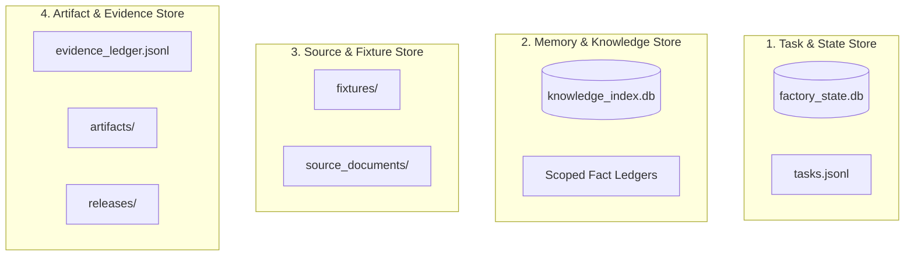
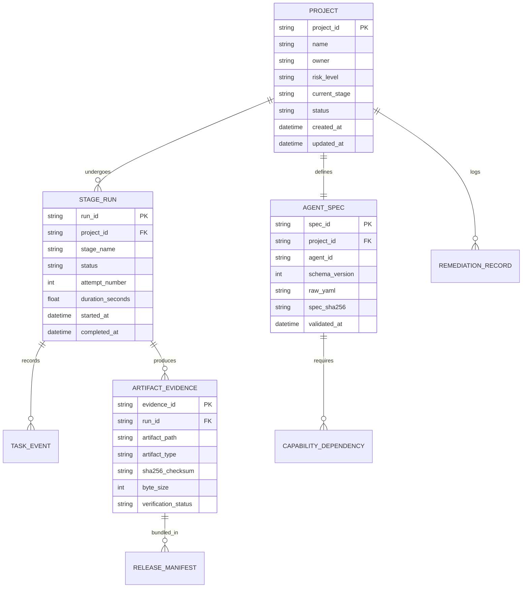

# Factory Data Architecture

**Document Version:** 1.0.0  
**Date:** 2026-11-03  
**Author:** Antigravity 2.0 (Supervising Principal Platform Architect)  
**Status:** BASELINED & APPROVED  

---

## 1. Data Classification Model

To guarantee least privilege and prevent data leakage, the Agent Development Factory classifies all information into five strict tiers:

| Data Class | Description | Allowed Destinations | Retention Policy | Storage Security |
| :--- | :--- | :--- | :--- | :--- |
| **PUBLIC** | Open-source code, public benchmarks, documentation, published articles. | Local disk, public LLMs, remote gateways. | Indefinite. | Standard filesystem permissions. |
| **SYNTHETIC** | Machine-generated test data, synthetic CSVs, mock user profiles, test fixtures. | Local disk, local models, remote LLMs. | Project lifecycle + 30 days. | Workspace isolation. |
| **INTERNAL** | Factory telemetry, operational metrics, task logs, architecture drafts. | Local factory database, local dashboards. | 90 days. | Host user permissions only. |
| **CONFIDENTIAL** | Proprietary algorithms, customer data, private codebases, audit findings. | Approved local runtimes, verified private models. | Explicit project retention window. | Encrypted at rest, strict egress filtering. |
| **RESTRICTED_SECRET** | API keys, OAuth tokens, passwords, private SSH keys, signing certificates. | Dedicated secure credential store only. | Controlled by key lifecycle. | **NEVER stored in files, prompts, git, logs, or reports.** Injected at runtime via memory reference. |

---

## 2. Four Conceptual Data Stores

In strict alignment with Section 15 of the *Full-Lifecycle Engineering Handbook*, the factory separates data into four distinct conceptual stores to prevent state corruption:



### Store 1: Task and State Store
* **Purpose:** Manages workflow progression, active task allocations, worker locks, and stage transitions.
* **Technology:** SQLite database (`data/factory_state.db`) + append-only JSON Lines event ledger (`data/task_events.jsonl`).
* **Properties:** ACID-compliant, supports transactional checkpointing, crash recovery, and idempotent task replay.

### Store 2: Scoped Memory and Knowledge Store
* **Purpose:** Stores reusable domain knowledge, architectural patterns, and verified facts.
* **Scope:** Explicitly namespaced per project or agent profile. Never permits unvetted cross-agent memory pollution.
* **Schema:**
  ```json
  {
    "fact_id": "fact_01H...",
    "namespace": "data_quality_rules",
    "subject": "csv_anomaly_thresholds",
    "fact_value": "Z-score > 3.0 indicates outlier",
    "source_reference": "ISO-8000-61",
    "confidence": 0.98,
    "created_at": "2026-11-03T11:00:00Z",
    "expiry": null,
    "superseded_by": null
  }
  ```

### Store 3: Source & Fixture Store
* **Purpose:** Holds immutable golden test fixtures, synthetic CSV datasets, and verified input files.
* **Integrity:** Every fixture is tracked with an immutable SHA-256 hash. Once checked in, a test fixture cannot be modified by the builder agent to force a pass.

### Store 4: Artifact & Cryptographic Evidence Store
* **Purpose:** Stores generated reports, agent code packages, test execution traces, and release manifests.
* **Integrity:** Append-only ledger (`evidence/evidence_ledger.jsonl`). Every artifact is cryptographically hashed (`SHA-256`) immediately upon production.

---

## 3. Entity-Relationship Model



---

## 4. End-to-End Data Lifecycle & Protection

1. **Ingestion & Classification:** Input data is scanned for secret patterns, classified into the appropriate data tier, and assigned a unique `input_id` and SHA-256 hash.
2. **Workspace Mounting:** Workspaces mount only explicitly permitted fixtures. Secrets are never copied to disk; they are passed via ephemeral process memory or local loopback auth headers.
3. **Evidence Archival:** Every executed command logs its timestamp, parameters (with secrets redacted), exit code, stdout, and stderr into an immutable file in `evidence/`.
4. **Pruning & Decommissioning:** When a project is retired or temporary scratch space is reclaimed:
   * Ephemeral build directories are safely removed.
   * Cryptographic evidence records in `evidence_ledger.jsonl` are permanently retained for auditability.
