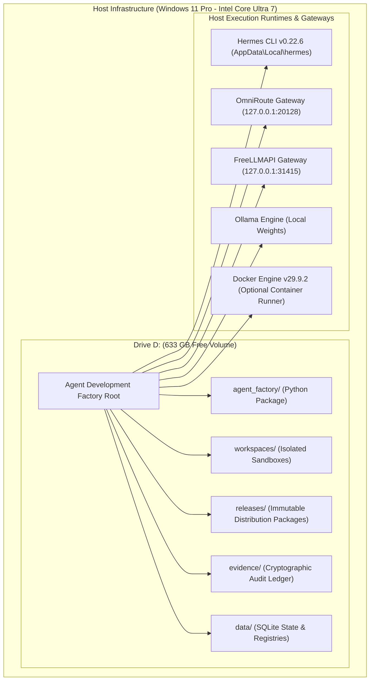

# Factory Deployment Architecture

**Document Version:** 1.0.0  
**Date:** 2026-11-03  
**Author:** Antigravity 2.0 (Supervising Principal Platform Architect)  
**Status:** BASELINED & APPROVED  

---

## 1. Deployment Topology & Infrastructure Layout

The Agent Development Factory is deployed directly on the local Windows 11 host infrastructure, operating from the dedicated high-capacity storage volume:
`D:\1_Hermes Working Folder_Directory\1_Projects\Agent Development Factory`



---

## 2. Supported Deployment Targets

The factory supports three distinct, vendor-neutral deployment targets for manufactured agents:

### Target 1: Standalone Local Process (Default / Universal)
* **Mechanics:** The agent package is distributed with its own entrypoint (`__main__.py`) and executed directly by the host Python runtime.
* **Benefits:** Zero dependencies on external agent frameworks; runs anywhere Python 3.12+ is installed.
* **Invocation:**
  ```powershell
  python -m <agent_package_name> --input input.json --config config.yaml
  ```
* **Resource Limits:** Governed by process timeouts and OS process limits.

### Target 2: Hermes Managed Agent (Orchestrated)
* **Mechanics:** The agent is deployed as a managed task or skill within a designated Hermes profile (e.g., `hermes -p factory_agents`).
* **Benefits:** Seamless integration with Hermes cron scheduling, Telegram messaging gateways, and multi-agent coordination.
* **Safety:** Uses a dedicated isolated profile to prevent contamination of the default user workspace.

### Target 3: Containerized Microservice (Docker)
* **Mechanics:** The agent and its pinned dependencies are packaged into an OCI container image built via Docker Engine v29.9.2.
* **Benefits:** Complete OS filesystem isolation, strict network namespace controls, and reproducible runtime dependencies.

---

## 3. Release Packaging Standard

A valid release is not a loose collection of files or a prompt snippet. Every manufactured agent release bundle (`releases/<agent_id>-v<version>.zip`) contains:

```
<agent_id>-v<version>/
├── manifest.json              # Release metadata, author, git commit, target runtime
├── checksums.sha256           # Cryptographic SHA-256 hashes of all files in bundle
├── agent.yaml                 # Immutable, frozen Universal Agent Specification
├── policy.yaml                # Verified permission boundaries and data classifications
├── requirements.lock          # Pinned dependency versions
├── src/                       # Production agent source code
│   ├── __init__.py
│   ├── __main__.py            # CLI entrypoint
│   └── agent.py               # Core agent implementation logic
├── tests/                     # Validation test suite
│   └── test_agent.py
├── fixtures/                  # Golden test inputs and expected outputs
├── docs/                      # Usage instructions and API documentation
└── rollback.md                # Specific rollback procedure and recovery steps
```

### Manifest Schema (`manifest.json`):
```json
{
  "manifest_version": "1.0",
  "agent_id": "csv_data_anomaly_analyzer",
  "version": "1.0.0",
  "release_id": "rel_01H...",
  "created_at": "2026-11-03T11:20:00Z",
  "created_by": "Agent Development Factory v1.0.0",
  "runtime_target": "local_process",
  "risk_classification": "LOW",
  "evaluation_score": {
    "efficacy": 1.0,
    "safety": 1.0,
    "efficiency_ms": 320
  },
  "package_sha256": "e3b0c44298fc1c149afbf4c8996fb92427ae41e4649b934ca495991b7852b855",
  "approval_token": "AUTO_APPROVED_LOW_RISK"
}
```

---

## 4. Promotion, Canary & Rollback Strategies

### 4.1 Staging and Canary Rollout
1. **Candidate Staging:** The release package is extracted to a clean staging directory (`staging/<project_id>/`).
2. **Smoke Test Execution:** The standalone test suite executes against synthetic fixtures.
3. **Canary Deployment:** The candidate agent processes a low-risk synthetic workload.
4. **Health Gate:** If error rates are 0% and no permission denials occur, the agent is promoted to active status.

### 4.2 Deterministic Rollback Procedure
If a deployed agent exhibits drift, unexpected errors, or performance regressions:
1. **Execution Halt:** The operator or monitor triggers `factory rollback <agent_id>`.
2. **Process Drain:** Active worker processes are allowed 10 seconds to finish in-flight tasks, then terminated gracefully.
3. **Restoration:** The system unzips the previous known-good release package from `releases/`.
4. **State Verification:** Checks that config and task ledgers match the restored version.
5. **Incident Recording:** The failure cause is logged to `evidence/rollback_events.jsonl` and converted into a regression test case for the next build cycle.
