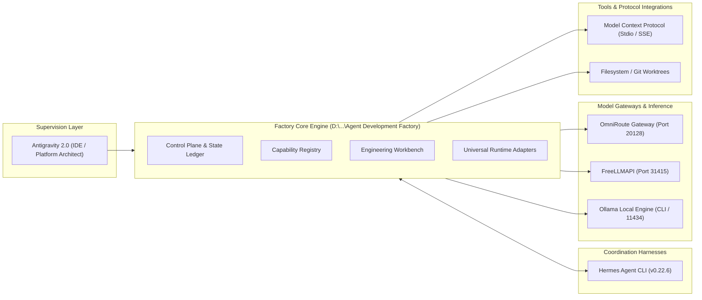

# Factory Integration Architecture

**Document Version:** 1.0.0  
**Date:** 2026-11-03  
**Author:** Antigravity 2.0 (Supervising Principal Platform Architect)  
**Status:** BASELINED & APPROVED  

---

## 1. System Integration Overview

The Agent Development Factory operates as a vendor-neutral orchestrator bridging existing development harnesses, model routing gateways, and runtime environments. It leverages existing host infrastructure without tightly coupling its core logic to any single proprietary implementation.

---

## 2. Harness Integrations

### 2.1 Hermes Agent Integration
* **Version & Install:** Hermes v0.22.6 · commit `f0d94882e89a` located at `C:\Users\rajaj\AppData\Local\hermes\hermes-agent`.
* **Integration Mode:** Non-invasive subprocess delegation and programmatic interface via `agent_factory.adapters.hermes_adapter`.
* **Execution Boundary:**
  * Uses verified CLI commands: `hermes chat -q`, `hermes skills list`, `hermes mcp list`, `hermes status`.
  * Passes `--in <workspace_dir>` to isolate filesystem changes to the project workspace.
  * Honors `--safe-mode` and `--ignore-user-config` when strict clean-room execution is mandated.
  * Existing Hermes profiles and scheduled cron jobs are completely preserved and remain untouched.

### 2.2 Google Antigravity 2.0 Integration
* **Role:** Supervising Platform Architect, quality gate auditor, and code reviewer.
* **Supervision Model:**
  * Antigravity independently inspects generated agent specifications, tests, and diffs before release.
  * Automates execution of Open Code Review (`ocr review`) and enforces the SuperGravity Engineering Governance Principles.
  * Ensures compliance with Zero Paid Fallback and Least-Privilege boundaries.

---

## 3. Model Provider & Gateway Integrations

### 3.1 OmniRoute Model Gateway (Primary)
* **Endpoint:** `http://127.0.0.1:20128/v1/`
* **Transport:** HTTP REST / OpenAI Chat Completions standard.
* **Authentication:** Requires local Bearer API token configured in Hermes `custom:omniroute-(localhost)` credential pool.
* **Capabilities:** Routes to remote reasoning models (e.g., `hermes-reasoning`, `claude-sonnet-4.6`, `gpt-4o-mini`).
* **Adapter:** `OmniRouteModelAdapter` handles connection timeouts, payload marshaling, token usage accounting, and rate-limit backoff.

### 3.2 FreeLLMAPI (Secondary / Free Capacity)
* **Endpoint:** `http://127.0.0.1:31415/v1/`
* **Transport:** Node.js service running at `C:\Users\rajaj\Projects\FreeLLMAPI\server\dist\index.js`.
* **Role:** Free-tier model capacity for non-sensitive public/synthetic agent tasks.

### 3.3 Ollama Local Engine (Zero-Cost / Offline)
* **Engine:** Ollama v0.31.1 installed at `C:\Users\rajaj\AppData\Local\Programs\Ollama\ollama.exe`.
* **Models Available:** 23 locally stored model weights, including:
  * Fast models: `spark-x2.5-4b`, `spark-x2.6-4b`, `qwen3.5:2b`, `qwen3.5:4b`.
  * Heavy reasoning: `deepseek-r1:32b`, `gemma4:26b`, `qwen3:30b`.
* **Hardware Sizing:** Operates via CPU execution on the Intel Core Ultra 7 265U (12 cores).

---

## 4. MCP (Model Context Protocol) Integration

The factory integrates with MCP servers following the Model Context Protocol standard:
* **Transport:** `stdio` (JSON-RPC over standard input/output).
* **Isolation:** Each MCP server child process runs with dedicated environment filtering.
* **Integration Points:**
  * `codegraph`: Explores codebase AST symbols and call graphs.
  * `filesystem`: Scoped read/write access strictly within `workspaces/<project_id>/`.
  * `memory`: Scoped knowledge retrieval.
  * `fetch`: Restricted web fetching for approved URLs only.

---

## 5. Failure Isolation & Chaining Policy

To prevent cascading system outages:
1. **No Circular Chaining:** An agent generated by the factory cannot directly invoke the factory control plane to modify its own specification or expand its permissions.
2. **Gateway Isolation:** A timeout in OmniRoute or FreeLLMAPI trips a circuit breaker after 3 failures; the factory immediately parks the task in `BLOCKED` with an error report rather than trying alternative unvetted paid endpoints.
3. **Traceability:** Every interaction across harness, gateway, or tool boundaries logs a unique `correlation_id` across the Control, Execution, and Evidence planes.
