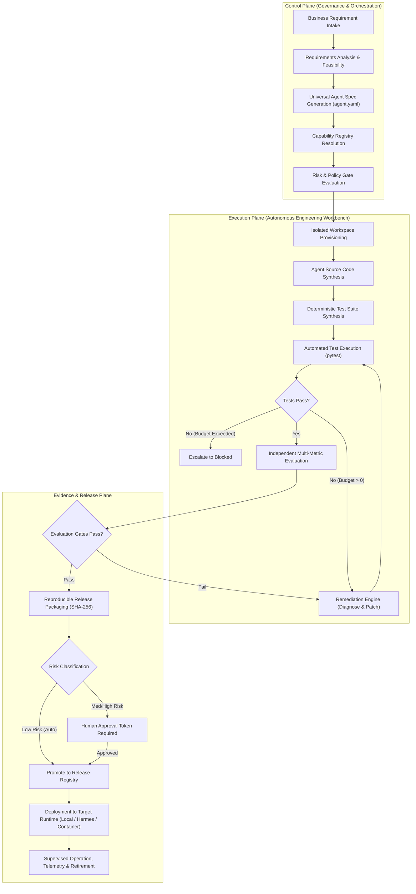

# Factory Master Architecture

**Document Version:** 1.0.0  
**Date:** 2026-11-03  
**Author:** Antigravity 2.0 (Supervising Principal Platform Architect)  
**Status:** BASELINED & APPROVED  
**Harness / Orchestrator:** Hermes Agent v0.22.6 & Google Antigravity 2.0  

---

## 1. Executive Architectural Blueprint

The **Autonomous Agent Development Factory** is a vendor-neutral, modular, quality-gated manufacturing line for artificial intelligence agents. It automates the progression from raw business objectives to fully tested, evaluated, packaged, and operated software agents, while maintaining human governance over critical risk boundaries.

Rather than treating agent creation as an unstructured conversational session, the factory operates as an industrial software production line governed by strict state transitions, cryptographic evidence ledgers, and deterministic acceptance gates.



---

## 2. The Three-Plane Separation Model

To prevent the operational hazards identified in historical agent systems (where task status on a kanban board substituted for proof of execution), the factory enforces strict decoupling across three operational planes:

```
┌────────────────────────────────────────────────────────────────────────┐
│                        1. CONTROL PLANE                                │
│  - Request Intake & Semantic Classification                            │
│  - Universal Agent Specification Enforcement (JSON Schema / Pydantic)  │
│  - Finite State Machine Orchestration (11 Discrete Stages)             │
│  - Risk-Based Human Approval Enforcement (Low / Medium / High)         │
│  - Resource Quota & Budgetary Guardrails                               │
└──────────────────────────────────┬─────────────────────────────────────┘
                                   │ Dispatches Tasks / Injects Config
                                   ▼
┌────────────────────────────────────────────────────────────────────────┐
│                        2. EXECUTION PLANE                              │
│  - Isolated Workspace Sandbox (Per-Project Directory Isolation)        │
│  - Autonomous Code & Test Synthesis Engine                             │
│  - Multi-Target Runtime Adapters (Local Process, Hermes Harness)       │
│  - Bounded Autonomous Remediation Engine (Max 3 Iterations)            │
│  - Multi-Metric Evaluation Runner (Efficacy, Safety, Efficiency)       │
└──────────────────────────────────┬─────────────────────────────────────┘
                                   │ Emits Raw Streams, Artifacts & Hashes
                                   ▼
┌────────────────────────────────────────────────────────────────────────┐
│                        3. EVIDENCE PLANE                               │
│  - Append-Only Cryptographic Evidence Ledger (SHA-256 Hashes)          │
│  - Immutable Test & Evaluation Execution Logs                          │
│  - Reproducible Distribution Artifact Bundles (zip + checksums)       │
│  - Audit Trails with Active Secret Redaction                           │
└────────────────────────────────────────────────────────────────────────┘
```

1. **Control Plane:** Owns all policy, task state, dependency graphs, and progression gates. It never executes arbitrary code directly in its process context.
2. **Execution Plane:** Operates in disposable, isolated worktrees and sandboxes. Worker processes receive sanitized environment variables and bounded execution timers.
3. **Evidence Plane:** The single source of empirical truth. A stage transition cannot proceed unless the Evidence Plane records the exact input digest, output digest, execution duration, and exit code.

---

## 3. Core Logical Subsystems

### Subsystem A: Factory Control Plane
* **Request Intake Engine:** Accepts natural language requests or structured project briefs, extracting functional requirements, non-goals, data boundaries, and operational limits.
* **Orchestration State Machine:** Governs lifecycle stages with deterministic entry and exit conditions. Supported states:
  `INTAKE` $\rightarrow$ `SPEC_DRAFT` $\rightarrow$ `SPEC_REVIEW` $\rightarrow$ `BUILD` $\rightarrow$ `TEST` $\rightarrow$ `EVALUATE` $\rightarrow$ `REMEDIATE` $\rightarrow$ `PACKAGE` $\rightarrow$ `RELEASE` $\rightarrow$ `OPERATION` $\rightarrow$ `RETIRED`.
* **State Ledger:** Durable persistence implemented in SQLite and JSON Line ledgers. Survives crashes and supports resumption from verified checkpoints.

### Subsystem B: Universal Agent Specification Standard
* Defines a portable, framework-agnostic definition (`agent.yaml`).
* Specifies identity, purpose, inputs/outputs, permitted tool authority levels, execution limits, data classifications, durable state fields, and acceptance targets.
* Validated by both syntactic JSON Schema validation and semantic policy validation.

### Subsystem C: Unified Capability Registry
* A single, strongly typed catalog of infrastructure capabilities:
  * `MODEL`: Local and remote LLM checkpoints with context limits and tokenizer properties.
  * `PROVIDER`: Gateway endpoints (OmniRoute, FreeLLMAPI, Ollama).
  * `HARNESS`: Development and orchestration systems (Hermes Agent, Antigravity 2.0).
  * `RUNTIME`: Target execution environments (Local Python Process, Docker, Hermes).
  * `TOOL` & `MCP`: Callable tools and MCP servers with explicit permission classifications.
  * `SKILL`: Reusable procedures vetted through the quarantine pipeline.

### Subsystem D: Agent Engineering Workbench
* **Workspace Provisioning:** Creates isolated working directories per project with dedicated virtual environment bindings, file boundaries, and scratch space.
* **Code Synthesizer:** Instantiates clean, production-grade agent implementations from spec definitions using validated architectural patterns (Reactive, Tool-Using, Pipeline, Autonomous Coding).
* **Test Synthesizer:** Generates pytest unit tests, fixture datasets, and mock harnesses corresponding to the agent's input/output contracts.

### Subsystem E: Multi-Target Agent Runtime
* Execution runtime completely independent of the development harness.
* Provides:
  * Sandboxed process execution with strict wall-time and memory timeouts.
  * Secret injection at runtime via environment or secure keyring.
  * Native tool execution loop with error handling and idempotency checking.

### Subsystem F: Evaluation and Quality Assurance Engine
* Independent evaluation harness implementing the A01–A15 standard test pack.
* Computes three explicit, uncoupled score vectors:
  1. **Efficacy:** Task completion rate, functional correctness, schema validity.
  2. **Safety:** Zero unauthorized side-effects, prompt injection resilience, data boundary adherence.
  3. **Efficiency:** Monotonic wall-time, total model invocations, token usage, and cost.

### Subsystem G: Autonomous Remediation Engine
* Bounded defect diagnosis and repair engine.
* When a test or evaluation fails, the engine:
  1. Captures stderr, stdout, and traceback.
  2. Classifies failure mode (`SYNTAX_ERROR`, `LOGIC_ERROR`, `SCHEMA_MISMATCH`, `TIMEOUT`).
  3. Proposes a minimal, surgical code patch.
  4. Verifies the patch against the failing test and the regression suite.
  5. Aborts and escalates if repairs exceed the configured attempt ceiling (default: 3).

### Subsystem H: Observability, Governance & Operations
* Structured logging with automated secret redaction.
* Real-time metrics tracking pipeline throughput, evaluation scores, and resource consumption.
* Automated release packaging with reproducible SHA-256 manifests.
* Deterministic rollback and suspension runbooks.

---

## 4. Key Architectural Decisions (ADR Summary)

* **ADR-001: Universal Specification Decoupling:** Agent specifications must remain 100% agnostic of runtime frameworks (Pydantic + YAML). Runtime-specific code is generated or adapted.
* **ADR-002: Three-Plane Separation:** Control, Execution, and Evidence planes are isolated to prevent unverified completion claims.
* **ADR-003: Zero Unapproved Paid Fallback:** Ceiling of $0 paid spend by default. Never silently fail over to paid commercial APIs.
* **ADR-004: Local Synthetic Evaluation First:** All agents must pass deterministic synthetic fixtures before interacting with external services.
* **ADR-005: Workspace Isolation:** Every project build executes in an isolated file workspace with sanitized environment variables.
* **ADR-006: Bounded Self-Remediation:** Maximum 3 remediation attempts before parking in `BLOCKED` to eliminate infinite spending loops.
