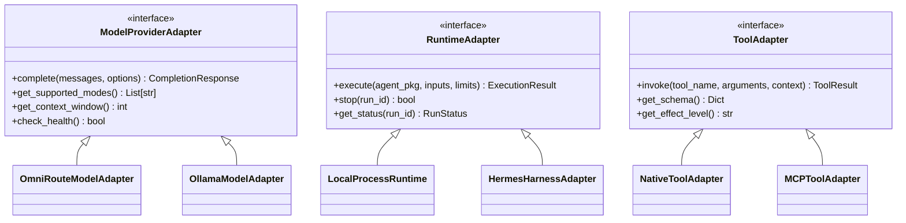

# Factory Provider Adapter Specification

**Document Version:** 1.0.0  
**Date:** 2026-11-03  
**Author:** Antigravity 2.0 (Supervising Principal Platform Architect)  
**Status:** BASELINED & APPROVED  

---

## 1. Adapter Abstraction Hierarchy

To satisfy the non-negotiable principle of **Vendor Agnosticism**, the Agent Development Factory decouples providers and runtimes into standard abstract interfaces:

1. **`ModelProviderAdapter`**: Standardizes LLM inference across local gateways, cloud endpoints, and local engines.
2. **`RuntimeAdapter`**: Standardizes agent process execution across local subprocesses, containers, and multi-agent harnesses.
3. **`ToolAdapter`**: Standardizes function calling across native Python functions, CLI utilities, and MCP servers.

---

## 2. Portability Levels (P0 - P4)

Every runtime adapter must declare and verify its achieved portability level:

* **P0 (Definition):** The target can ingest translated prompts/instructions and return text output.
* **P1 (Tools):** The target supports structured tool definitions, input parameter validation, error handling, and JSON schema outputs.
* **P2 (Policy):** The target enforces permission boundaries (`READ_PUBLIC`, `SPEND_DELETE`), resource limits, and denial stop rules.
* **P3 (Continuity):** The target maintains durable state across sessions, supports graceful resumption from checkpoints, and preserves failure logs.
* **P4 (Operations):** The target supports automated deployment packaging, health monitoring, canary testing, rollback, and retirement.

---

## 3. Concrete Adapter Specifications

### 3.1 `OmniRouteModelAdapter`
* **Target:** Localhost OmniRoute Gateway (`http://127.0.0.1:20128/v1`)
* **Protocol:** OpenAI Chat Completions API.
* **Achieved Portability:** P1 (Text + Structured Tool Calling).
* **Error Handling:** Maps HTTP 401/403 to `AuthenticationError`, HTTP 429 to `RateLimitError` (triggers exponential backoff up to 3 retries), and HTTP 5xx to `ProviderUnavailableError`.

### 3.2 `HermesHarnessAdapter`
* **Target:** Installed Hermes Agent CLI v0.22.6 (`AppData\Local\hermes`).
* **Protocol:** CLI Subprocess Delegation.
* **Achieved Portability:** P2 (Policy & Tool Enforcement).
* **Command Mapping:** Maps Universal Agent Specification parameters to `hermes chat -q`, `--in <workspace>`, and designated `--skills`.

### 3.3 `LocalProcessRuntime`
* **Target:** Direct Python Runtime (Standalone Process).
* **Protocol:** Standard OS Process Execution (`subprocess.Popen`).
* **Achieved Portability:** P4 (Complete Operational & Packaging Lifecycle).
* **Environment:** Executes with scrubbed environment block and hard wall-time timeout.
