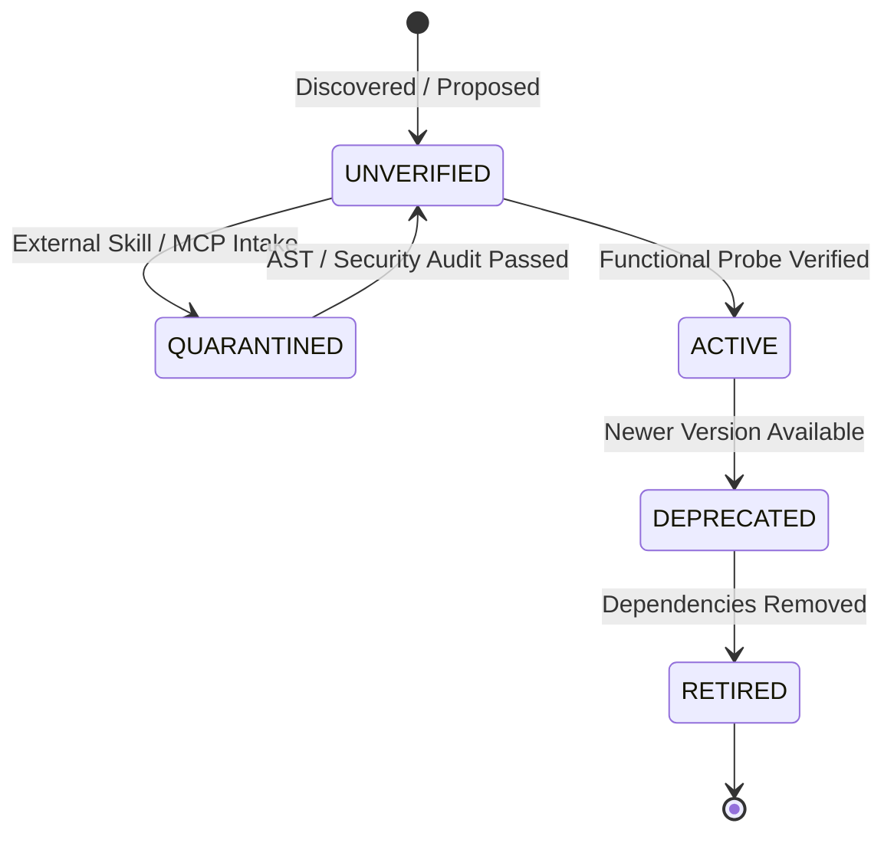

# Factory Registry Specification

**Document Version:** 1.0.0  
**Date:** 2026-11-03  
**Author:** Antigravity 2.0 (Supervising Principal Platform Architect)  
**Status:** BASELINED & APPROVED  

---

## 1. Universal Registry Architecture

The **Unified Capability Registry** serves as the central directory and source of truth for all software, model, tool, and infrastructure components available to the Agent Development Factory. 

Rather than maintaining separate, uncoordinated databases for tools, skills, and models, the factory employs a single, strongly typed registry schema that enforces compatibility, version locking, and security verification.

---

## 2. Capability Data Model

Every registered capability conforms to the `CapabilityRecord` schema:

```json
{
  "id": "cap_model_omniroute_hermes_reasoning",
  "kind": "MODEL",
  "name": "hermes-reasoning",
  "version": "1.0.0",
  "provider": "omniroute",
  "description": "Primary reasoning model routed through local OmniRoute gateway",
  "license": "Proprietary / Terms Apply",
  "status": "ACTIVE",
  "security_classification": "INTERNAL",
  "permissions_required": ["READ_PUBLIC"],
  "resource_requirements": {
    "min_ram_gb": 4,
    "gpu_required": false
  },
  "dependencies": ["cap_prov_omniroute_localhost"],
  "metadata": {
    "endpoint": "http://127.0.0.1:20128/v1",
    "context_window": 32768,
    "supports_tools": true
  },
  "last_verified_at": "2026-11-03T11:00:00Z",
  "verification_evidence_ref": "evidence/probes/omniroute_probe.json"
}
```

### Supported Capability Kinds:
1. **`MODEL`**: Inference checkpoints (e.g., `spark-x2.5-4b`, `hermes-reasoning`, `gpt-4o-mini`).
2. **`PROVIDER`**: Gateway services (e.g., `omniroute`, `freellmapi`, `ollama`).
3. **`HARNESS`**: Development orchestration platforms (e.g., `hermes_cli`, `antigravity`).
4. **`RUNTIME`**: Execution targets (e.g., `local_process`, `docker`).
5. **`TOOL`**: Callable functions (e.g., `read_local_csv`, `compute_statistics`).
6. **`MCP`**: Model Context Protocol servers (e.g., `codegraph`, `filesystem`, `fetch`).
7. **`SKILL`**: Reusable multi-step procedures (e.g., `data_cleaning`, `markdown_report`).
8. **`EVALUATION`**: Benchmark fixtures and grading suites (e.g., `standard_eval_a01_a15`).
9. **`ARTIFACT`**: Versioned release packages and golden templates.

---

## 3. Capability Lifecycle States



* **`UNVERIFIED`**: Capability is known/configured, but has not completed an active functional probe. Cannot be selected by the factory for production builds.
* **`QUARANTINED`**: Newly acquired external skill or tool undergoing AST static analysis and dependency audit.
* **`ACTIVE`**: Verified and ready for autonomous allocation.
* **`DEPRECATED`**: Retained for backward compatibility; not assigned to new projects.
* **`RETIRED`**: Safely deactivated; execution disabled.

---

## 4. Registry Operations & Programmatic API

```python
class CapabilityRegistry:
    def register(self, record: CapabilityRecord) -> None:
        """Adds or updates a capability record in the persistent registry."""

    def get(self, capability_id: str) -> Optional[CapabilityRecord]:
        """Retrieves a capability record by its unique ID."""

    def resolve(self, kind: CapabilityKind, criteria: Dict[str, Any]) -> List[CapabilityRecord]:
        """Queries active, verified capabilities matching requirements."""

    def verify(self, capability_id: str, probe_fn: Callable[[], bool]) -> bool:
        """Executes verification probe, updating status to ACTIVE or UNVERIFIED."""

    def deprecate(self, capability_id: str, replacement_id: Optional[str] = None) -> None:
        """Marks capability as deprecated and checks reverse dependencies."""
```
