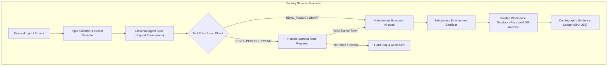

# Factory Security Architecture

**Document Version:** 1.0.0  
**Date:** 2026-11-03  
**Author:** Antigravity 2.0 (Supervising Principal Platform Architect & Security Architect)  
**Status:** BASELINED & APPROVED  

---

## 1. Security Philosophy & Foundational Posture

In accordance with Section 2.4 and Section 10 of the Master Directive and Section 15 of the *Full-Lifecycle Engineering Handbook*, security in the Agent Development Factory is an active, structural boundary—not a post-hoc audit checklist.

Because LLMs are probabilistic engines susceptible to prompt injection, jailbreaks, and hallucinations, **safety guarantees must be enforced by deterministic system controls outside the model context**. Instructions in prompts provide behavioral guidance, but host boundaries, process isolation, environment sanitization, and cryptographic gates provide the actual enforcement.

---

## 2. Mandatory Security Controls & Implementation

### 2.1 Credential Isolation & Secret Management
* **Zero Secrets in Code or Specs:** Specifications use named references only (e.g. `PROVIDER_KEY_REF`). Raw API tokens, passwords, or certificates are strictly forbidden in YAML/JSON specs, code repositories, test fixtures, or prompts.
* **Ephemeral Runtime Injection:** When an agent invokes an external model or tool requiring authentication, the adapter retrieves the credential from the local secure environment at the exact moment of socket creation and scrubs it immediately.
* **Active Secret Redaction:** All stdout, stderr, exception traces, and task ledgers pass through `SecretRedactor` (`agent_factory.security.redactor`) before being written to disk or surfaced in the UI.

### 2.2 Tool Permission Boundaries & Effect Levels
Every tool and callable capability registered in the Capability Registry is classified into one of six mutually exclusive effect levels:

| Effect Level | Description | Default Risk | Autonomy Policy |
| :--- | :--- | :--- | :--- |
| **`READ_PUBLIC`** | Accesses publicly available URLs, documentation, or local public datasets. | Low | **Autonomous** |
| **`READ_PRIVATE`** | Accesses local private configuration, internal project repositories, or user files. | Medium | **Policy Governed** (Requires pre-approved file path allowlist) |
| **`WRITE_LOCAL_DRAFT`** | Writes artifacts, reports, and code inside the project's isolated workspace sandbox. | Low | **Autonomous** |
| **`CHANGE_ACCOUNT`** | Modifies user accounts, system configuration, environment variables, or registry keys. | High | **Strict Human Approval Gate** |
| **`SEND_PUBLISH`** | Sends emails, messages (Telegram/Slack), pushes git commits to remote, or publishes web content. | High | **Strict Human Approval Gate** |
| **`SPEND_DELETE`** | Incurs financial charges (paid API calls, cloud provisioning) or deletes persistent data. | High | **Strict Human Approval Gate** |

*Rule:* If an agent attempts an action whose effect level exceeds its approved specification policy, the runtime immediately raises a `PermissionDeniedException`, logs a security audit event, and halts execution (`stop_and_report`).

### 2.3 Workspace Isolation & Execution Sandboxing
* Every project build runs in an isolated directory subtree: `workspaces/<project_id>/`.
* Child processes are spawned with:
  * A scrubbed environment block (removing host cloud credentials and master keys).
  * Explicit working directory lockdown.
  * Deterministic execution deadlines (wall-time timeout enforcement).
  * Subprocess stream limits preventing memory exhaustion attacks via infinite output loops.

### 2.4 Skill & Capability Quarantine Pipeline
External tools, community skills, or third-party MCP servers are never auto-installed or executed directly on the host:
1. **Quarantine Zone:** New capabilities are staged under `quarantine/<capability_id>/`.
2. **Static AST Analysis:** An automated scanner parses Python files to detect dangerous constructs:
   * Prohibited imports: `os.system`, `subprocess.Popen` (without factory wrapper), `ctypes`, `winreg`.
   * Dynamic code execution: `eval()`, `exec()`, `__import__()`.
   * Unapproved network sockets or arbitrary URL fetching.
3. **License Verification:** SPDX license check ensuring compatibility (MIT, Apache-2.0, BSD).
4. **Sandboxed Smoke Test:** Executed against synthetic fixtures inside a disposable runner.
5. **Signed Promotion:** Only upon passing all four checks can the capability be promoted to the active registry.

---

## 3. STRIDE Threat Model & Mitigations

| Threat Category (STRIDE) | Attack Vector / Scenario | Architectural Mitigation | Evidence / Verification |
| :--- | :--- | :--- | :--- |
| **Spoofing** | Attacker impersonates human owner to authorize high-risk deployment. | Cryptographic approval tokens validated against local owner secret; worker summaries or chat text cannot authorize changes. | `tests/test_security.py::test_spoofed_approval_rejected` |
| **Tampering** | Rogue agent edits test fixtures or graders to falsify test results. | Golden test fixtures and graders are hashed with SHA-256 before the build; hash mismatch immediately fails the run. | `tests/test_evals.py::test_grader_tamper_detection` |
| **Repudiation** | An unauthorized change or external call is made without traceable logs. | Append-only Cryptographic Evidence Ledger logs every task transition, tool invocation, and exit code. | `tests/test_evidence.py::test_immutable_ledger_verification` |
| **Information Disclosure** | API credentials or private data leak into stdout, test logs, or reports. | Active regex secret redactor intercepts all log streams before persistence; secrets injected only in RAM. | `tests/test_security.py::test_secret_redaction_in_logs` |
| **Denial of Service** | Agent enters infinite loop, spawns thousands of workers, or exhausts disk/RAM. | Hard quotas enforced in universal spec: `max_steps`, `max_wall_time_seconds`, and max 3 remediation retries. | `tests/test_runtime.py::test_execution_timeout_and_step_cap` |
| **Elevation of Privilege** | Agent uses shell execution to escape workspace and modify host OS files. | Sanitized subprocess environment, path traversal guards, and file guard validation; bypass attempts fail closed. | `tests/test_policy.py::test_path_traversal_blocked` |

---

## 4. Incident Response & Containment

If a policy violation, unexpected socket connection, or execution fault occurs:
1. **Immediate Pause:** The orchestrator halts the affected project workspace and terminates active child processes.
2. **Evidence Preservation:** The state machine takes a snapshot of the workspace, preserving raw stdout/stderr, input payloads, and timestamps.
3. **Rollback:** The system reverts workspace files to the last known-good checkpoint.
4. **Alerting:** A structured security incident record is written to `evidence/security_incidents.jsonl` for human review.
