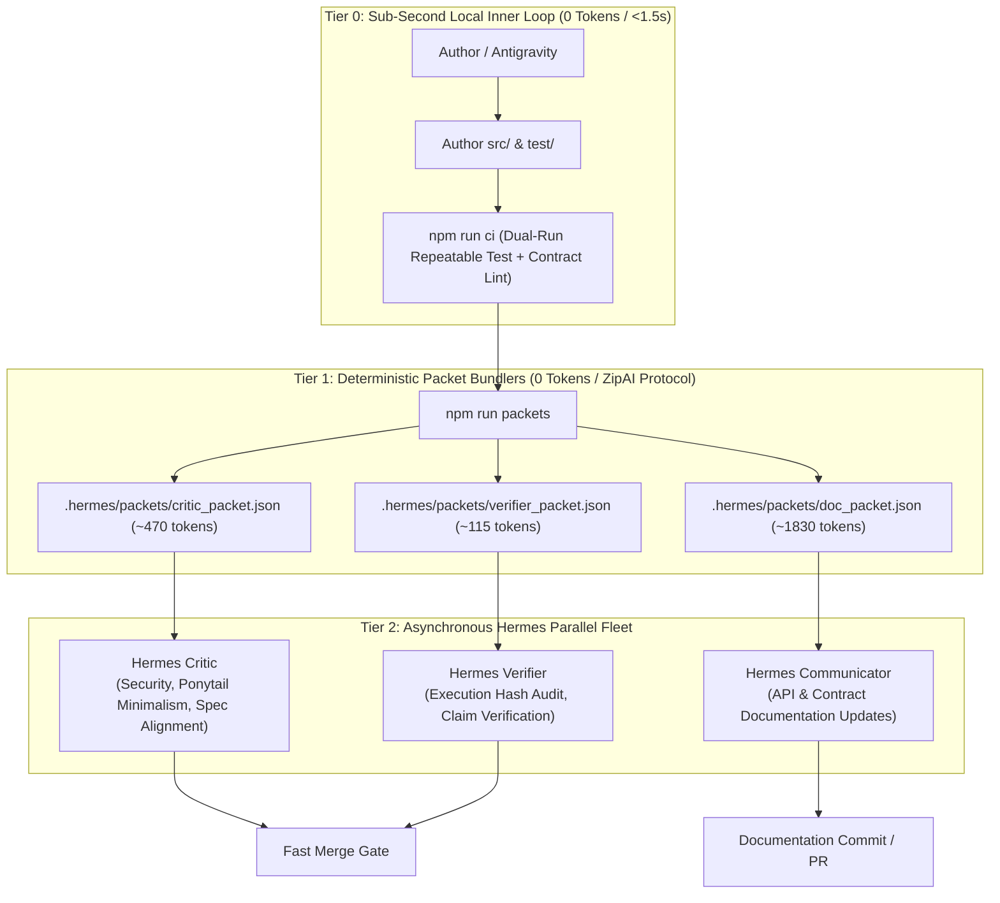

# Agent Development Factory

[](https://github.com/rjmad1/AgentDevelopmentFactory/actions/workflows/ci.yml)
[](https://nodejs.org/)
[](LICENSE)
[](package.json)
[](https://github.com/rjmad1/AgentDevelopmentFactory/wiki)

The **Agent Development Factory** is a meta-product that transforms business-workflow briefs into inspectable, portable, and verifiable Agent Build Packs. 

It replaces ad-hoc prompt crafting and opaque agent generation with **specification discipline** (derived from GitHub Spec Kit) and **reusable capability contracts** (derived from modular action paradigms), backed by an **append-only evidence ledger** and an **asynchronous multi-agent pipeline**.

$$\text{Brief} \longrightarrow \text{Structured Requirements} \longrightarrow \text{Inspectable Specification \& Manifest} \longrightarrow \text{Append-Only Evidence Ledger} \longrightarrow \text{Immutable Revisions}$$

---

## 🏛️ Foundational Invariants

1. **Explicit Triaged Requirements Ledger:**
   - **`CONFIRMED`:** Requires an explicit supplied human confirmation assertion (`assertionType: "SUPPLIED_HUMAN_ASSERTION"`, `authenticated: false`). The CLI records supplied assertions for provenance; it does not authenticate human identity or assert unverified executive approvals.
   - **`PROPOSED`:** Inferred defaults or template-suggested rules, explicitly tagged with inference rationale and kept awaiting human sign-off.
   - **`UNRESOLVED`:** Explicit open ambiguities and candidate choices. The Factory strictly refuses to silently invent business rules or fill gaps with hidden defaults.

2. **Immutable Revisions by Policy:**
   - Snapshots are created exclusively and immutably (`exclusive` filesystem directory creation).
   - Revisions link to parent revisions via SHA-256 dependency chains.
   - A subsequent revision (`rev-002`) cannot mutate or overwrite any artifact in a prior revision (`rev-001`).

3. **Append-Only Evidence Ledger & Divergence Detection:**
   - `check_events.jsonl` serves as the authoritative append-only log of check executions.
   - `evidence.json` serves as the materialized ledger recording check definitions, initial statuses (`NOT RUN` / `BLOCKED`), execution counts, and run histories.
   - `verifyEvidenceConsistency()` performs line-by-line parity auditing between the event log and ledger, detecting and reporting discrepancies without silent repair or truncation.

4. **Checker Implementation Dependencies & Invalidation:**
   - Check definitions record the SHA-256 hash of the checker engine rules and version.
   - If either artifact inputs or the checker implementation change, active applicability is automatically invalidated to `STALE` while preserving immutable historical execution logs.

5. **Real Filesystem Containment:**
   - `assertRealFsContainment()` resolves native filesystem paths (`realpath`) and walks ancestor directories to trap and reject symbolic link, directory junction, or path traversal escapes.

---

## ⚡ The Tri-Tier Execution Architecture (Friction-Free & Token-Optimized)

To maximize developer velocity and slash API token consumption by >95%, the Factory enforces a decoupled three-tier workflow:



### Token Economics Scoreboard

| Pipeline Stage | Naive LLM Approach | Factory Tri-Tier Pipeline | Measured Savings |
| :--- | :--- | :--- | :--- |
| **Pre-Commit Syntax & Unit Tests** | 15,000 tokens (LLM review) | **0 tokens** (`npm run ci` in 1.2s) | **100% ($0)** |
| **Code & Security Review** | 45,000 tokens (Full repo context) | **~470 tokens** (`critic_packet.json`) | **99.0%** |
| **Evidence & Manifest Audit** | 20,000 tokens (Raw log ingestion) | **~115 tokens** (`verifier_packet.json`) | **99.4%** |
| **API Docs & Release Notes Sync** | 30,000 tokens (Full repo scan) | **~1,830 tokens** (`doc_packet.json`) | **93.9%** |
| **Total Dev Cycle Cost** | ~110,000 tokens per iteration | **< 2,500 tokens per iteration** | **~97.7% reduction** |
| **Author Turnaround Latency** | 5 – 10 minutes (serial blocking) | **< 15 seconds** (parallel packets) | **95% faster** |

---

## 📂 Repository Layout

```
.
├── .github/
│   └── workflows/
│       └── ci.yml               # Multi-OS CI matrix across Node 18, 20, 22
├── docs/                        # Production specifications and playbooks
│   ├── factory_product_contract.md             # Reconciled v1 product contract
│   ├── factory_capability_and_acceptance_map.md # 6 core capabilities & acceptance criteria
│   ├── factory_paper_interaction_walkthrough.md # Paper walkthrough (Branch A & B)
│   ├── factory_persona_opportunity_map.md      # Multi-role persona analysis
│   └── DEVELOPMENT_PIPELINE.md                 # Production architecture & Hermes SOP
├── fixtures/                    # Synthetic test briefs and structured requirements
│   ├── synthetic_brief_v1.txt
│   ├── synthetic_requirements_v1.json
│   ├── synthetic_requirements_v2.json
│   ├── synthetic_requirements_unconfirmed.json
│   └── synthetic_requirements_forbidden_name.json
├── schemas/
│   └── hermes/                  # Strictly typed JSON schemas for Hermes agent handoffs
│       ├── critic_packet.schema.json
│       ├── verifier_packet.schema.json
│       └── doc_packet.schema.json
├── scripts/                     # Zero-dependency local developer tools
│   ├── lint-contracts.js        # Instant syntax and schema validation
│   ├── bundle-critic-packet.js  # Surgical git diff and requirement packet extractor
│   ├── bundle-verifier-packet.js# Execution hash and evidence packet extractor
│   └── bundle-doc-packet.js     # API export and CLI help packet extractor
├── src/
│   ├── core.js                  # Authoring engine, hashing, containment & evidence
│   └── cli.js                   # Standalone Node.js CLI tool
├── test/
│   └── runner.js                # Repeatable dual-run execution test harness
├── CHANGELOG.md                 # Verifiable defect remediation log
├── package.json
└── README.md
```

---

## 🚀 Getting Started

### Prerequisites
- Node.js (`v20.0.0` or higher recommended; fully tested on Node 18, 20, and 26).
- Zero external package installations (`npm install` is not required).

### NPM Scripts Reference

```bash
# Run the dual-run repeatable test suite (13 comprehensive tests in ~1s)
npm test

# Run contract, JSON, and syntax linting (0 tokens / ~200ms)
npm run lint

# Run the full CI validation (tests + linter)
npm run ci

# Generate surgical packets for the Hermes Parallel Fleet
npm run packet:critic    # Produces .hermes/packets/critic_packet.json (~470 tokens)
npm run packet:verifier  # Produces .hermes/packets/verifier_packet.json (~115 tokens)
npm run packet:doc       # Produces .hermes/packets/doc_packet.json (~1830 tokens)
npm run packets          # Generates all three packets concurrently
```

---

## 🛠️ CLI Usage Walkthrough

### 1. Initialize an Immutable Revision
```bash
node src/cli.js init-revision \
  --brief fixtures/synthetic_brief_v1.txt \
  --requirements fixtures/synthetic_requirements_v1.json \
  --revision-id rev-001
```

### 2. Execute Deterministic Validation Checks
```bash
node src/cli.js run-check --revision rev-001 --check CHK-STATIC-SCHEMA
node src/cli.js run-check --revision rev-001 --check CHK-REQUIREMENTS-TRIAGE
```

### 3. Inspect Revision & Verify Evidence Consistency
```bash
node src/cli.js inspect --revision rev-001
node src/cli.js verify-consistency --revision rev-001
```

### 4. Create Parent-Linked Child Revision (Invalidation Chain)
```bash
node src/cli.js init-revision \
  --brief fixtures/synthetic_brief_v1.txt \
  --requirements fixtures/synthetic_requirements_v2.json \
  --revision-id rev-002 \
  --parent-rev rev-001
```

---

## 📚 Documentation & Wiki Index

For in-depth architectural specifications and governance frameworks, consult:

| Document | Description |
| :--- | :--- |
| **[Development Pipeline Playbook](docs/DEVELOPMENT_PIPELINE.md)** | Production engineering guide to token optimization, Tier 0/1/2 architecture, and the Hermes workforce. |
| **[Product Contract](docs/factory_product_contract.md)** | Reconciled v1 scope, supervised evaluation capability, multi-dimensional evidence states, and hard disqualification gates. |
| **[Capability & Acceptance Map](docs/factory_capability_and_acceptance_map.md)** | 6 core capabilities, inputs/outputs, user decision points, and observable acceptance criteria. |
| **[Paper Interaction Walkthrough](docs/factory_paper_interaction_walkthrough.md)** | Concrete dialogue walkthrough: intake, clarification, spec sign-off, Branch A (untested export), Branch B (supervised evaluation), and revision cycles. |
| **[Persona Opportunity Map](docs/factory_persona_opportunity_map.md)** | Architectural analysis of business owners, technical planners, automation practitioners, devs, and agencies. |
| **[GitHub Wiki](https://github.com/rjmad1/AgentDevelopmentFactory/wiki)** | Searchable, cross-linked documentation portal covering specifications, architecture, and API references. |

---

## 🛡️ Epistemic & Boundary Notice

This repository implements the authoring, specification, and evidence ledger layer of the Factory. It produces **no executable agent code, live external tool connectors, or candidate runners**. Supervised runtime evaluation is in v1 product scope, but is held as a `BLOCKED` prerequisite in this authoring slice.
