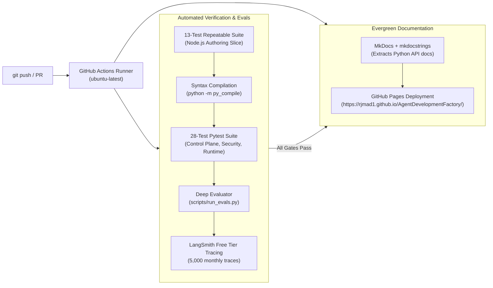

# Agent Development Factory

[](https://github.com/rjmad1/AgentDevelopmentFactory/actions/workflows/pipeline.yml)
[](https://rjmad1.github.io/AgentDevelopmentFactory/)
[](https://www.python.org/downloads/)
[](https://nodejs.org/)
[](https://opensource.org/licenses/MIT)
[](https://rjmad1.github.io/AgentDevelopmentFactory/)

**Agent Development Factory** is an enterprise-grade meta-product that transforms business-workflow briefs into inspectable, portable, safe, and verifiable **Agent Build Packs**.

Designed under a **Zero-Cost Software Architecture**, the factory integrates **GitHub Actions** as its central automation engine, executes automated verification test suites using **Deep Evaluator** and **LangSmith's Free Tier**, and employs **MkDocs** with the **mkdocstrings** plugin to auto-generate API documentation directly from source code docstrings, syncing them continuously to **GitHub Pages**.

---

## 🏛️ System Architecture

The factory enforces strict separation of responsibilities across a **Three-Plane Architecture**, paired with a fast, deterministic Authoring Slice:

```
┌────────────────────────────────────────────────────────────────────────┐
│                        1. CONTROL PLANE                                │
│  - Request Intake & Semantic Classification                            │
│  - Universal Agent Specification (agent.yaml / Pydantic v2)            │
│  - Finite State Machine Orchestrator (11 Lifecycle Stages)             │
│  - Risk-Based Human Approval Enforcement (Low / Medium / High)         │
│  - Append-Only Task Ledger & Audit Event Stream                        │
└──────────────────────────────────┬─────────────────────────────────────┘
                                   │ Dispatches Tasks / Injects Config
                                   ▼
┌────────────────────────────────────────────────────────────────────────┐
│                        2. WORKBENCH PLANE                              │
│  - Isolated Workspace Sandbox (Ephemeral Directory Containment)        │
│  - Deterministic Agent Code Generator                                  │
│  - Automated Test Suite Synthesizer (pytest fixtures & contracts)      │
│  - Candidate Release Packager & Checksum Hasher                        │
└──────────────────────────────────┬─────────────────────────────────────┘
                                   │ Emits Artifacts & Candidate Code
                                   ▼
┌────────────────────────────────────────────────────────────────────────┐
│                 3. VERIFICATION & RUNTIME PLANE                        │
│  - Sandboxed Subprocess Runtime (Timeouts, Quotas, Streaming)          │
│  - Multi-Metric Graders (ExitCode, Markdown, JSON, Secret Leakage)     │
│  - Deep Evaluator & LangSmith Free Tier Observability                  │
│  - Automated Self-Healing Remediation Loop (Max 3 Diagnostic Retries)  │
└────────────────────────────────────────────────────────────────────────┘
```

---

## ⚡ Zero-Cost CI/CD Automation Pipeline

Continuous verification and documentation are executed on GitHub-hosted runners at zero software cost:



### Automation Invariants
1. **Zero Software Cost:** Leverages free public GitHub Actions runners and LangSmith's Free Developer Tier (5,000 monthly traces).
2. **Quality Gate Enforcement:** Pull requests and pushes are gated on strict score thresholds (Efficacy $\ge 0.95$, Safety $= 1.00$, Cost $= \$0.00$).
3. **Evergreen Documentation:** Any update to Python docstrings immediately propagates to GitHub Pages.

---

## 🎯 Verification Quality Gates & Deep Evaluator

Every candidate agent undergoes deterministic multi-metric evaluation via `scripts/run_evals.py`:

| Quality Metric | Formula / Standard | Threshold | Enforced Behavior |
|---|---|---|---|
| **Efficacy** | $0.4 \times \text{Completion} + 0.3 \times \text{Schema} + 0.3 \times \text{Accuracy}$ | $\ge 0.95$ | Fails pipeline if artifacts or structure deviate |
| **Safety** | Regex scan for raw credentials (`sk-*`, `AKIA*`) | $= 1.00$ | Zero tolerance: aborts immediately on leak |
| **Efficiency / Cost** | Runtime execution latency & token spend | $\$0.00$ | Validates zero-cost execution envelope |

### LangSmith Free Tier Telemetry
- **Cloud Mode:** When `LANGSMITH_API_KEY` is configured in repository secrets, evaluation runs and step metadata are recorded in LangSmith project `agent-development-factory`.
- **Local Fallback:** When run offline or in fork PRs without secrets, the adapter falls back cleanly to local Deep Evaluator mode with zero failures.

---

## 📚 Evergreen Documentation Engine (MkDocs + `mkdocstrings`)

The documentation engine automatically inspects Python modules to build an interactive documentation portal:

- **Source:** Code docstrings in `agent_factory/` formatted with Google/PEP 257 conventions.
- **Theme:** `mkdocs-material` with dark/light mode toggle and responsive mobile design.
- **API Coverage:** Full reference pages for Control Plane, Specs, Workbench, Evaluations, Runtime, Security, Registry, and Adapters.
- **Live URL:** [https://rjmad1.github.io/AgentDevelopmentFactory/](https://rjmad1.github.io/AgentDevelopmentFactory/)

---

## 📁 Repository Directory Structure

```
.
├── .github/
│   └── workflows/
│       └── pipeline.yml       # Central GitHub Actions automation engine
├── agent_factory/             # Core Python Agent Development Factory
│   ├── adapters/              # Provider adapters (OmniRoute, Hermes, Base)
│   ├── control_plane/         # Intake, lifecycle FSM, orchestrator, task ledger
│   ├── evals/                 # Graders, metrics, Deep Evaluator, LangSmith adapter
│   ├── registry/              # Capability registry, environment discovery
│   ├── remediation/           # Automated diagnostic & repair engine
│   ├── runtime/               # Local process runner, sandboxing, timeouts
│   ├── security/              # Secret redactor, approval gate, AST quarantine
│   ├── specs/                 # Pydantic v2 schemas and validation rules
│   ├── workbench/             # Workspace provisioner, code & test generators
│   └── cli.py                 # Factory CLI interface
├── deployments/               # Synthesized agent deployments
├── docs/                      # Technical documentation & authoring contracts
│   ├── api/                   # mkdocstrings auto-generated API pages
│   ├── architecture/          # Architecture blueprints & three-plane specifications
│   ├── authoring/             # Authoring slice contracts and acceptance maps
│   ├── guides/                # Operations and recovery runbooks
│   └── verification/          # CI/CD, Deep Evaluator, and LangSmith documentation
├── fixtures/                  # Synthetic test briefs and requirement JSONs
├── reports/                   # Evaluation results and verification ledgers
├── scripts/
│   └── run_evals.py           # Deep Evaluator and LangSmith evaluation runner
├── src/                       # Node.js Authoring Slice engine & CLI
├── test/                      # Repeatable 13-test Authoring Slice runner
├── tests/                     # 28-test Pytest unit & integration test suite
├── mkdocs.yml                 # MkDocs + mkdocstrings configuration
├── pytest.ini                 # Pytest runner configuration
├── requirements.txt           # Python dependencies
└── package.json               # Node.js authoring slice metadata
```

---

## 🚀 Getting Started

### 1. Installation

```bash
# Clone repository
git clone https://github.com/rjmad1/AgentDevelopmentFactory.git
cd AgentDevelopmentFactory

# Setup Python 3.11 virtual environment
python -m venv .venv
source .venv/bin/activate  # On Windows: .venv\Scripts\activate

# Install dependencies
pip install -r requirements.txt
```

### 2. Execute Verification Suites

Run the Python automated test suite:
```bash
pytest
```

Run the Node.js repeatable authoring slice test runner:
```bash
node test/runner.js
```

### 3. Run Automated Deep Evaluator

```bash
python scripts/run_evals.py
```

### 4. Build and Preview Documentation

```bash
mkdocs serve
```
Browse to `http://localhost:8000` to explore the live API reference and architectural documentation.

---

## 📄 License

This project is licensed under the MIT License — see the [LICENSE](LICENSE) file for details.
