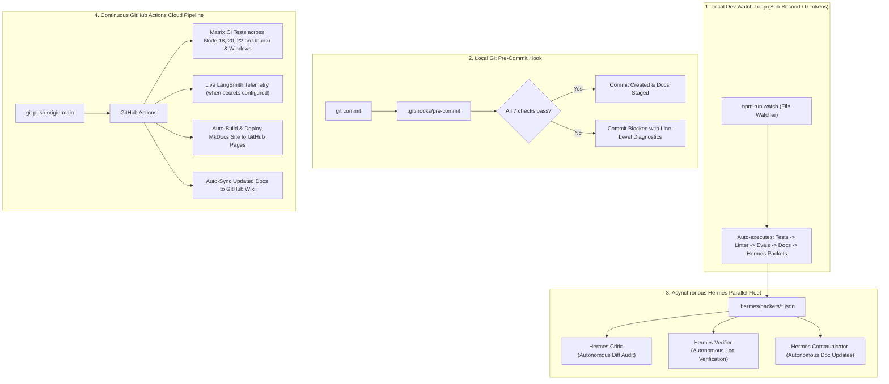

# Agent Development Factory: Autonomous Engineering Loop

**Document Status:** Architecture Guide & Automation Directive  
**Target:** Continuous, Zero-Friction Developer Velocity with Guaranteed Epistemic Honesty  

---

## 1. Overview: The 4 Pillars of Autonomous Factory Development

The Factory’s automated engineering system eliminates human ceremony and token waste through four synchronized automation layers:



---

## 2. Layer 1: Local Watch Loop (`scripts/autonomous-loop.js`)

The autonomous loop constantly monitors your workspace without any external package dependencies.

### Command
```bash
# Run in continuous watch mode (monitors src/, test/, fixtures/, schemas/)
npm run watch

# Run single autonomous validation pass
npm run auto
```

### Execution Cadence (Executed on Every Save in < 3.5s)
1. **Repeatable Unit Test Suite:** Executes dual isolated runs in `test-runs/` to verify deterministic state.
2. **Contract & Schema Linter:** Validates syntax of all JS files (`node --check`) and checks all JSON schemas and fixtures.
3. **Automated Evaluation Suite:** Runs the 5 benchmark cases (urgency triage, PII redaction, boundary defense).
4. **Source JSDoc & API Docs Generator:** Updates `docs/api/core.md` and `docs/api/cli.md` directly from source code comments.
5. **Hermes Critic Packet Bundler:** Extracts minimal git diff into `.hermes/packets/critic_packet.json`.
6. **Hermes Verifier Packet Bundler:** Extracts execution metrics and hashes into `.hermes/packets/verifier_packet.json`.
7. **Hermes Doc Packet Bundler:** Extracts CLI help and function AST into `.hermes/packets/doc_packet.json`.

---

## 3. Layer 2: Autonomous Git Pre-Commit Hook

Install the hook once on any machine or repository clone:

```bash
npm run setup:hooks
```

### How It Works
* When you run `git commit`, Git automatically executes `node scripts/autonomous-loop.js --once`.
* If any test, evaluation, or syntax error exists, Git **blocks the commit** and prints the exact stack trace.
* If all 7 checks pass, Git automatically stages any newly generated API documentation files (`docs/api/`) and commits cleanly.

---

## 4. Layer 3: Autonomous Hermes Agent Fleet

The Hermes fleet consumes lean JSON packets (< 2,500 total tokens) instead of raw codebases:

* **Hermes Critic:** Ingests `critic_packet.json` (~470 tokens) and writes `.hermes/verdicts/critic_verdict.json`.
* **Hermes Verifier:** Ingests `verifier_packet.json` (~115 tokens) and writes `.hermes/verdicts/verifier_verdict.json`.
* **Hermes Communicator:** Ingests `doc_packet.json` (~1,830 tokens) and maintains documentation deltas.

Full instructions: [`.hermes/AUTONOMOUS_FLEET.md`](https://github.com/rjmad1/AgentDevelopmentFactory/blob/main/.hermes/AUTONOMOUS_FLEET.md).

---

## 5. Layer 4: Continuous GitHub Actions Automation

Whenever code is pushed to `main` on GitHub:

1. **[`.github/workflows/ci.yml`](https://github.com/rjmad1/AgentDevelopmentFactory/blob/main/.github/workflows/ci.yml):**
   * Multi-OS matrix test on Node 18, 20, and 22.
   * Runs unit tests, linter, and evaluation suite.
   * Streams live run telemetry to LangSmith if `LANGSMITH_API_KEY` secret is set.
2. **[`.github/workflows/docs.yml`](https://github.com/rjmad1/AgentDevelopmentFactory/blob/main/.github/workflows/docs.yml):**
   * Generates API documentation from source comments.
   * Builds MkDocs Material site.
   * Publishes directly to GitHub Pages at [https://rjmad1.github.io/AgentDevelopmentFactory/](https://rjmad1.github.io/AgentDevelopmentFactory/).
3. **[`.github/workflows/wiki-sync.yml`](https://github.com/rjmad1/AgentDevelopmentFactory/blob/main/.github/workflows/wiki-sync.yml):**
   * Clones `AgentDevelopmentFactory.wiki`.
   * Automatically copies updated documents from `docs/` and commits them to the Wiki master branch.
   * **Result:** The GitHub Wiki is 100% evergreen with zero manual sync commands.
