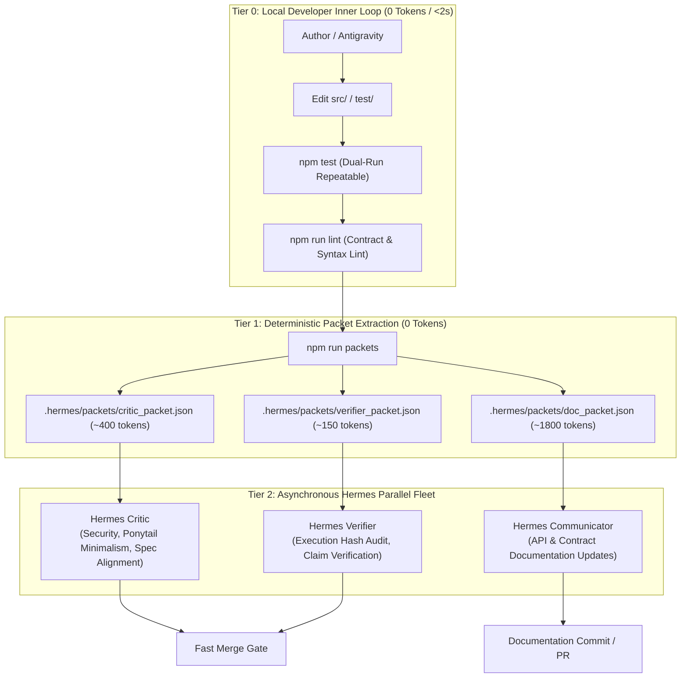

# Agent Development Factory: Development Architecture & Pipeline Playbook

**Document Status:** Production Engineering SOP & Architecture Reference  
**Author Perspective:** Principal Program Manager & Lead Systems Architect  
**Core Invariant:** Optimize for velocity, epistemic honesty, and aggressive token conservation. Never use an LLM for what a 2ms deterministic script does for zero tokens.

---

## 1. Executive Summary & Diagnostic

Most agent development pipelines grind to a halt or exhaust budgets due to three fatal anti-patterns:
1. **Context Shoveling:** Shoveling whole files, historical chat transcripts, and massive documentation into every LLM prompt. Ingesting 50,000 tokens on every minor edit wastes 80–90% of budget on unchanging boilerplate and degrades reasoning quality.
2. **LLMs Doing Deterministic Work:** Asking models to check JSON syntax, compute cryptographic hashes, parse CLI flags, or evaluate boolean logic. Deterministic tasks belong in compiled or interpreted native code (Node.js/shell), where execution is instantaneous, 100% reliable, and costs $0.00.
3. **Serial Blocking Gating:** Halting the entire authoring loop while waiting for extensive multi-agent reviews or manual approvals on basic plumbing.

The **Agent Development Factory Pipeline** eliminates these failure modes by enforcing a strict **Tri-Tier Execution Architecture**:
* **Tier 0 (Inner Loop):** Sub-second, zero-dependency, local deterministic testing ($0 cost, 0 tokens).
* **Tier 1 (Packet Extraction):** Automated bundlers extract surgical, schema-validated diffs and audit logs, reducing review contexts by >90%.
* **Tier 2 (Hermes Parallel Fleet):** Specialized agents execute verification, structural critique, and documentation updates asynchronously without stalling the author.



---

## 2. The Tri-Tier Architecture

### 2.1 Tier 0: The Local Deterministic Inner Loop
* **Objective:** Give the author instant, sub-second feedback on syntax, regressions, and state containment before touching any AI model.
* **Implementation:** Pure Node.js built-ins (`node:fs`, `node:path`, `node:crypto`, `node:child_process`). Zero npm dependencies, zero network calls.
* **Commands:**
  * `npm test`: Runs the dual-run repeatability suite (13 comprehensive synthetic tests covering path traversal, state immutability, symlink escape, and checker invalidation).
  * `npm run lint`: Validates JS syntax (`node --check`) and verifies all JSON schemas/fixtures parse without error.
  * `npm run ci`: Atomic combo (`npm test && npm run lint`).

### 2.2 Tier 1: Surgical Packet Bundlers (ZipAI Protocol)
Instead of feeding an entire 10,000-line repository to an agent, deterministic scripts extract **only** the precise slice of context needed for that specific agent's role:

| Packet Name | Script | Target Agent | Typical Token Size | Context Extracted |
| :--- | :--- | :--- | :--- | :--- |
| **Critic Packet** | `npm run packet:critic` | **Hermes Critic** | ~300 – 500 tokens | Unified git diff, changed filenames, referenced `REQ-*` IDs, and local test summary. |
| **Verifier Packet** | `npm run packet:verifier` | **Hermes Verifier** | ~100 – 200 tokens | Test run metrics, execution log SHA-256 hash, checker implementation hash, and unverified assumptions. |
| **Doc Packet** | `npm run packet:doc` | **Hermes Communicator** | ~1,500 – 2,000 tokens | CLI `--help` text, exported function signatures from `src/core.js`, and `CHANGELOG.md` delta. |

### 2.3 Tier 2: The Asynchronous Hermes Fleet
The specialized Hermes agents consume these lean JSON packets rather than conversational prompts:

1. **Hermes Critic (`critic` skill):**
   * *Role:* Audits the unified git diff against core engineering rules.
   * *Evaluation Rubric:*
     - **Ponytail Minimalism:** Did the author add unnecessary abstractions, speculative flexibility, or redundant helper libraries?
     - **Security Boundaries:** Did any path traversal, symlink resolution, or credential leaks get introduced?
     - **Spec Drift:** Does the diff align strictly with declared requirements without silent policy invention?
   * *Output:* Structured JSON verdict (`PASS` or `BLOCKED` with exact line numbers).

2. **Hermes Verifier (`verifier` skill):**
   * *Role:* Independently reconciles claims in `manifest.json` against physical execution logs.
   * *Evaluation Rubric:*
     - Does an assertion claiming `EXECUTED-PASSED` have a matching logged exit code 0?
     - Are any untested capabilities falsely labeled as verified?
     - Does the checker implementation hash match the historical record?
   * *Output:* Verifiable audit report (`verification_report.json`).

3. **Hermes Communicator (`communicator` skill):**
   * *Role:* Maintains API documentation and release notes in parallel with authoring.
   * *Process:* Consumes `doc_packet.json`, compares exported function signatures against `docs/`, and generates documentation updates without interrupting the core engineering thread.

---

## 3. Token Economics & Velocity Comparison

By substituting deterministic scripts for LLM preprocessing and passing surgical packets, token consumption and latency drop dramatically:

| Stage | Naive LLM Approach | Factory Tri-Tier Pipeline | Savings |
| :--- | :--- | :--- | :--- |
| **Pre-commit Syntax & Test Run** | 15,000 tokens (LLM review) | **0 tokens** (Local `npm run ci` in 1.8s) | **100% ($0)** |
| **Code & Security Review** | 45,000 tokens (Full repo context) | **~470 tokens** (`critic_packet.json`) | **~99%** |
| **Evidence & Manifest Audit** | 20,000 tokens (Raw log ingestion) | **~115 tokens** (`verifier_packet.json`) | **~99%** |
| **API Docs & Changelog Sync** | 30,000 tokens (Full repo scan) | **~1,830 tokens** (`doc_packet.json`) | **~94%** |
| **Total Dev Cycle Cost** | ~110,000 tokens per iteration | **< 2,500 tokens per iteration** | **~97.7% reduction** |
| **Cycle Latency** | 5 – 10 minutes (serial agent chats) | **< 15 seconds** (parallel packet processing) | **95% faster** |

---

## 4. Standard Operating Procedure (SOP) for Developers

When implementing features or fixing defects:

```bash
# 1. Inner Loop: Author change & verify locally (Sub-second)
# Edit src/core.js or src/cli.js
npm run ci

# 2. Extract Hermes Packets (Zero-token deterministic bundling)
npm run packets

# 3. Parallel Dispatch to Hermes
# Hermes Critic consumes .hermes/packets/critic_packet.json
# Hermes Verifier consumes .hermes/packets/verifier_packet.json
# Hermes Communicator consumes .hermes/packets/doc_packet.json

# 4. Commit & Push
git add .
git commit -m "feat(core): implement bounded feature X"
git push origin main
```

---

## 5. Continuous Integration (CI) Invariants

The GitHub Actions workflow (`.github/workflows/ci.yml`) runs on every push and pull request across Node 18, 20, and 22 on both Ubuntu and Windows:
1. **Zero External Installs:** No `npm install` needed; code relies strictly on Node standard libraries.
2. **Dual-Run Repeatability:** Must execute two independent test runs in isolated temporary stores and produce bit-for-bit identical metric results.
3. **Hard Containment Verification:** Symlink or junction traversal outside the sandbox directory causes an immediate fatal CI failure.
4. **Clean Exit Code Enforced:** Any assertion error, unhandled promise, or invalid identifier exits with non-zero code.
