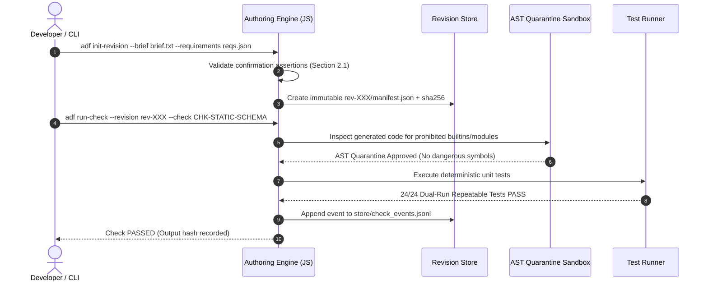
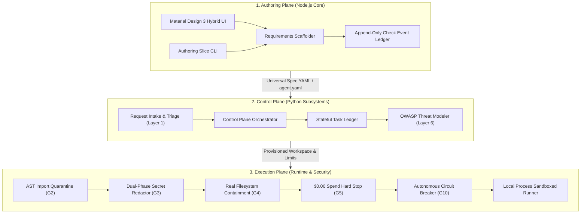
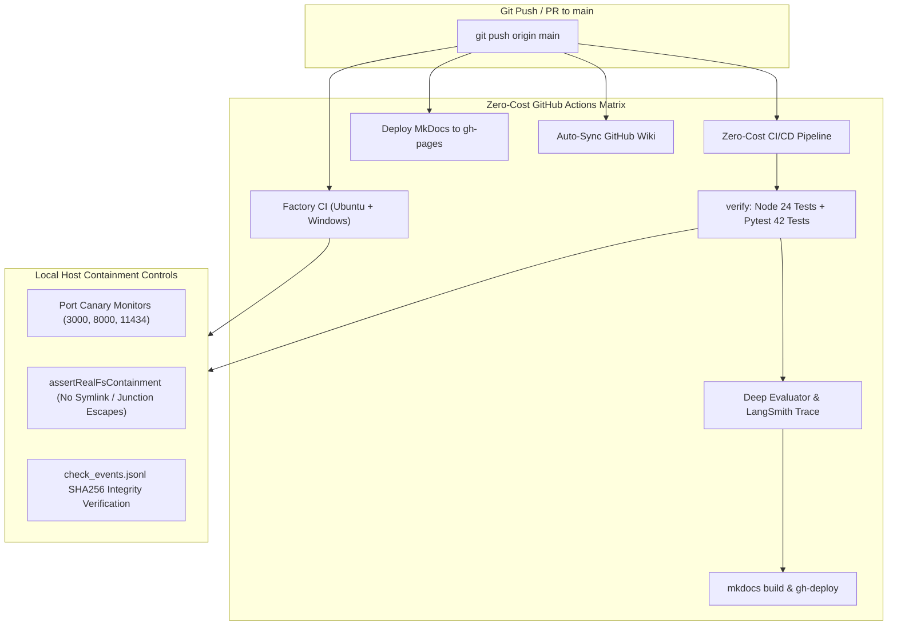
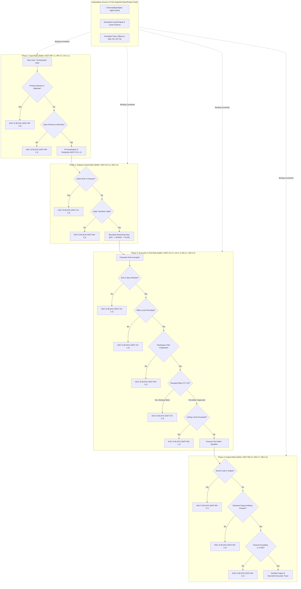
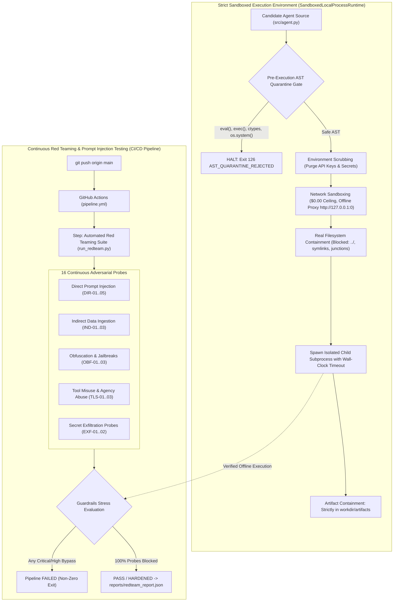
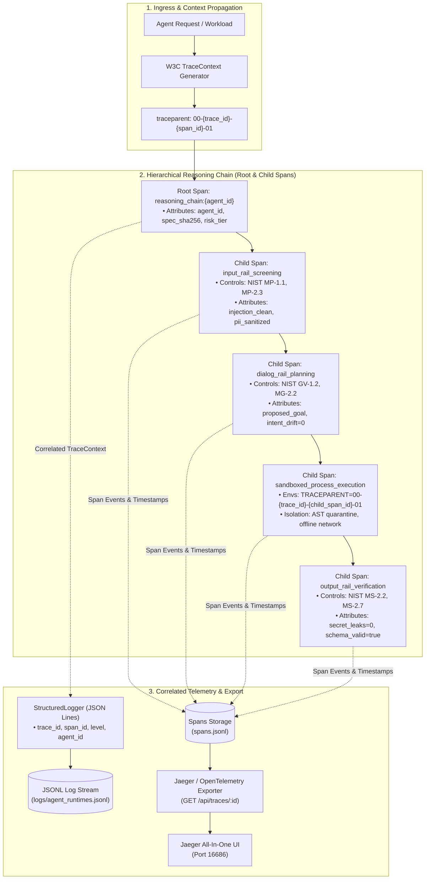
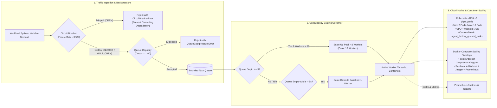
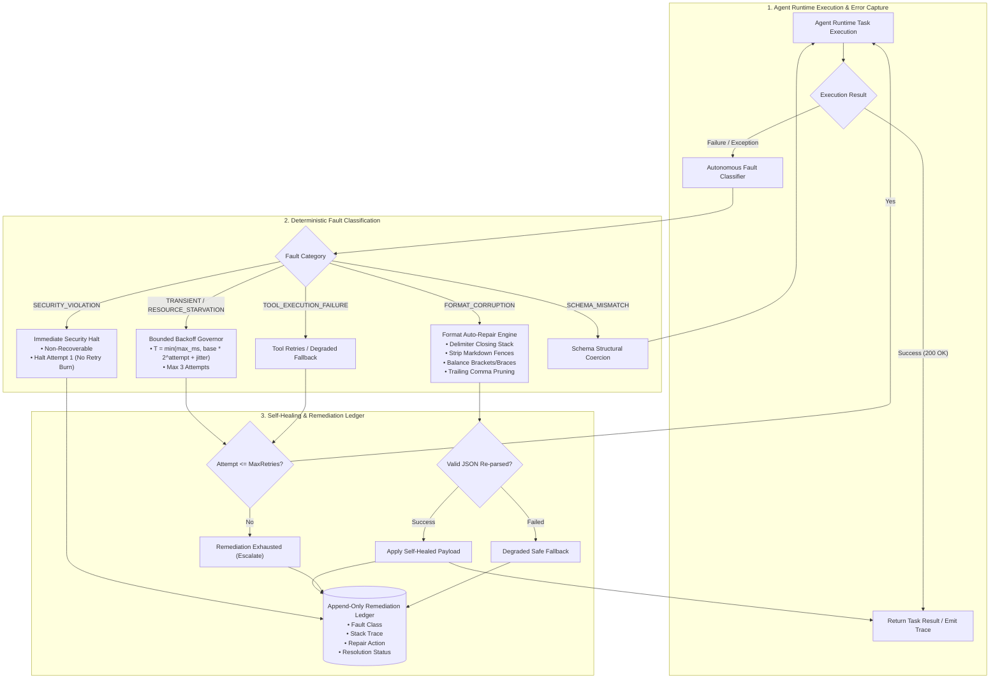
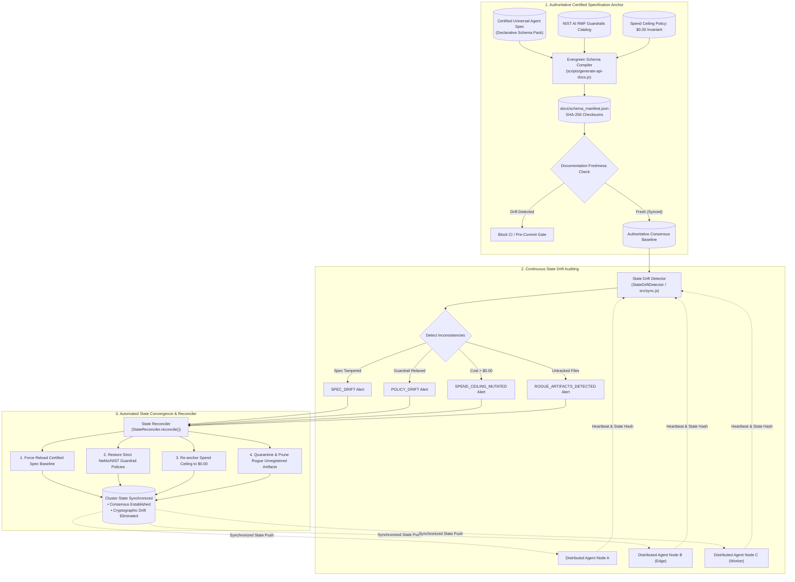

# Role-Based Architecture and Diagrams

This document provides visual system architecture diagrams and operational workflows for the **Agent Development Factory (ADF)**. Diagrams are organized by role to address the technical and operational needs of each stakeholder group:
1. [Software & Agent Developers](#1-for-developers-authoring-loop--code-synthesis)
2. [AI & Evaluation Engineers](#2-for-ai-engineers-model-routing-evals--self-healing)
3. [End Users & Business Operators](#3-for-end-users--business-operators-intake-to-promotion)
4. [Enterprise & Software Architects](#4-for-architects-three-plane-system-architecture)
5. [System Administrators & DevSecOps](#5-for-system-administrators--devsecops-ci-pipeline--containment)

---

## 1. For Developers: Authoring Loop & Code Synthesis

Developers interact with the ADF via the CLI (`src/cli.js`), the Python Workbench (`agent_factory.workbench`), and the local REST API.

### Developer Authoring Lifecycle


### Key Developer Concepts:
- **Zero-Dependency Core**: The authoring engine and CLI run natively in standard Node.js without needing `npm install` for external runtime packages.
- **AST Quarantine Sandbox**: All generated Python and JavaScript agent code is statically inspected to ensure modules like `socket`, `subprocess`, and `pty` or builtins like `eval` and `exec` are blocked unless explicitly whitelisted under elevated permission.
- **Immutable Revisions**: Once created, a revision folder (`rev-001`, `rev-002`) cannot be modified or overwritten. Any modification yields a child revision that automatically invalidates stale evidence.

---

## 2. For AI Engineers: Model Routing, Evals & Self-Healing

AI Engineers optimize agent reasoning, model routing, evaluation metrics ($\text{pass@k}$ vs $\text{pass}^k$), and iterative prompt refinement.

### Evaluation & Self-Healing Engine
```mermaid
flowchart TD
    subgraph ModelRouting ["Zero-Cost Model Routing"]
        P1["Agent Prompt Request"] --> Router{"Model Tier Selector"}
        Router -->|T0 / Low-Complexity| Local["OmniRoute / FreeLLM (127.0.0.1:11434)"]
        Router -->|T1+ / High-Reasoning| Gemini["Cloud Model Free Tier"]
    end

    subgraph EvalHarness ["Deep Evaluator & Graders"]
        Local --> Cand["Candidate Output"]
        Gemini --> Cand
        Cand --> G1["Exit Code Grader"]
        Cand --> G2["Schema & Type Grader"]
        Cand --> G3["Secret Leak Grader"]
        Cand --> G4["Behavioral Grader (EV-01..15)"]
    end

    subgraph Metrics ["Reliability Calculations"]
        G1 & G2 & G3 & G4 --> RelCalc["Reliability Engine"]
        RelCalc --> PassAtK["pass@3 >= 0.90 (Any correct)"]
        RelCalc --> PassPowerK["pass^3 >= 0.85 (Consistency)"]
    end

    subgraph SelfHealing ["Automated Remediation Loop"]
        PassAtK & PassPowerK --> Decision{"Gates Satisfied?"}
        Decision -->|YES| Promoted["Promote Candidate"]
        Decision -->|NO (Retries < 3)| RemEngine["Remediation Engine"]
        RemEngine --> Diagnostic["Failure Classification"]
        Diagnostic --> PromptPatch["Adjust Prompt & Guardrails"]
        PromptPatch --> P1
        Decision -->|NO (Retries >= 3)| Tripped["Circuit Breaker Tripped (HALT)"]
    end
```

### Mathematical Formulation of Reliability & Laya RLCD Calibration
- **$\text{pass@k}$ (Exploration Quality)**:
  $$\text{pass@k} = 1 - \frac{\binom{n-c}{k}}{\binom{n}{k}}$$
  Measures the probability that at least 1 out of $k$ generated attempts succeeds. Required $\ge 0.90$.
- **$\text{pass}^k$ (Repeatable Consistency)**:
  $$\text{pass}^k = \left(\frac{c}{n}\right)^k$$
  Measures the probability that all $k$ consecutive runs succeed independently without state drift. Required $\ge 0.85$.
- **Laya RLCD Calibrated Composite Quality Gate**:
  $$\text{CompositeScore} = w_H \cdot \mathcal{R}_{\text{HG}} + w_I \cdot \mathcal{R}_{\text{IF}} + w_S \cdot \mathcal{R}_{\text{SB}} + \text{Prior}$$
  where:
  - $\mathcal{R}_{\text{HG}}$: Hallucination & Grounding Rubric (threshold $\ge 0.90$)
  - $\mathcal{R}_{\text{IF}}$: Instruction Following & Spec Adherence Rubric (threshold $\ge 0.90$)
  - $\mathcal{R}_{\text{SB}}$: Security Boundaries & Containment Rubric (zero-tolerance threshold $= 1.00$)
  - $\mathbf{w} = (w_H, w_I, w_S)$: Calibrated weights dynamically fetched from host Laya Intelligence (`~/.laya/data/laya.db`)
  - Promotion granted if $\text{CompositeScore} \ge 0.92$ and $\mathcal{R}_{\text{SB}} = 1.00$.

---

## 3. For End Users & Business Operators: Intake to Promotion

End users interact with the factory to automate workflows, review business rules, and authorize deployment.

### User Touchpoints and Human-in-the-Loop Workflow


---

## 4. For Architects: Three-Plane System Architecture

Enterprise architects govern the separation of concerns across planes, modularity, and compliance with the 10-layer capability map.

### 3-Plane Architecture & 10-Layer Matrix


### 10-Layer Defense-in-Depth Guardrail Matrix (G1..G10)
1. **G1: Structural JSON Schema Validation**: Strict type enforcement against Universal Agent Spec.
2. **G2: AST Import & Quarantine Sandbox**: Static code inspection preventing forbidden imports.
3. **G3: Dual-Phase Secret Redactor**: Masking sensitive keys (`[REDACTED_API_KEY]`) in logs and traces.
4. **G4: Real Filesystem Containment**: Resolution of physical paths preventing directory traversal and symlink escapes.
5. **G5: Zero-Cost Spend Ceiling**: Hard immediate process exit if paid API spend exceeds $0.00.
6. **G6: MCP Tool Registry Whitelist**: Granular permission checks (`READ_ONLY`, `CONTAINED_WRITE`, `EXTERNAL_EFFECT`).
7. **G7: Output Safety & Injection Filter**: Sanitization of agent output preventing indirect prompt injection.
8. **G8: Mandatory Human-in-the-Loop Signoff**: Cryptographic approval token required for Tier 1+ promotions.
9. **G9: Append-Only Audit Stream**: `check_events.jsonl` recording tamper-evident check history.
10. **G10: Autonomous Circuit Breaker**: Hard limit of 3 remediation retries preventing infinite loops.

---

## 5. For System Administrators & DevSecOps: CI Pipeline & Containment

DevSecOps engineers maintain security boundaries, zero-cost CI/CD pipelines, and environment isolation.

### CI/CD Deployment & Containment Boundary


### DevSecOps Key Safeguards:
- **Hermetic Filesystem Containment**: Tests create isolated, unique `test-runs/run-<id>` directories. If any code attempts to write outside its bounded execution root or escape via symlinks or Windows junction points, the operation is rejected immediately.
- **Tamper-Evident Hashing**: Manifests and check events calculate SHA-256 hashes of both input briefs and checker implementations. If a checker's source changes, previously recorded evidence is marked `STALE` without erasing audit history.
- **Port Canaries**: The platform includes zero-cost canaries that verify required services (UI port 3000, local LLM port 11434) without opening external network attack surfaces.

---

## 6. NeMo & NIST Operational Safety Guardrail Architecture (For DevSecOps, Architects, and AI Engineers)

The Agent Development Factory binds the agent reasoning engine to the ingested declarative specification pack as the authoritative source of truth. Mandatory programmable guardrails derived from NVIDIA NeMo Guardrails and mapped to NIST AI RMF 1.0 (NIST AI 100-1) actively police execution paths, halting any path that deviates from the certified specification or violates security boundaries.



### NIST AI RMF (NIST AI 100-1) Mapping Matrix:
| NIST Function | Control ID | NeMo Rail Component | Operational Mechanism |
| :--- | :--- | :--- | :--- |
| **GOVERN** | `GV-1.1` | PII & Secret Redactor | Strips credentials and PII prior to reasoning engine intake |
| **GOVERN** | `GV-1.2` | Tool & Effect Policy Enforcer | Rejects tools or effects not explicitly declared in `UniversalAgentSpec` |
| **GOVERN** | `GV-1.3` | Action Gate Authorization | Demands HMAC owner approval tokens for elevated actions (T1–T3) |
| **GOVERN** | `GV-3.1` | Append-Only Decision Ledger | Logs all rail decisions and state checkpoints in tamper-evident ledger |
| **MAP** | `MP-1.1` | Input/Output Schema Validator | Verifies parameters adhere to declarative typed JSON schemas |
| **MAP** | `MP-2.3` | Prompt Injection & Path Defense | Rejects jailbreak payloads and path escapes (symlinks/junctions) |
| **MEASURE** | `MS-2.2` | Grounding & Efficacy Graders | Ensures output claims match ground truth (no hallucinated records) |
| **MEASURE** | `MS-2.7` | Zero-Tolerance Secret Scanner | Enforces 1.00 score preventing API keys or bearer token disclosures |
| **MANAGE** | `MG-1.1` | Resource Ceiling Governor | Hard halts on step counts, token usage, wall time, and spend ceiling |
| **MANAGE** | `MG-2.2` | Active Fail-Safe Rail Enforcer | Immediately halts and blocks any execution path violating spec bounds |
| **MANAGE** | `MG-2.4` | Fail-Safe Escalation Router | Dispatches unresolvable policy blocks to human intervention queues |

---

## 7. Sandboxed Execution Isolation & Continuous Red Teaming Pipeline (For DevSecOps & Platform Engineers)

The Agent Development Factory strictly isolates all candidate agent code within hermetic sandboxes and continuously stresses guardrails via automated red teaming in CI/CD.



### Attack Vector Taxonomy & Defense Controls:
1. **Direct Prompt Injection (`RED-DIR-01..05`)**: Protects against role-hijacking, system directive erasures, ChatML `<|im_start|>` delimiters, and developer mode prompts. Mapped to **NIST MP-2.3**.
2. **Indirect Ingestion Injection (`RED-IND-01..03`)**: Neutralizes data-as-code attacks in CSV rows, hidden HTML comments, and markdown image data-exfiltration URLs. Mapped to **NIST MP-1.1 / MP-2.3**.
3. **Obfuscated Jailbreak Variants (`RED-OBF-01..03`)**: Detects base64-encoded instructions, illegal state machine jumps (`INIT` $\to$ `COMPLETE`), and prohibited destruction intents. Mapped to **NIST GV-1.2 / MG-2.2**.
4. **Autonomous Tool Misuse (`RED-TLS-01..03`)**: Blocks unlisted tool invocations, parameter path escapes (`../../../../system32`), and unapproved effect elevations. Mapped to **NIST GV-1.2 / MG-2.2**.
5. **Secret Exfiltration Probes (`RED-EXF-01..02`)**: Intercepts active credential leaks (`sk-`, `Bearer`, `AKIA`) and scrubs environment variables. Mapped to **NIST MS-2.7**.

---

## 8. Distributed Tracing & Auto-Scaling Concurrency Governance (For System Administrators, Architects & AI Engineers)

### Distributed Tracing & Causal Reasoning Chain Architecture



### Auto-Scaling Infrastructure & Dynamic Concurrency Governor



### Observability & Scaling Key Safeguards:
1. **W3C TraceContext Standard Compliance**: Strictly follows `00-{trace_id}-{span_id}-{trace_flags}` enabling seamless trace propagation across Node.js, Python, and external OpenTelemetry collectors without proprietary SDK lock-in.
2. **Causal Reasoning Chain Observability**: Every reasoning phase (Intake, Plan, Tool Execution, Output Verification) generates linked child spans, recording execution durations, evaluated NIST AI RMF controls, and error states.
3. **Structured Log Correlation**: Ingests active `trace_id` and `span_id` into every JSON Lines log event, enabling microsecond-precision log aggregation and correlation.
4. **Autonomous Circuit Breaker Protection**: Employs a sliding-window failure rate governor (25% threshold over 20 executions) with automatic `CLOSED` $\to$ `OPEN` $\to$ `HALF_OPEN` self-healing canary recovery.
5. **Elastic Workload Burst Scaling**: Dynamic worker scaling under queue pressure (min 1 to max 16 workers) with idle scale-down and hard backpressure limits, strictly upholding the constitutional **$0.00 spend ceiling**.

---

## 9. Autonomous Self-Healing & Distributed State Synchronization Architecture (For Architects, AI Engineers & Enterprise Operators)

### Autonomous Self-Healing & Delimiter-Stack Auto-Repair Loop



### Strict State Synchronization & Distributed Drift Elimination Topology



### Self-Healing & State Synchronization Key Safeguards:
1. **Security Boundary Non-Retry Invariant**: Security violations (prompt injection, jailbreak attempts, path traversal, guardrail trips) are strictly non-recoverable and halt immediately on attempt 1 with zero retry budget consumption, preventing vulnerability exploitation loops.
2. **Reverse Delimiter Stack JSON Auto-Repair**: Syntax corruptions resulting from LLM truncation, unclosed brackets, braces, and trailing commas are repaired using a reverse delimiter stack (`{` $\to$ `}`, `[` $\to$ `]`), restoring syntactic validity without loss of extracted tokens.
3. **Cryptographically Coupled Evergreen Documentation**: Schemas directly compile to markdown architecture specifications. SHA-256 hashes are recorded in `docs/schema_manifest.json`, ensuring technical documentation can never drift from code contracts during CI/CD.
4. **Deterministic Convergence Protocol**: Node drift across distributed runtimes triggers automated non-destructive reconciliation, restoring declarative baseline contracts, purging untracked runtime artifacts, and strictly re-anchoring the **$0.00 spend ceiling**.


