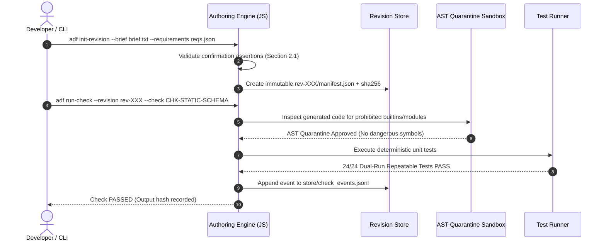
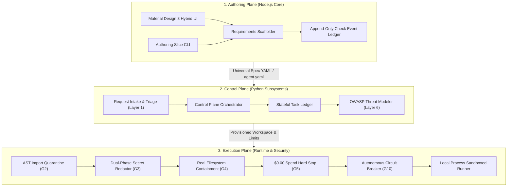
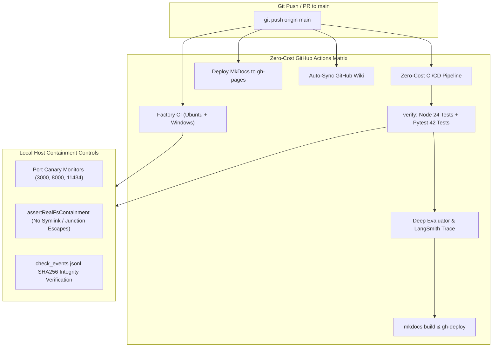

# Role-Based Architecture and Diagrams

This document provides visual system architecture diagrams and operational workflows for the **Agent Development Factory (ADF)**. Diagrams are organized by role to address the technical and operational needs of each stakeholder group:
1. [Software & Agent Developers](#1-for-developers-authoring-loop--code-synthesis)
2. [AI & Evaluation Engineers](#2-for-ai-engineers-model-routing-evals--self-healing)
3. [End Users & Business Operators](#3-for-end-users--business-operators-intake-to-promotion)
4. [Enterprise & Software Architects](#4-for-architects-three-plane-system-architecture)
5. [System Administrators & DevSecOps](#5-for-system-administrators--devsecops-ci-pipeline--containment)

---

## 1. For Developers: Authoring Loop & Code Synthesis

Developers interact with the ADF via the CLI (`src/cli.js`), the Python Workbench (`agent_factory.workbench`), and the local REST API.

### Developer Authoring Lifecycle


### Key Developer Concepts:
- **Zero-Dependency Core**: The authoring engine and CLI run natively in standard Node.js without needing `npm install` for external runtime packages.
- **AST Quarantine Sandbox**: All generated Python and JavaScript agent code is statically inspected to ensure modules like `socket`, `subprocess`, and `pty` or builtins like `eval` and `exec` are blocked unless explicitly whitelisted under elevated permission.
- **Immutable Revisions**: Once created, a revision folder (`rev-001`, `rev-002`) cannot be modified or overwritten. Any modification yields a child revision that automatically invalidates stale evidence.

---

## 2. For AI Engineers: Model Routing, Evals & Self-Healing

AI Engineers optimize agent reasoning, model routing, evaluation metrics ($\text{pass@k}$ vs $\text{pass}^k$), and iterative prompt refinement.

### Evaluation & Self-Healing Engine
```mermaid
flowchart TD
    subgraph ModelRouting ["Zero-Cost Model Routing"]
        P1["Agent Prompt Request"] --> Router{"Model Tier Selector"}
        Router -->|T0 / Low-Complexity| Local["OmniRoute / FreeLLM (127.0.0.1:11434)"]
        Router -->|T1+ / High-Reasoning| Gemini["Cloud Model Free Tier"]
    end

    subgraph EvalHarness ["Deep Evaluator & Graders"]
        Local --> Cand["Candidate Output"]
        Gemini --> Cand
        Cand --> G1["Exit Code Grader"]
        Cand --> G2["Schema & Type Grader"]
        Cand --> G3["Secret Leak Grader"]
        Cand --> G4["Behavioral Grader (EV-01..15)"]
    end

    subgraph Metrics ["Reliability Calculations"]
        G1 & G2 & G3 & G4 --> RelCalc["Reliability Engine"]
        RelCalc --> PassAtK["pass@3 >= 0.90 (Any correct)"]
        RelCalc --> PassPowerK["pass^3 >= 0.85 (Consistency)"]
    end

    subgraph SelfHealing ["Automated Remediation Loop"]
        PassAtK & PassPowerK --> Decision{"Gates Satisfied?"}
        Decision -->|YES| Promoted["Promote Candidate"]
        Decision -->|NO (Retries < 3)| RemEngine["Remediation Engine"]
        RemEngine --> Diagnostic["Failure Classification"]
        Diagnostic --> PromptPatch["Adjust Prompt & Guardrails"]
        PromptPatch --> P1
        Decision -->|NO (Retries >= 3)| Tripped["Circuit Breaker Tripped (HALT)"]
    end
```

### Mathematical Formulation of Reliability
- **$\text{pass@k}$ (Exploration Quality)**:
  $$\text{pass@k} = 1 - \frac{\binom{n-c}{k}}{\binom{n}{k}}$$
  Measures the probability that at least 1 out of $k$ generated attempts succeeds. Required $\ge 0.90$.
- **$\text{pass}^k$ (Repeatable Consistency)**:
  $$\text{pass}^k = \left(\frac{c}{n}\right)^k$$
  Measures the probability that all $k$ consecutive runs succeed independently without state drift. Required $\ge 0.85$.

---

## 3. For End Users & Business Operators: Intake to Promotion

End users interact with the factory to automate workflows, review business rules, and authorize deployment.

### User Touchpoints and Human-in-the-Loop Workflow

```mermaid
flowchart LR
    Start(["Business Workflow Need"]) --> Submit["1. Submit Plain-Text Brief"]
    Submit --> Triage{"2. Complexity Triage"}
    
    Triage -->|Simple / Deterministic| Script["S1: Pure Script / Regex Pipeline"]
    Triage -->|Complex / Multi-Step| Agent["S2: Autonomous Agent Pack"]
    
    Script & Agent --> Review["3. Review Requirements Ledger"]
    Review --> Confirm{"Confirm Proposed Items?"}
    
    Confirm -->|Revoke / Clarify| Adjust["Update Constraints"]
    Adjust --> Review
    Confirm -->|Confirmed| Gates["4. Run 9 Release Gates"]
    
    Gates --> TierCheck{"Target Risk Tier?"}
    TierCheck -->|T0 Read-Only| AutoApprove["Auto-Promoted"]
    TierCheck -->|T1+ Contained Write| Modal["5. Operator Signoff Dialog"]
    
    Modal --> GrantToken["Sign with Approval Token"]
    GrantToken --> Promoted(["Agent Ready in Production"])
    AutoApprove --> Promoted
```


---

## 4. For Architects: Three-Plane System Architecture

Enterprise architects govern the separation of concerns across planes, modularity, and compliance with the 10-layer capability map.

### 3-Plane Architecture & 10-Layer Matrix


### 10-Layer Defense-in-Depth Guardrail Matrix (G1..G10)
1. **G1: Structural JSON Schema Validation**: Strict type enforcement against Universal Agent Spec.
2. **G2: AST Import & Quarantine Sandbox**: Static code inspection preventing forbidden imports.
3. **G3: Dual-Phase Secret Redactor**: Masking sensitive keys (`[REDACTED_API_KEY]`) in logs and traces.
4. **G4: Real Filesystem Containment**: Resolution of physical paths preventing directory traversal and symlink escapes.
5. **G5: Zero-Cost Spend Ceiling**: Hard immediate process exit if paid API spend exceeds $0.00.
6. **G6: MCP Tool Registry Whitelist**: Granular permission checks (`READ_ONLY`, `CONTAINED_WRITE`, `EXTERNAL_EFFECT`).
7. **G7: Output Safety & Injection Filter**: Sanitization of agent output preventing indirect prompt injection.
8. **G8: Mandatory Human-in-the-Loop Signoff**: Cryptographic approval token required for Tier 1+ promotions.
9. **G9: Append-Only Audit Stream**: `check_events.jsonl` recording tamper-evident check history.
10. **G10: Autonomous Circuit Breaker**: Hard limit of 3 remediation retries preventing infinite loops.

---

## 5. For System Administrators & DevSecOps: CI Pipeline & Containment

DevSecOps engineers maintain security boundaries, zero-cost CI/CD pipelines, and environment isolation.

### CI/CD Deployment & Containment Boundary


### DevSecOps Key Safeguards:
- **Hermetic Filesystem Containment**: Tests create isolated, unique `test-runs/run-<id>` directories. If any code attempts to write outside its bounded execution root or escape via symlinks or Windows junction points, the operation is rejected immediately.
- **Tamper-Evident Hashing**: Manifests and check events calculate SHA-256 hashes of both input briefs and checker implementations. If a checker's source changes, previously recorded evidence is marked `STALE` without erasing audit history.
- **Port Canaries**: The platform includes zero-cost canaries that verify required services (UI port 3000, local LLM port 11434) without opening external network attack surfaces.
