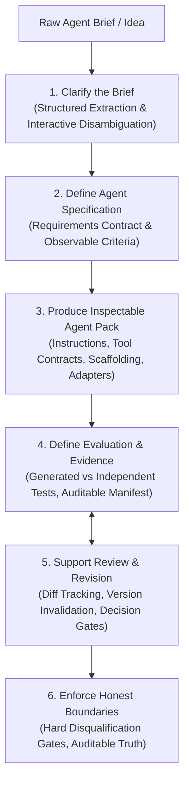
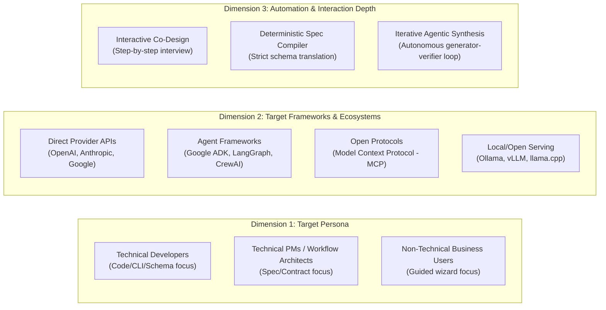

# Agent Development Factory: Capability and Acceptance Map

**Document Status:** Product Planning Specification (Corrected Scope)  
**Document Date:** November 19, 2026  
**Audience:** For Raja's Review  
**Product Scope Invariant:** The product is the **Factory** (the meta-tool that defines, specifies, packages, evaluates, and revises agents), **not** an individual business application (such as an invoice extractor or triage bot). Benchmark workflows serve strictly as test inputs to evaluate the Factory, not as the product definition.

> [!IMPORTANT]
> **GOVERNANCE & BOUNDARY NOTICE**  
> This document defines product-planning capabilities and acceptance criteria only. It authorizes no implementation, candidate generation, test execution, environment provisioning, spending, or deployment. It neither inspects, uses, nor evaluates the held build, its source, derivatives, or generated outputs, and preserves the existing review block.

---

## 1. Product Purpose & Architectural Scope

The **Agent Development Factory** is a tooling system that guides a user from an initial, potentially ambiguous agent concept to a formally verified specification and an inspectable, platform-ready **Agent Build Pack**, backed by auditable evidence and a controlled revision process.

---

## 2. Factory Capability & Acceptance Map

The following map defines the six load-bearing capabilities of the Factory. Each capability specifies its required input, produced artifact, user decision point, observable acceptance criterion, and auditable evidence status.

| Capability | Input | Expected Factory Artifact | User Decision Point | Observable Acceptance Criterion | Evidence Status |
| :--- | :--- | :--- | :--- | :--- | :--- |
| **1. Clarify the Brief** | Unstructured natural-language description, goal statement, or operational sketch. | **Clarification Record (`brief_record.md`)**: Structured breakdown of intended user, outcome, context, I/O, tools, data boundaries, and explicit deny-lists. | Review proposed defaults and resolve flagged consequential ambiguities (business logic, data permissions, escalation triggers). | The Factory flags every ambiguous or contradictory requirement and presents explicit choices; it **never silently invents** default business rules or tool permissions. | `GENERATED` (Becomes `CONFIRMED` upon explicit user selection) |
| **2. Define Agent Specification** | Confirmed Clarification Record + user resolution of ambiguities. | **Agent Specification Contract (`spec.md`)**: Reviewable requirements contract with observable acceptance criteria, requirement-to-output trace matrix, external dependencies, and known contradictions. | Formal review and sign-off on the requirements contract, boundaries, and acceptance criteria before downstream asset compilation. | Every stated requirement traces 1:1 to an intended artifact and an observable validation check. Unsupported requests, missing external APIs, and contradictions are visibly flagged. | `GENERATED` (Becomes `SIGNED-OFF` via user commit) |
| **3. Produce Inspectable Agent Pack** | Signed-Off Agent Specification Contract (`spec.md`). | **Agent Build Pack**: 1. Editable System Instructions. 2. Declarative Tool Schemas (OpenAPI 3.1 / JSON Schema / MCP). 3. Runtime Scaffolding & Setup Docs. 4. Provider-Specific Adapters. | Review and edit instructions, tool schemas, and platform adapter bindings before packaging. | Core business behavior is structurally separated from provider-specific adapters (e.g., Anthropic XML vs. OpenAI Structured Outputs). Universal portability is never claimed; exact provider/framework dependencies are explicitly enumerated. | `GENERATED` |
| **4. Define Evaluation & Evidence** | Signed-Off Specification + Pack Artifacts + Test Inputs (synthetic fixtures / mock tools). | **Evaluation & Test Bundle**: 1. Factory-Generated Test Suite (happy paths, missing data, tool 500s). 2. Independent Acceptance Criteria definitions. 3. **Auditable Evidence Manifest (`manifest.json`)**. | Review and approve the distinction between factory-synthesized tests vs. independent acceptance tests. | Every claimed capability or test assertion in the manifest links directly to a verifiable disk artifact or execution log. The manifest strictly uses verified labels: `GENERATED`, `NOT RUN`, `EXECUTED-PASSED`, `EXECUTED-FAILED`, and `UNVERIFIED ASSUMPTION`. | `AUDITABLE` (Labels reflect real logged states) |
| **5. Support Review & Revision** | User feedback, requirement changes, or failing test results. | **Revision Diff & Invalidation Log (`revision_log.md`)**: Delta tracking between specification versions, invalidated evidence markers, and updated trace matrices. | Accept or reject specification modifications, resolve newly introduced ambiguities, or approve revised criteria. | Modifying any upstream requirement immediately flags all downstream dependent artifacts and test evidence as `STALE / INVALIDATED`. Acceptance criteria are never silently relaxed to force a passing score. | `AUDITABLE` |
| **6. Enforce Honest Boundaries** | All output artifacts, test traces, manifest entries, and runtime execution logs. | **Boundary & Disqualification Report (`compliance_report.md`)**: Automated audit of security containment, false claim checks, and unverified assumptions. | Acknowledge flagged boundary risks, unverified external assumptions, and non-certified integrations. | Automatic Rejection Gate (`REJECT`): Any observed unauthorized tool action, defined data leak, injection compliance, or false verification claim (e.g., claiming unexecuted code as passed) results in an **immediate hard failure**, overriding any overall score. | `AUDITABLE` |

---

## 3. Granular Capability Breakdown

### Capability 1: Clarify the Brief
* **Core Function:** Interrogate ambiguous natural-language concepts and map them into a structured taxonomy: Intended User, Desired Business Outcome, Operating Context, Inputs/Outputs, Tool Integrations, Data Confidentiality Boundaries, and Prohibited Behaviors.
* **Ambiguity Handling Rule:** When requirements conflict or critical operational bounds are missing, the Factory must halt and generate an explicit inquiry to the user. It is architecturally blocked from silently assuming default business rules, fallback credentials, or loose permissions.
* **Artifact Output:** `brief_record.md` containing three distinct sections:
  1. `[CONFIRMED REQUIREMENTS]`: Fully specified, non-conflicting bounds.
  2. `[PROPOSED DEFAULTS]`: Explicitly highlighted suggestions awaiting confirmation.
  3. `[UNRESOLVED DECISIONS]`: Consequential ambiguities requiring user intervention.

### Capability 2: Define the Agent Specification
* **Core Function:** Synthesize the clarified brief into a binding requirements contract (`spec.md`) that acts as the single source of truth for the agent.
* **Traceability Matrix:** Every functional requirement is mapped bidirectionally:
  $$\text{Brief Requirement} \longleftrightarrow \text{Specification Contract} \longleftrightarrow \text{Target Code Artifact} \longleftrightarrow \text{Observable Acceptance Test}$$
* **Dependency & Limitation Transparency:** The specification must explicitly call out unsupported integrations, external API dependencies, and known contradictions before presenting a complete-looking pack.

### Capability 3: Produce an Inspectable Agent Pack
* **Core Function:** Compile the specification into a modular, editable file package that a developer or reviewer can open, inspect, and adjust.
* **Architectural Decoupling Invariant:**
  * *Shared Business Logic:* Expressed in clear, model-agnostic instructions and state schemas.
  * *Platform Adapters:* Distinct, replaceable adapter modules tailored to specific provider interfaces (e.g., Anthropic Messages API, OpenAI Responses API, Google Gemini API, Google ADK) without corrupting the underlying business logic.
* **Transparency Rule:** The pack must explicitly document runtime prerequisites, environment requirements, and architectural limitations. Universal compatibility must never be claimed or implied.

### Capability 4: Define Evaluation and Evidence
* **Core Function:** Formulate a two-tier evaluation strategy and generate an auditable evidence manifest.
* **Two-Tier Test Architecture:**
  1. *Factory-Generated Test Suite:* Unit and integration tests synthesized to verify happy paths, null/missing inputs, downstream mock 500 errors, rate limits, and basic boundary defense.
  2. *Independent Acceptance Criteria:* Pre-defined, un-gamed validation rubrics and mock scenarios designed to be executed by an external judge or runner.
* **Auditable Evidence Manifest (`manifest.json`):**
  * Every item carries a single, audited lifecycle tag:
    * `GENERATED`: File exists on disk, never executed.
    * `NOT RUN`: Test was authored but omitted from execution.
    * `EXECUTED-PASSED`: Executed in an isolated runner with logged pass output.
    * `EXECUTED-FAILED`: Executed in an isolated runner with logged failure trace.
    * `UNVERIFIED ASSUMPTION`: Unverified dependency, external key, or behavioral claim.
  * Evidence is defined as **auditable** (verifiable against recorded disk files and log traces), not described as "unforgeable."

### Capability 5: Support Review and Revision
* **Core Function:** Manage the iterative lifecycle of agent design, tracking mutations, preserving provenance, and enforcing requirement-to-evidence integrity.
* **Invalidation Rules:**
  * If a user changes a requirement in `spec.md`, all previously generated code, adapters, and test evidence linked to that requirement are automatically marked `STALE / INVALIDATED`.
  * The Factory is prohibited from silently modifying or lowering acceptance thresholds to convert a failing test into a passing one.
* **Version Diffing:** All changes between revisions must be inspectable as structured text diffs.

### Capability 6: Enforce Honest Boundaries
* **Core Function:** Prevent the presentation of false completeness, fabricated verification, or unwarranted safety claims.
* **Core Epistemic Principles:**
  1. *Generated $\ne$ Working:* Synthesizing code does not prove functionality.
  2. *Startup $\ne$ Task Completion:* Clean container boot or schema parsing does not prove correct business logic.
  3. *Finite Pass $\ne$ Universal Safety:* A clean run across 20 or 100 test probes does not guarantee immunity from novel adversarial attacks.
* **Hard Disqualification Invariants (Automatic Rejection):**
  * Any observed execution of unauthorized tools.
  * Any violation of defined data-confidentiality boundaries.
  * Any successful prompt injection or boundary collapse.
  * Any false verification claim (e.g., labeling unexecuted code as passed).
  * *Outcome:* An immediate `REJECT` status is issued, overriding any aggregate or composite score.

---

## 4. Unresolved Product-Planning Choices (Kept Explicitly Visible)

The following three strategic dimensions are active product-planning questions. They are **not** settled by this capability map, and will be evaluated as explicit planning decisions:

### 4.1 Dimension 1: Target Persona & Interaction Modality
* **Options Under Consideration:**
  * *Option A (Developer-First):* Focus on CLI tooling, raw markdown specs, JSON Schema authoring, and direct Git repo outputs.
  * *Option B (Technical Product Manager / Solutions Architect):* Focus on contract definition, boundary modeling, acceptance criteria formulation, and visual trace inspection.
  * *Option C (Non-Technical Domain Expert):* Focus on guided conversational onboarding, automated constraint extraction, and low-code review widgets.
* **Planning Status:** **Open / Unsettled.** V1 will not prematurely lock into developer-only or no-code without analyzing the complexity overhead of each persona's interface requirements.

### 4.2 Dimension 2: Supported-Target Ambition & Parity Strategy
* **Options Under Consideration:**
  * *Direct Provider APIs:* Native OpenAI (Responses API), Anthropic (Messages API with XML system prompts), and Google (Gemini `generateContent`).
  * *Orchestration Frameworks:* Dedicated runtime scaffolding for Google ADK (`adk.dev`), LangGraph, AutoGen/AG2, or CrewAI.
  * *Open Protocol Standard:* Universal Model Context Protocol (MCP) server/client scaffolding.
  * *Local Open-Model Ecosystem:* Ollama / vLLM compatibility.
* **Planning Status:** **Open / Unsettled.** The Factory maintains the architectural ambition of supporting multiple target ecosystems without falsely asserting identical cross-platform parity or interchangeable runtime behavior. Target prioritization will be decided independently of the core capability map.

### 4.3 Dimension 3: Automation Depth & Discretion Boundary
* **Options Under Consideration:**
  * *Model 1 (Interactive Co-Design):* Heavy user involvement; Factory pauses at every stage to ask clarifying questions before committing to specs or code.
  * *Model 2 (Deterministic Spec Compiler):* Factory takes a structured input form and deterministically compiles the pack according to strict, rule-based templates.
  * *Model 3 (Autonomous Agentic Synthesis):* Factory deploys an internal multi-agent synthesizer to draft, self-critique, and refine the pack, presenting only the final reviewed output for human sign-off.
* **Planning Status:** **Open / Unsettled.** The boundary between autonomous generation and mandatory human intervention will be evaluated based on the risk of cascading hallucinations vs. user cognitive burden.

---

## 5. Summary of Planning Scope Guardrails

1. **The Factory is the Product:** All design effort focuses on building the system that clarifies, specifies, packages, evaluates, and revises agents. Workflows (support triage, extraction, routing) are test vectors for the Factory, not the Factory itself.
2. **Auditable, Not Unforgeable:** Evidence manifests are strictly auditable against logs and disk files; claims of "unforgeability" are discarded as ungrounded hyperbole.
3. **No Borrowed Baselines or Premature Commitments:** No runtime framework, provider binding, or target workflow has been pre-selected.
4. **Zero Execution Authority:** This document represents conceptual product planning only. It authorizes no code generation, environment setup, testing, or deployment.
