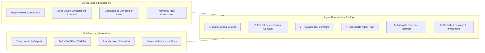
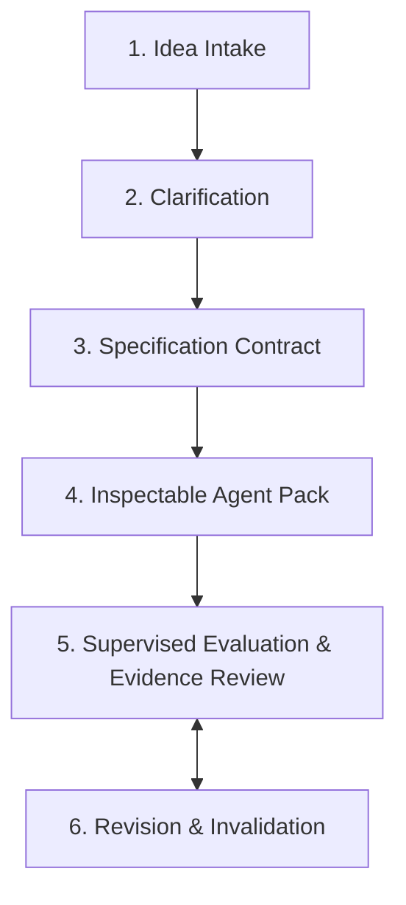
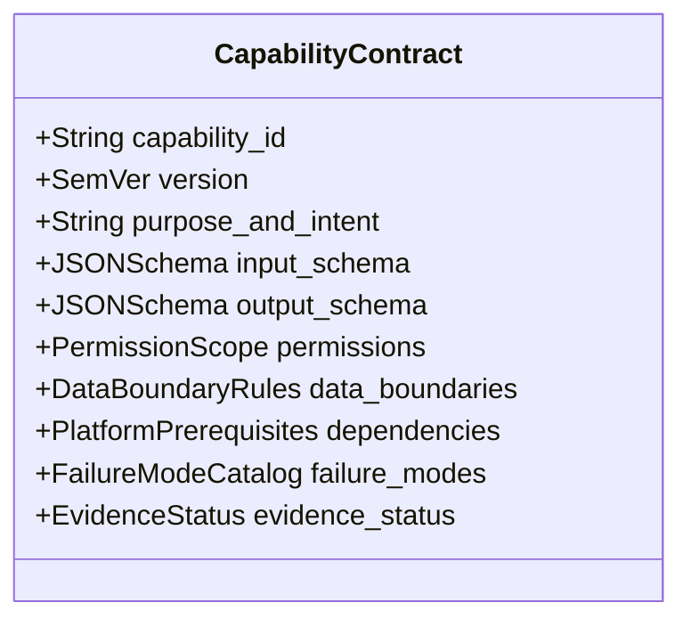
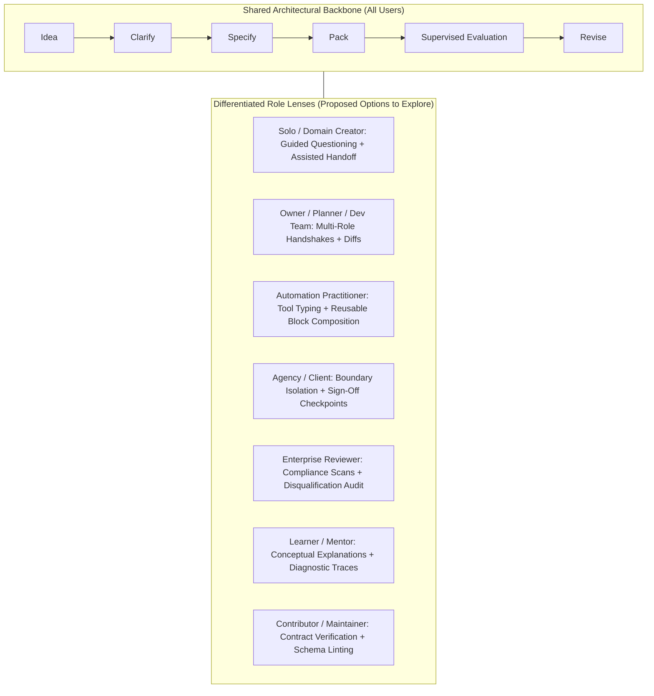

# Agent Development Factory: Product Contract

**Document Status:** Product Planning Contract (Reconciled with Confirmed v1 Supervised Evaluation Scope)  
**Document Date:** November 20, 2026  
**Audience:** For Raja's Review & Architectural Alignment  
**Foundational Invariant:** The product is the **Factory** (the system that clarifies, specifies, packages, evaluates, and revises agents). Benchmark workflows (support triage, research, extraction) are evaluation test inputs, not the product definition.

> [!IMPORTANT]
> **GOVERNANCE & PLANNING INVARIANT**  
> This contract establishes product planning definitions, interface contracts, and evidence governance only. It incorporates the newly confirmed v1 scope for supervised evaluation capability (product scope approval only; does not require evaluation prior to pack export or authorize any evaluation now). It does **not** authorize code execution, test runs, environment provisioning, account connection, spending, deployment, or access to held builds and derivative materials. Neither Spec Kit nor Builderpack establishes validated market demand, working runtime compatibility, or product uniqueness.

---

## 1. The Architectural Intersection

The Factory is designed at the structural intersection of **specification discipline** (derived from GitHub Spec Kit) and **reusable capability modularity** (derived from Builderpack's action/tool pattern).

### 1.1 Documented Reference Capabilities

* **GitHub Spec Kit (`github/spec-kit`, `github.github.com/spec-kit/`, read 20 Nov 2026):**
  * *Constitution as Root Anchor:* `.specify/memory/constitution.md` sets project guidelines, principles, and architectural rules against which subsequent specs are evaluated. Crucially, the constitution is **amendable and versioned** (containing formal amendment procedures, version increments, and sync impact analysis), providing a stable yet evolving governance baseline.
  * *Spec-Driven Development (SDD):* Clear separation between *what* to build (`spec.md` user scenarios and requirements) and *how* to build (`plan.md` technical architecture).
  * *Checklists as "Unit Tests of Requirements":* `templates/commands/checklist.md` evaluates specification clarity, completeness, and consistency before any code is generated.
  * *Idea Assessment Lifecycle:* Structured 5-stage gating (`intake` $\to$ `research` $\to$ `define` $\to$ `shape` $\to$ `decide`) outputting evidence-backed `go`, `needs-clarification`, or `kill` recommendations.
  * *Extensible Layering:* Presets, overlays, and local overrides that modify templates without forking core logic.
* **Builderpack (`builderpack.com/docs`, `builderpack.com/actions`, read 20 Nov 2026):**
  * *Dual-Modality Capability Units:* Modular actions that function interchangeably as deterministic workflow automation steps or autonomous agent-callable tools within HubSpot.
  * *Typed Parameter Contracts:* Explicit input definitions (literal strings, CRM property tokens, prior step outputs) with fixed-choice enumerations and required/optional constraints.
  * *Asynchronous Processing:* Structured execution pattern where background research operations resolve cleanly without stalling orchestration threads.
  * *Explicit Output Tokens:* Granular output schemas mapped directly into subsequent execution nodes or state variables.

### 1.2 Proposed Factory Synthesis
The Factory synthesizes these two paradigms into an integrated agent authoring lifecycle:
* It applies **Spec Kit's specification rigor** to agent definition: extracting explicit data boundaries, prohibited actions, and observable acceptance criteria before prompting or coding begins.
* It applies **Builderpack's capability contract** to tool design: treating every agent capability as an isolated, typed, and permission-bounded block that declares its dependencies, error behaviors, and data flow.
* It binds them together with an **auditable evidence manifest** that distinguishes generated assets from executed, verified outcomes.

### 1.3 Reference Characteristics NOT Inherited (Boundary Distinctions)

| Reference Characteristic | Why the Factory Distinguishes / Does Not Inherit It |
| :--- | :--- |
| **Spec Kit: Repository Workflow Focus** | Spec Kit's reference workflows and templates focus on software engineering features in Git repositories. The Factory adapts its specification discipline specifically to agent systems—defining prompt boundaries, model-context limits, non-deterministic reasoning loops, tool permissions, and adversarial guardrails. |
| **Spec Kit: Checklist Conflation** | In Spec Kit, passing a `requirements.md` checklist verifies that requirements are well-written and consistent. The Factory treats requirement consistency as a check on specification quality, **never** as proof of functional agent execution or formal verification. |
| **Builderpack: HubSpot Platform Coupling** | Builderpack's public documentation describes an action pack configured specifically for HubSpot portals (OAuth, CRM properties, Professional/Enterprise tiers). The Factory defines provider- and platform-agnostic capability contracts, defaulting to no specific CRM or vendor runtime. |
| **Builderpack: Action Catalog vs. Factory Lifecycle** | Builderpack provides a curated catalog of pre-built actions for HubSpot; its public docs do not establish whether it includes standalone evaluation suites or adversarial guardrails, nor do they establish an open tool marketplace. The Factory focuses on the *tooling lifecycle*—authoring, evaluating, packaging, and revising arbitrary agent capabilities with explicit failure modes and auditable evidence. |

---

## 2. The End-to-End Factory Journey

The Factory lifecycle transitions an ambiguous concept into a verified, inspectable agent pack through six disciplined stages:

### Stage 1: Idea Intake
* **Input:** Raw, unstructured natural-language brief, business pain point, operational sketch, or napkin idea.
* **Output Artifact:** `idea_intake.md` (captured raw intent, requester identity, proposed domain, and initial stated goals).
* **Decision Owner:** Agent Requester / Sponsor.
* **Observable Acceptance Criterion:** Complete text capture without algorithmic distortion; the Factory acknowledges raw input without silently rewriting, assuming technical constraints, or committing to feasibility.

### Stage 2: Clarification
* **Input:** `idea_intake.md`.
* **Output Artifact:** `clarification_record.md` structured into:
  1. `[CONFIRMED REQUIREMENTS]`: Articulated, non-conflicting bounds.
  2. `[PROPOSED DEFAULTS]`: Explicitly highlighted structural defaults suggested by the Factory.
  3. `[CONSEQUENTIAL AMBIGUITIES]`: Explicit inquiries where business logic, permissions, or escalation thresholds conflict or require clarification.
* **Decision Owner:** Agent Owner / Definer.
* **Observable Acceptance Criterion:** The Factory surfaces consequential ambiguities (conflicting business rules, missing essential inputs, or ambiguous tool permissions) and presents explicit choices; it **never silently invents** default business policies, fallback credentials, or loose permissions.

### Stage 3: Specification Contract
* **Input:** Resolved `clarification_record.md` with explicit owner decisions.
* **Output Artifact:** `spec.md` (The binding Requirements Contract) containing:
  * Functional goals and observable acceptance criteria.
  * Required tool contracts and external dependencies.
  * Explicit Prohibited Action List (hard operational boundaries).
  * Traceability Matrix:
    $$\text{Requirement ID(s)} \longleftrightarrow \text{Acceptance Criteria} \longleftrightarrow \text{Planned Artifact(s)} \longleftrightarrow \text{Evidence Record}$$
* **Decision Owner:** Technical Planner / Solution Architect.
* **Observable Acceptance Criterion:** Requirements link (via 1:1, 1:many, or many:many relationships as appropriate) to intended artifacts and observable validation checks. Unsupported integrations, missing external APIs, and contradictions are visibly flagged as unresolved blockers.

### Stage 4: Inspectable Agent Pack Compilation
* **Input:** Signed-Off `spec.md`.
* **Output Artifact:** **Agent Build Pack** (filesystem bundle):
  1. `instructions.md`: Core system instructions, cleanly separated into model-agnostic business rules vs. target-specific platform adapters.
  2. `tools/`: Declarative capability contracts (OpenAPI 3.1 / JSON Schema / MCP definitions).
  3. `runtime/`: Scaffolding entrypoints, setup documentation, environment requirements, and explicit platform dependencies.
  4. `tests/`: Factory-generated edge-case and failure-mode test suites.
* **Decision Owner:** Integration Developer / Automation Assembler.
* **Observable Acceptance Criterion:** The package is generated as an inspectable filesystem bundle with syntactically valid static assets; core business behavior is structurally separated from platform adapter logic; universal compatibility is not claimed. Mandatory container boot is **not** a condition of generating or exporting a pack. Boot checks, static linting, functional evaluations, and adversarial probes are distinct forms of evidence, not equivalent passes. Evaluation remains strictly optional for pack export; an untested pack can be inspected and exported with a clear `NOT RUN` status on its evaluation dimensions, never with a claim that it works.

### Stage 5: Supervised Evaluation & Evidence Review
* **Input:** Compiled Agent Build Pack + Evaluation Configuration (scope, test cases, permissions, runtime parameters).
* **Factory Supervised-Evaluation Capability:** A human supervisor:
  1. Reviews and scopes the evaluation plan, test cases, tool permissions, mock bindings, and execution conditions prior to any run.
  2. Can start, pause, stop, and inspect an evaluation run when separately authorized.
  3. Reviews recorded outcomes, error traces, and boundary compliance before signing off.
* **Export Optionality:** Evaluation is strictly **optional** for pack export. An un-evaluated or partially evaluated pack can be exported provided all unevaluated dimensions are clearly labeled `NOT RUN`.
* **Output Artifact:** Proposed Evidence Record (`audit_manifest.json`): Detailed record linking evaluated assets, model/configuration, external dependencies, and environment to logged outcomes across distinct evidence dimensions.
* **Decision Owner:** Evaluation Supervisor / Approver.
* **Observable Acceptance Criterion:** Traceable alignment between claimed results and physical execution logs. Any observed unauthorized tool action, defined confidentiality breach, boundary-breaking injection, or false verification claim rejects that evaluated pack, regardless of overall scores.

### Stage 6: Revision & Invalidation
* **Input:** User feedback, modified requirements, newly discovered edge cases, or failing test traces.
* **Output Artifact:** `revision_delta.md` (Versioned mutation record):
  * Textual diff of changed requirements.
  * State invalidation table: Records affected downstream code, adapters, and test evidence whose current applicability is updated to `STALE / INVALIDATED`.
* **Decision Owner:** Joint: Agent Owner (for requirement changes) & Technical Planner (for spec updates).
* **Observable Acceptance Criterion:** Historical results are preserved in the audit log (an earlier pass on version X remains on record as having passed version X); mutating an upstream requirement updates the current applicability status of affected downstream evidence to `STALE / INVALIDATED` relative to the new version Y. Acceptance criteria are never silently relaxed to force a passing score.

---

## 3. Reusable Capability Contract

Every tool, action, or integration block within an Agent Pack is governed by a declarative, machine-readable **Capability Contract** (`capability_contract.json` / `tool_definition.json`). It defaults to no specific CRM or vendor ecosystem.

### 3.1 Mandatory Contract Schema Fields

1. **Identity & Purpose:**
   * `capability_id`: Unique canonical name (e.g., `company_intelligence_lookup`).
   * `version`: Semantic version string (`major.minor.patch`).
   * `purpose_and_intent`: Unambiguous description of what the tool accomplishes and when an agent should invoke it.
2. **Data Contracts:**
   * `input_schema`: Declarative schema (such as JSON Schema Draft 2020-12 or OpenAPI 3.1) defining all parameters, types, regex formats, fixed-choice enums, default values, and required fields.
   * `output_schema`: Declarative schema defining terminal response properties, output tokens, and payload structures.
3. **Permissions & Execution Boundaries:**
   * `permissions`: Explicit permission flags (e.g., `network_egress: true`, `filesystem_write: false`, `data_mutation: false`).
   * `data_boundaries`: Explicit data-handling constraints (e.g., prohibited PII passing, mandatory secret redaction, token masking rules).
4. **Platform & Runtime Dependencies:**
   * `dependencies`: Declared runtime prerequisites (e.g., required runtime version, network reachability, protocol support like MCP or HTTP REST).
5. **Failure Modes & Degradation Behaviors:**
   * `failure_modes`: Structured catalog of expected error conditions and mandatory recovery responses:
     * *HTTP 429 / Rate Limit:* Declares backoff expectation or graceful user notification.
     * *HTTP 500 / Downstream Crash:* Declares fallback payload or explicit failure message (prohibits hallucinating mock success).
     * *Schema Mismatch / Malformed Output:* Declares immediate validation rejection.
6. **Multi-Dimensional Evidence Status:**
   * `evidence_status`: Status record tracking creation, execution outcome, assumption confidence, and current applicability.

### 3.2 Visibility of Requirement-to-Capability Mismatches
The Factory defines capability contracts as standalone, local specifications without defaulting to HubSpot integration or presuming a commercial marketplace. When an agent specification requires an action that conflicts with an available capability contract, the Factory surfaces the mismatch in the trace matrix:
* **Parameter Type Clash:** If `spec.md` specifies an integer account ID but the capability schema requires an alphanumeric string, the compiler raises a `SCHEMA_TYPE_MISMATCH` blocker.
* **Permission Deficit:** If the agent brief requires creating an external record but the capability contract declares `data_mutation: false`, the Factory flags a `PERMISSION_BOUNDARY_VIOLATION`.
* **Missing Error Handling:** If the brief requires uninterrupted uptime but the capability declares unhandled 500 crashes, the Factory flags an `UNMITIGATED_FAILURE_MODE`.

---

## 4. Diverse Users & The Collaborative Backbone

The Factory provides a single, unified architectural backbone while accommodating differentiated guidance, technical depth, and handoff mechanisms across diverse user roles. One individual may hold several roles (e.g., a solo founder acting as requester, planner, and developer). The Factory does **not** select a developer-only audience, a specific workflow, or a single runtime.

### 4.1 Persona Matrix: Guidance, Technical Depth & Handoff Concepts (Proposed Options)

*Note: The specific interaction modalities, UI views (such as Git-native reviews, parameter cards, white-labeled client packs, or compliance dashboards) described below are **proposed design concepts to explore**, not settled or approved product interfaces.*

| User Archetype | Guidance Model | Technical Depth Exposed | Primary Handoff Mechanism (Proposed Concept) |
| :--- | :--- | :--- | :--- |
| **Solo / Domain Creator** | High guidance; conversational Socratic questioning to unpack implicit domain assumptions. | Low-to-Medium; hides raw JSON Schema syntax, exposes parameter descriptions and plain-language boundaries. | Exportable specification bundle with clear setup instructions for an external integrator. |
| **Owner / Planner / Dev Team** | Structured handshakes; owners clarify intent, planners structure contracts, devs inspect code. | Full spectrum; role-based views dynamically expose requirements, state graphs, or raw code. | Collaborative branch reviews (`spec.md` diffs, runtime entrypoint reviews, pull-request checks). |
| **Automation Practitioner** | Catalog-driven; focuses on connecting existing modular tools, mapping variables, and configuring tokens. | Medium; exposes parameters, typed inputs/outputs, and connector configuration without raw code writing. | Modular tool configurations, environment mappings, and runtime glue scripts for local orchestrators. |
| **Agency & Multi-Client Delivery** | Template-driven; emphasizes reusable agency patterns with client-specific parameterization. | High; inspects full codebase, prompts, and schema contracts. | Client delivery pack containing signed specifications, recorded test logs, and maintenance runbooks. |
| **Enterprise Platform & Reviewers** | Policy-driven; automated scanning against organizational compliance rules and data boundaries. | Audit depth; focuses on security manifests, egress declarations, permission boundaries, and failure logs. | Verifiable compliance and audit report (`compliance_report.md`) for infosec sign-off. |
| **Learner & Mentor** | Pedagogical; provides inline explanations of *why* an ambiguity is problematic and *how* tools communicate. | Progressive; starts with simple conceptual views and allows drilling down into underlying JSON/code. | Guided sandbox review with detailed error annotations and recovery explanations. |
| **Contributor & Capability Author** | Contract-first; strict linting of tool definitions, schema validity, and failure cataloging. | Interface depth; focuses strictly on JSON Schema compliance, protocol adherence (MCP), and mock fixtures. | Standalone Capability Contract bundle ready for inclusion into agent packs. |

---

## 5. Evidence & Change Governance Rules

To ensure complete epistemic honesty and prevent deceptive completeness, the Factory operates under strict evidence and mutation invariants.

### 5.1 Multi-Dimensional Evidence Architecture
Rather than forcing all lifecycle information into a single mutually exclusive status tag, evidence is tracked across four distinct, complementary dimensions:

1. **Artifact Creation Status:**
   * `GENERATED`: The file, prompt, or test stub exists on disk.
   * `NOT CREATED`: The artifact has not been authored or compiled.
2. **Check Execution & Outcome:**
   * `NOT RUN`: The check or validation case was defined, but was not executed in a runtime environment.
   * `EXECUTED-PASSED`: The check was executed in an authorized environment and all assertions passed with logged stdout/stderr and exit code 0.
   * `EXECUTED-FAILED`: The check was executed in an authorized environment and failed one or more assertions (raw failure trace retained).
3. **Assumption Confidence:**
   * `VERIFIED`: The dependency, credential format, or external behavior has been empirically confirmed via test or verified schema.
   * `UNVERIFIED ASSUMPTION`: Any dependency, key format, runtime behavior, or environment prerequisite assumed by the Factory without empirical confirmation.
4. **Current Applicability (Temporal Relevance):**
   * `CURRENT`: The evidence directly applies to the active, unmodified version of the specification and pack.
   * `STALE / INVALIDATED`: An upstream requirement or instruction has mutated since this check was performed, rendering the evidence historically valid for its original version but invalid for current applicability.

### 5.2 Preservation of Historical Results & Version Linkage
* **Preservation of History:** Prior test results are preserved as immutable historical facts. An earlier pass (`EXECUTED-PASSED` on version X) is never deleted or rewritten as though it never occurred; instead, its current applicability status is marked `STALE / INVALIDATED` relative to the newly modified version Y.
* **Proposed Evidence Record (`audit_manifest.json`):** Every recorded check links to an auditable record identifying:
  * The exact pack snapshot and runtime entrypoint evaluated.
  * The specific test cases, assertions, and boundary probes executed.
  * Declared external dependencies and mock service bindings.
  * The model family, version, and runtime configuration evaluated.
  * The execution environment description and raw timestamped log traces.
* **Role of Hashes:** Cryptographic hashes (`SHA-256`) may be used to link records to exact file snapshots and detect drift; **hashes link versions, but do not prove functional correctness or safety**.

### 5.3 Auditable Evidence Standard & Bounded Claims
* All evidence is defined as **auditable** against physical log files, network capture dumps, and disk artifacts. Claims of evidence being "unforgeable" are explicitly rejected.
* All claims regarding safety and performance are strictly **bounded claims about observed results** in finite test episodes. Passing a finite test suite does not constitute a universal guarantee against unobserved failures, nor does it guarantee the universal absence of violations.

### 5.4 Automatic Disqualification Invariants (Hard Failures)
The following occurrences constitute non-negotiable rejection conditions (`REJECT`) for an evaluated pack, which **cannot** be offset, diluted, or forgiven by high aggregate scores on other benchmarks:
1. **Observed Unauthorized Action:** The agent attempts an action, tool call, or API invocation not explicitly permitted in its capability contract.
2. **Observed Confidentiality Breach:** The agent discloses internal secrets, unmasked PII, or data explicitly designated as confidential in `spec.md`. (Editable system prompts are **not** automatically assumed to be confidential; protection follows explicit confidentiality requirements defined in `spec.md`).
3. **Observed Boundary-Breaking Injection:** The agent complies with adversarial prompt injections, violating stated operational constraints.
4. **False Verification Claim:** Any artifact, manifest, or report claiming an assertion was tested or verified when no corresponding verifiable log trace exists.

---

## 6. Planning Governance Ledger

This ledger records the formal status of product direction, working technical proposals, and unresolved owner choices. **A model-authored ledger does not establish approval; only explicit owner decisions establish approved scope.**

### 6.1 Confirmed Direction (Approved Scope Decisions)
* **The Product is the Factory:** All design effort focuses on the meta-tooling that clarifies, specifies, packages, evaluates, and revises agents. Downstream workflows (triage, extraction, routing) are benchmark test vectors, not the product definition.
* **Supervised Evaluation Capability in v1 (Newly Confirmed Scope):** v1 must have the capability for supervised evaluation:
  * A human supervisor reviews the evaluation scope, test cases, permissions, mock bindings, and conditions.
  * A human supervisor can start, pause, stop, and inspect an evaluation run when separately authorized.
  * A human supervisor reviews recorded outcomes and boundary compliance.
  * *Export Invariant:* Evaluation is strictly **optional** for pack export. An un-evaluated or partially evaluated pack can be inspected and exported with clear `NOT RUN` labels, never with a claim that it works. Boot checks, static linting, and functional/security evaluations are different forms of evidence, not equivalent passes. Mandatory container boot is **not** a condition of generating or exporting a pack.
* **Specification Discipline:** Every agent originates from an unambiguous, traceable requirements contract (`spec.md`).
* **Decoupled Architecture:** Core business behavior is structurally separated from platform-specific adapters and declarative capability contracts.
* **Auditable Multi-Dimensional Evidence:** Separation of creation, outcome, assumption, and applicability; preservation of historical results; automated invalidation of current applicability upon requirement mutations; zero tolerance for false verification claims.
* **Hard Disqualification Invariants:** Safety violations, unauthorized actions, confidentiality breaches of designated data, and false claims trigger immediate rejection regardless of aggregate performance.
* **Multi-Role Collaborative Scope:** Product accommodates defiers, assemblers, and approvers rather than forcing a single developer-only persona.

### 6.2 Proposed Technical Defaults (Working Hypotheses — Not Formally Approved)
*Note: The following items are working proposals and design concepts to explore; they remain subject to future architectural review and do not constitute approved owner commitments:*
* **UI Views & Progressive Disclosure:** Proposing a unified product with four progressive role views (Brief, Spec, Artifact, Evidence) rather than fragmented point tools.
* **Specific Handoff Mechanisms:** Concepts such as Git-native branch reviews, visual parameter cards, white-labeled client delivery packs, compliance reports, and sandbox review views are exploratory proposals.
* **Schema Specifications:** Proposing OpenAPI 3.1 / JSON Schema (Draft 2020-12) and Model Context Protocol (MCP) as standard capability contract formats.
* **Containerized Execution Design:** Proposing rootless, ephemeral containers with mock services and denied-by-default networking for future local test execution designs.
* **Cryptographic Version Linking:** Proposing SHA-256 file hashing as an audit mechanism to link evidence records to version snapshots.

### 6.3 Unresolved Owner Choices (Explicitly Preserved for Future Decision)
1. **Target Provider & Framework Prioritization:** Prioritizing Anthropic Messages API vs. OpenAI Responses API vs. Google ADK vs. LangGraph or other runtimes remains an open planning decision.
2. **Primary Entry Persona Selection:** Selecting which persona (Business Owner vs. Planner vs. Automation Specialist vs. Developer vs. Agency) will serve as the initial commercial wedge remains an open decision to be guided by customer discovery.
3. **Benchmark Workflow Selection:** Choosing which specific workflow briefs (support triage, extraction, routing) will serve as the initial benchmark corpus for testing the Factory remains an open choice.

---

*Boundary Notice: This document establishes the reconciled planning contract for the Agent Development Factory. It authorizes no implementation, candidate generation, code execution, environment setup, testing, spending, account connection, or deployment, and preserves the existing review block.*
