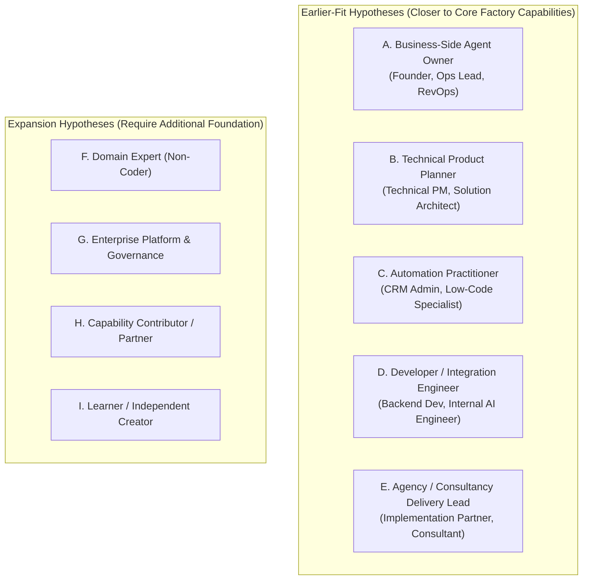

# Agent Development Factory: Persona Opportunity Map

**Document Status:** Product Planning Hypotheses (Not Validated Demand)  
**Document Date:** November 19, 2026  
**Audience:** For Raja's Review  
**Operational Invariant:** The Factory remains the product. Sales, research, and extraction agents are possible generated outputs, not replacement product definitions. All persona definitions, fit evaluations, and design implications are hypotheses to be tested, not proven market facts.

> [!IMPORTANT]
> **GOVERNANCE & PLANNING INVARIANT**  
> This document establishes planning hypotheses and persona evaluation criteria only. It does not select a primary persona, nor does it authorize implementation, candidate generation, testing, environment creation, spending, deployment, or access to held builds and derivative materials.

---

## 1. Core Recommendation

1. **Design for Multi-Role Collaboration:** Model the Factory experience as a structured collaboration between the person who **defines** the agent (business intent/boundaries), the person who **assembles or integrates** it (tool schemas/runtime scaffolding), and the person who **approves** its organizational use (security/compliance/budget). Do not compress all three roles into a single hypothetical technical persona.
2. **Preserve Progressive Depth:** Explore role-tailored entry points (e.g., guided brief interrogation for owners, specification review for planners, artifact inspection for builders, evidence review for approvers) as distinct views rather than fragmented, separate products.
3. **Avoid Premature Persona Selection:** Do not lock into developer-first, business-first, or agency-first entry before validating recurring need, willingness to pay, tolerance for setup, and access to implementation resources.

---

## 2. Competitive Context: What Builderpack Actually Shows

* **Primary Sources Examined (Read on Nov 19, 2026):**
  * `[1]` Builderpack Home (`https://www.builderpack.com/`)
  * `[2]` Builderpack Actions Catalog (`https://www.builderpack.com/actions`)
  * `[3]` Builderpack Setup Documentation (`https://www.builderpack.com/docs`)
  * `[4]` Builderpack Use Cases (`https://www.builderpack.com/use-cases`)

### Verified Site Characteristics
* **HubSpot-Centric Action Pack:** Builderpack advertises a curated library of 19 actions focused on company research, social/web intelligence, content creation, and utility functions designed specifically for HubSpot environments.
* **Dual Execution Modality:** The site describes these 19 actions as dual-purpose: they can execute either as standard HubSpot workflow automation steps or as agent-invokable tools.
* **Prerequisites & Installation:** Requires an OAuth installation into an existing HubSpot portal (specifically requiring a Professional or Enterprise portal tier) with pre-mapped inputs and outputs.
* **Described Use Cases:** Explicitly targeted at sales prospect research, competitive marketing intelligence, blog/social content generation, and citation-backed web lookups.

### Critical Analytical Distinctions for the Factory
* **Site Descriptions $\ne$ Validated Adoption:** These vendor descriptions describe product positioning and feature claims, not independently verified capabilities, customer volume, or commercial traction.
* **Not an Agent Factory:** Builderpack provides an *action/tool catalog* that hooks into HubSpot; it is **not** an agent-development factory that takes an unstructured natural-language brief, extracts boundaries, generates specifications, outputs multi-platform packs, or compiles adversarial test suites.
* **Interaction Pattern Value:** What Builderpack *does* illustrate is the pattern of **modular tool and action reuse** within an existing enterprise workflow environment, providing valuable input for the **Automation Practitioner** persona (Persona C). It does not demonstrate that Builderpack's customer base wants an agent factory, nor does it justify building on HubSpot.

---

## 3. Plausible Factory User Hypotheses

### 3.1 Earlier-Fit Hypotheses

#### A. Business-Side Agent Owner
* **Variants:** Founder, Operations Director, RevOps Lead, Marketing Lead.
* **Core Job-to-be-Done:** Convert an operational bottleneck or business objective into a structured agent brief, and understand exactly what is being signed off before implementation begins.
* **Specific Needs:** Guided discovery interviews, plain-language operational boundaries, visual behavioral previews, explicit visibility into assumptions, and a clean handoff bundle for downstream implementers.
* **Primary Barrier:** High outcome-urgency; may demand an instant, turn-key business result (e.g., "just fix my tickets") rather than interacting with a specification and design tool.

#### B. Technical Product Planner
* **Variants:** Technical Product Manager, Enterprise Solution Architect, AI Transformation Consultant.
* **Core Job-to-be-Done:** Translate ambiguous executive or stakeholder intent into reviewable, verifiable agent contracts; evaluate implementation options and trade-offs.
* **Specific Needs:** Bidirectional requirement-to-code traceability, capability boundary modeling, side-by-side version comparison, and an enforceable acceptance contract.
* **Primary Barrier:** Overhead risk; structured specifications add unwanted bureaucracy unless they tangibly shorten the end-to-end timeline to a working, inspectable agent pack.

#### C. Automation Practitioner
* **Variants:** HubSpot/Salesforce Administrator, Zapier/Make Power User, Low-Code Builder, Internal Automation Specialist.
* **Core Job-to-be-Done:** Assemble and orchestrate functional agents using existing corporate SaaS tools and connectors without writing full-stack custom code.
* **Specific Needs:** Explicit tool input/output typing, visual permission controls, pre-packaged capability blocks, and transparent ecosystem/runtime dependency warnings.
* **Primary Barrier:** Ecosystem lock-in, API connector drift, and ambiguous ownership when a multi-tool execution path fails in production.
* *Builderpack Connection:* Builderpack’s action-reuse model aligns directly with this persona's desired interaction pattern, highlighting the need for modular tool schemas in generated packs.

#### D. Developer or Integration Engineer
* **Variants:** Full-Stack/Backend Engineer, Independent AI Builder, Internal Platform AI Engineer.
* **Core Job-to-be-Done:** Inspect, modify, test, and maintain generated agent scaffolding rather than relying on an opaque, closed vendor runtime.
* **Specific Needs:** Direct access to editable files (Markdown instructions, JSON/OpenAPI schemas, runtime scripts), declared dependencies, meaningful edge-case test suites, and git-friendly versioned evidence manifests.
* **Primary Barrier:** Scaffold cynicism; if generated code is messy, over-abstracted, or bloated, developers will discard the factory and write the orchestration code from scratch.

#### E. Agency or Consultancy Delivery Lead
* **Variants:** Solo AI Automation Consultant, Systems Implementation Partner, Multi-Client Digital Agency.
* **Core Job-to-be-Done:** Produce consistent, high-integrity agent specifications, test suites, and deployment handoffs for multiple external client organizations.
* **Specific Needs:** Reusable specification patterns, client-specific boundary isolation, transparent sign-off checkpoints, and complete requirement revision histories.
* **Primary Barrier:** Multi-tenant data segregation, liability for agent hallucination, and the risk that a generic template fails to satisfy bespoke client requirements.

---

## 3.2 Expansion Hypotheses (Deferred for Later Phases)

#### F. Domain Expert with Limited Coding Experience
* **Variants:** Research Scientist, Legal Analyst, Medical Informatics Specialist, Educator.
* **Profile & Needs:** Possesses deep domain expertise but no software background. Needs teach-by-example prompt refinement, uncertainty calibration, and an automated technical handoff.
* **Planning Barrier:** Severe domain subtlety; high risk of premature confidence in superficially fluent model outputs. The Factory must not promise autonomous expert judgment.

#### G. Enterprise Platform or Governance Team
* **Variants:** Enterprise AI Platform Owner, InfoSec Auditor, Compliance Officer, Procurement Sponsor.
* **Profile & Needs:** Responsible for organizational risk; requires centralized policy enforcement, complete audit trails, RBAC, portfolio-wide visibility, and clear lines of liability.
* **Planning Barrier:** Heavy organizational sales cycles and heavyweight compliance requirements (SOC 2, ISO 42001, FedRAMP). Reviewers typically consume audit evidence rather than operating the Factory day-to-day.

#### H. Capability Contributor or Ecosystem Partner
* **Variants:** Tool Developer, API Provider, Connector Maintainer, Reusable Agent Pack Author.
* **Profile & Needs:** Authoring and monetizing modular capability blocks (actions, tool schemas, domain-specific evaluation suites). Requires contribution contracts, versioning registries, and compatibility verification.
* **Planning Barrier:** Marketplace dynamics; building a two-sided ecosystem requires significant developer trust, maintenance obligations, and revenue-sharing mechanisms. A marketplace is an exploratory ambition, not a current product feature.

#### I. Learner or Small Independent Creator
* **Variants:** Computer Science Student, AI Bootcamp Cohort Member, Hobbyist Maker, Solo Aspiring Founder.
* **Profile & Needs:** Educational exploration; needs step-by-step conceptual explanations, safe sandbox examples, intuitive error diagnostics, and zero-cost or low-cost access.
* **Planning Barrier:** High customer support overhead relative to willingness or ability to pay. Broad educational reach does not imply early commercial sustainability.

---

## 4. Design & Selection Trade-Offs

### 4.1 Progressive Depth Interaction Model
Instead of building four disconnected products for four different audiences, the Factory should explore a unified model of **progressive disclosure**:
1. **The Brief View (For Business Owners):** Guided natural-language interview capturing outcomes, boundaries, and explicit approvals.
2. **The Specification View (For Technical Planners):** Traceability matrices, requirement contracts, dependency audits, and boundary checks.
3. **The Artifact View (For Developers & Builders):** Raw editable file trees, OpenAPI/JSON schemas, platform adapters, and container entrypoints.
4. **The Evidence View (For Approvers & Governance):** Audit manifests (`manifest.json`), mutation test results, adversarial red-team traces, and invalidation logs.

### 4.2 Role Separation Principle
In any organizational deployment, the Factory must maintain strict distinction between five stakeholder functions, even if one individual temporarily wears multiple hats:
* **Requester:** Identifies the operational need.
* **Factory Operator:** Interacts with the Factory to clarify, specify, and compile the pack.
* **Approver:** Signs off on the specification, tool permissions, and test evidence.
* **Payer:** Holds the budget for software licenses and downstream LLM API tokens.
* **Downstream Agent User:** Interacts with the *generated agent* in production (distinct from the Factory user).

### 4.3 Strategic Entry-Point Trade-Offs

| Entry Strategy | Strategic Advantage | Operational Friction & Risks |
| :--- | :--- | :--- |
| **Business-Led Entry** | Expands addressable market beyond technical silos; anchors directly to business value. | Requires extremely robust automated disambiguation; high churn if users expect instant, fully automated execution. |
| **Developer-Led Entry** | Streamlines inspection and verification; developers can easily validate code and tool contracts. | Risks building an over-engineered tool that excludes the original business requester from the specification loop. |
| **Agency-Led Entry** | High recurring volume and willingness to pay for tools that accelerate client billable hours and handoffs. | Demands multi-client data isolation, bespoke white-labeling, and carries vicarious liability for agency delivery errors. |
| **Enterprise-Led Entry** | Large contract potential driven by compliance, governance, and audit visibility. | High enterprise friction: requires complex security reviews, SSO, and procurement gates before core utility is proven. |

---

## 5. Next Planning Comparison Criteria

To rank and select the primary entry persona during subsequent planning phases, each candidate will be evaluated across six objective dimensions:

1. **Recurrence of Need:** How frequently does this persona need to create, refine, or audit new AI agents (weekly vs. annual)?
2. **Value of Inspectable Packs:** Does this persona place high value on having inspectable, editable code and schemas, or do they prefer opaque SaaS execution?
3. **Access to Implementation:** Does this persona have immediate access to an engineer or platform to run the generated pack, or do they expect the Factory to host and run it?
4. **Tolerance for Setup:** What is their willingness to configure local environments, review JSON schemas, and resolve technical ambiguities?
5. **Assurance & Evidence Needs:** Does their use case demand auditable evidence manifests and adversarial verification, or is casual testing sufficient?
6. **Commercial Willingness to Pay:** Who owns the budget, and what is their demonstrated willingness to pay for specification and scaffolding software?

---

*Boundary Notice: All persona evaluations and design trade-offs above are planning hypotheses based on public vendor descriptions and structural analysis. Direct customer discovery conversations and empirical validation are required before locking in a primary audience. No implementation, testing, environment setup, spending, or deployment is authorized.*
