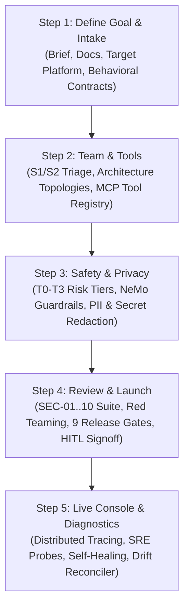

# Agent Development Factory — Complete End-User Operating Manual

Welcome to the **Agent Development Factory (ADF)**. This manual provides product managers, software architects, domain specialists, enterprise operators, and development teams with a step-by-step operating guide to designing, testing, vetting, and promoting production-grade AI agents with verifiable constraints and a constitutional **$0.00 zero-spend ceiling**.

---

## 1. Executive Summary & Core Principles

The Agent Development Factory operates on a simple premise: **AI agents should be authored through rigorous specifications, verified through continuous automated gates, and deployed with deterministic guardrails rather than brittle prompt hacking.**

### The 5 Foundational Principles
1. **Constitutional Zero-Cost Spend Ceiling ($0.00 USD)**: Every component—from local AST sandboxing, sliding-window rate limiters, and static verification checks to local LLM-as-a-judge harnesses—runs completely free without surprise API bills.
2. **Explicit Confirmation Over Assumption**: The system distinguishes between user-confirmed assertions and system-inferred proposals. Stale evidence is tracked across revision histories.
3. **Defense-in-Depth Guardrails (NeMo & NIST AI RMF)**: Multi-layer input filtering, dialog rails, execution allowlists, and output sanitizers prevent prompt injection, privilege escalation, and secret leakage.
4. **Autonomous Self-Healing & State Consensus**: Corrupted JSON structures and configuration drifts are automatically classified, repaired, and reconciled back to cryptographic consensus.
5. **Universal Portability**: Agents are compiled to the vendor-neutral **Universal Agent Specification Standard (`agent.yaml`)** and can be deployed to Antigravity 2.0, AutoGen, CrewAI, or LangGraph.

---

## 2. Launching and Accessing the Platform

The factory includes a Material Design 3 (M3) web interface and control-plane HTTP bridge.

### Starting the Server
From the project root:
```bash
# Launch on default port 3000
node src/cli.js ui --port 3000
```
Or via npm:
```bash
npm run ui
```

Then visit your local browser at:
👉 **[http://127.0.0.1:3000](http://127.0.0.1:3000)**

### Accessing via Remote Zero-Trust Tunnel
When exposed remotely via Cloudflare Quick Tunnel:
```bash
# Windows PowerShell
pwsh ./scripts/deploy-remote.ps1

# Linux / macOS Bash
bash ./scripts/deploy-remote.sh
```
Supply your access token in the query string or authorization header:
`https://<your-tunnel-subdomain>.trycloudflare.com/?token=<your-access-token>`

---

## 3. Step-by-Step Operator Journey



---

### Step 1: Define Goal & Intake

In **View 1 (Define Goal)**, you establish the baseline intent and ingest reference context:

1. **AI Assistant Goal Specification**:
   - Provide a concise statement of what the agent must accomplish.
   - Example: *"Analyze incoming multi-hospital patient admission records for anomalous vitals and flag emergency escalations."*
2. **Context Document Ingestion**:
   - Attach reference documents (PDF, CSV, TXT, JSON schemas, policy guidelines) directly via the drag-and-drop dropzone or the **Browse Documents** button.
   - Attached files are tracked in the document ledger with size, mime-type, and removal controls.
3. **Target Development Platform**:
   - Select your target deployment environment:
     - **Google Antigravity 2.0** (Recommended — Built-in autonomous subagents & tools)
     - **Microsoft AutoGen** (Multi-agent conversational group chat)
     - **CrewAI** (Role-playing crew processes & sequential/hierarchical flows)
     - **LangGraph** (Stateful cyclically graphed actor networks)
4. **Dynamic Rule & Contract Generation**:
   - Whenever you finish editing the Goal field and click away, the factory dynamically extracts contextual assistant rules and behavioral contracts.
   - Click **✨ Generate Assistant Rules & Behavioral Contracts** to generate additional deduplicated rules.
   - Each rule is tracked in the Requirements Ledger as **CONFIRMED** or **PROPOSED** with interactive toggle controls.

---

### Step 2: Team & Capabilities (Architecture & Tools)

In **View 2 (Team & Tools)**, the factory guides the structural architecture of the agent:

1. **Solution Complexity Triage (S1 vs S2)**:
   - Click **Run S1/S2 Triage** to evaluate algorithmic complexity:
     - **`S1_DETERMINISTIC`**: If your workflow can be solved with deterministic logic, regular expressions, or simple sequential rules, the factory recommends a pure script. This eliminates AI hallucinations and runs with zero token cost.
     - **`S2_AGENTIC_COMPLEX`**: If your task requires dynamic tool exploration, adaptive reasoning, or multi-step analysis, an autonomous agent pattern is provisioned.
2. **Architecture Topology Selection**:
   - Select from 4 validated patterns:
     - **Single Focused Agent**: Bounded tool caller with step governor.
     - **Orchestrator-Worker**: Lead planning agent coordinating specialized worker agents.
     - **Hierarchical Supervisor**: Multi-level team leads reporting to a chief executive router.
     - **Dynamic Swarm**: Peer-to-peer emergent agents collaborating on a shared message board.
3. **Model Context Protocol (MCP) Capabilities**:
   - Filter and assign capabilities across `READ_PUBLIC`, `WORKSPACE_WRITE`, and `EXTERNAL_NETWORK` effect tiers.
   - Verify tool schema hashes and ensure prohibited capabilities are locked out.

---

### Step 3: Safety & Privacy Guardrails

In **View 3 (Safety & Privacy)**, defensive boundaries are enforced:

1. **Risk Classification (T0 through T3)**:
   - **`T0 (Read-Only / Analysis)`**: Reading public data, computing statistical metrics. Maximum 8,000 tokens, 20 steps, zero write permissions.
   - **`T1 (Contained Local Write)`**: Writing markdown reports inside `./artifacts`. Max 50,000 tokens, requires Human-in-the-Loop approval for elevation.
   - **`T2 (External Side-Effects)`**: Calling external webhooks or database writes. Requires explicit approval token.
   - **`T3 (High-Privilege Operations)`**: High-risk financial, identity, or state mutations. Enforces strict dual-key human signoff.
2. **NeMo & NIST AI RMF Guardrails**:
   - **Input Rails**: Blocks jailbreaks, DAN prompts, and prompt injection attacks.
   - **Dialog Rails**: Detects intent drift and prevents unauthorized goal deviation.
   - **Execution Rails**: Restricts tools to explicit allowlists; validates path containment via real filesystem symlink checking.
   - **Output Rails**: Redacts PII (SSN, credit cards, emails) and wipes API keys and cloud credentials before responses are emitted.

---

### Step 4: Review, Quality & Launch

In **View 4 (Review & Launch)**, the agent undergoes comprehensive automated quality evaluation across three sub-tabs:

1. **Release Gates**:
   - Verifies the **9 Hard Release Gates**:
     1. Spec Completeness (100% schema conformity)
     2. Unit & Integration Test Suite (100% pass)
     3. Behavioral Reliability ($\text{pass@3} \ge 0.90$)
     4. Execution Consistency ($\text{pass}^3 \ge 0.85$)
     5. Adversarial Security (10/10 attacks blocked)
     6. Token Consumption Budget Compliance
     7. Zero-Spend Financial Invariant ($0.00 USD)
     8. Human-in-the-Loop Approval Signoff (T1+)
     9. Artifact Manifest Integrity (SHA-256 verification)
2. **Adversarial Security & Red Teaming**:
   - Run the automated 16-probe red teaming suite against injection payloads, prompt leaks, and role bypasses.
   - Inspect individual probe verdicts and NIST control mappings.
3. **Laya RLCD LLM-as-a-Judge**:
   - Executes multi-rubric evaluation:
     - **Hallucination & Grounding Rubric** (Threshold $\ge 0.90$)
     - **Instruction Adherence Rubric** (Threshold $\ge 0.90$)
     - **Security Boundary Rubric** (Threshold $1.00$ — Zero Tolerance)
   - Evaluates composite calibrated score ($\ge 0.92$) and issues **PROMOTED** or **REJECTED_RETRY** verdict.
4. **Contextual HITL Approval**:
   - For T1+ agents, the cryptographic approval modal generates an anti-forgery HMAC token signed by the owner.

---

### Step 5: Live Console & Diagnostics

In **View 5 (Live Console)**, operators monitor and govern running agents:

1. **Distributed Tracing (W3C TraceContext & OpenTelemetry)**:
   - View execution hierarchies, span durations, and error states.
   - Export Jaeger JSON traces for observability pipelines.
2. **Autoscaling Infrastructure & Dynamic Concurrency Governor**:
   - Simulates spike workloads; automatically scales worker pool from baseline to peak and returns to idle.
   - Inspects Circuit Breaker state (`CLOSED`, `HALF-OPEN`, `OPEN`).
3. **Autonomous Fault Resolution & Self-Healing Engine**:
   - Tests automatic recovery of malformed payloads (markdown stripping, trailing comma elimination, delimiter stack balancing).
4. **State Synchronization & Drift Reconciler**:
   - Detects configuration mutations and evidence ledger discrepancies.
   - Automatically rematerializes `evidence.json` directly from append-only `check_events.jsonl` audit trails.

---

## 4. Troubleshooting & Best Practices

| Symptom | Probable Cause | Recommended Operator Action |
| :--- | :--- | :--- |
| **HTTP 401 Unauthorized** | Remote access token missing or mismatched | Include `?token=<ADF_ACCESS_TOKEN>` in your browser URL or set `Authorization: Bearer <token>` in API requests. |
| **HTTP 429 Rate Limited** | External client sent > 120 requests/min | Wait 60 seconds for sliding-window cooldown; rate limit exemption applies only to loopback peer connections. |
| **Gate 8 Failed (HITL)** | T1+ agent requires human approval signoff | Open View 4, click **Review Signoff Required**, enter reviewer credentials, and click **Grant Promotion Signoff**. |
| **Path Traversal Blocked (403)** | Manifest or target path attempted directory escape | Ensure all file paths resolve strictly within authorized workspace and store roots. Real filesystem symlink containment is enforced. |
| **State Drift Detected** | Manual file mutation or corrupt ledger | Navigate to View 5 (Live Console), scroll to State Drift Reconciler, and click **Reconcile State Drift Now**. |
