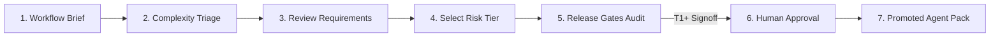

# Agent Development Factory — End-User Operating Manual

Welcome to the **Agent Development Factory (ADF)**. This manual provides non-technical users, business stakeholders, operations leads, and product owners with everything needed to transform workflow ideas into reliable, zero-cost, sandboxed software agents.

---

## 1. Executive Summary: What is the Agent Development Factory?

The Agent Development Factory is an autonomous assembly line for software agents. Rather than writing manual code or dealing with fragile agent prompts, you supply a plain-language **Workflow Brief**. The factory then:
1. **Triages the request** to determine if an AI agent is even needed (avoiding expensive AI when simple, deterministic scripts suffice).
2. **Scaffolds verified requirements**, distinguishing between what you confirmed and what the system inferred.
3. **Applies a 10-layer defense-in-depth safety shield** (preventing prompt injections, data leaks, path escapes, and runaway costs).
4. **Runs rigorous evaluations across 9 Release Gates** before any agent can be promoted to production.
5. **Enforces a strict $0.00 zero-cost spend ceiling**, ensuring 100% free-tier and local model compliance with zero unexpected cloud bills.

---

## 2. Launching the Material Design Web Platform

The factory includes a modern, responsive web application built with **Google Material Design 3 (M3)**.

### How to Start the Web Interface
From your terminal, execute:
```bash
node src/cli.js ui --port 3000
```
or via npm:
```bash
npm run ui
```

Then open your browser to:
👉 **[http://127.0.0.1:3000](http://127.0.0.1:3000)**

> **Hybrid Runtime Support**: The interface works in three distinct modes:
> - **Live REST Mode**: Connected directly to the factory's native server for real-time compilation and checks.
> - **Embedded Webview Mode**: Embedded inside IDE panes or desktop shells using secure `postMessage` protocol.
> - **Offline Simulation Mode**: Runs standalone if you open `ui/index.html` directly via `file:///` without any backend running, executing simulated heuristics and mock evaluations in the browser.

---

## 3. Step-by-Step Operator Journey



### Step 1: Submitting Your Workflow Brief
In the **Intake & Triage** workspace:
1. Enter your objective in the **Workflow Specification Brief** text box.
2. Be explicit about:
   - What data the agent consumes (e.g. CSV spreadsheets, log files, customer queries).
   - What decisions or transformations it performs.
   - What artifacts it produces (e.g. markdown reports, summarized metrics).
   - Any external actions it must NOT take (e.g. never delete database records).
3. Alternatively, click the **Load Sample Brief** dropdown to explore pre-configured patterns like the *Data Quality Anomaly Detector* or *Financial Ledger Reconciler*.

### Step 2: Understanding Complexity Triage (S1 vs S2)
Click **Run S1/S2 Triage**. The factory analyzes your brief using bounded algorithmic heuristics:
- **`S1_PURE_DETERMINISTIC`**: If your workflow can be solved with deterministic logic, regular expressions, or simple sequential rules, the factory recommends a pure script. This eliminates AI hallucinations and runs with zero token cost.
- **`S2_AGENTIC_COMPLEX`**: If your task requires dynamic tool exploration, adaptive reasoning, or multi-step analysis, the factory provisions an autonomous agent pattern (e.g. *Orchestrator-Worker*).

### Step 3: Reviewing the Requirements Ledger
Section 2.1 of our engineering constitution mandates that **all requirements must be traceable**:
- <span style="color:#146c2e; font-weight:bold;">CONFIRMED</span>: Requirements directly provided and asserted by you.
- <span style="color:#b36b00; font-weight:bold;">PROPOSED</span>: Requirements suggested by the factory's automated assistant. You can review and click **Confirm** or **Revoke**.
- <span style="color:#ba1a1a; font-weight:bold;">UNRESOLVED</span>: Open ambiguities that require your clarification before the agent can be built.

### Step 4: Selecting Safety & Risk Tiers
Navigate to the **Guardrails** workspace. The factory classifies agents into four Risk Tiers:
| Tier | Description | Allowed Privileges | Human Approval |
| :--- | :--- | :--- | :--- |
| **`T0`** | **Read-Only / Analysis** | Reading public data, mathematical calculation | Automatic (Sampled) |
| **`T1`** | **Contained Local Write** | Writing markdown reports inside `./artifacts` | **Required** (Gate 8 Token) |
| **`T2`** | **External Side-Effects** | Calling external webhook, writing to database | **Required** (Gate 8 Token) |
| **`T3`** | **Autonomous Financial/Identity**| High-privilege state modification | **Strict Dual-Key HITL** |

### Step 5: Release Gates & Human-in-the-Loop (HITL) Sign-Off
Navigate to **Evals & Gates** and click **Evaluate Release Gates**. The factory checks all 9 release gates:
1. **Gate 1 (Spec Compliance)**: Universal Agent Spec YAML passes strict schema validation.
2. **Gate 2 (Unit Tests)**: 100% of deterministic unit and integration tests pass.
3. **Gate 3 (Behavioral Evals)**: $\text{pass@3} \ge 0.90$ across realistic input distributions.
4. **Gate 4 (Consistency)**: $\text{pass}^3 \ge 0.85$ repeatable execution across runs.
5. **Gate 5 (Adversarial Security)**: 10 / 10 attacks defended in SEC-01..10 suite.
6. **Gate 6 (Token Budget)**: Token usage strictly within allocated budget window.
7. **Gate 7 (Zero-Cost Spend)**: Total monetary API spend is exactly **$0.00**.
8. **Gate 8 (Human Review)**: Explicit cryptographic signoff token for T1+ agents.
9. **Gate 9 (Manifest Integrity)**: Cryptographic SHA-256 hash match on all build artifacts.

If an agent is Tier 1 or higher, Gate 8 will pause and request **Human Signoff**. A modal dialog will appear:
- Enter your reviewer name.
- Review the auto-generated cryptographic token `token-hitl-signoff-...`.
- Click **Grant Promotion Signoff**.

---

## 4. Troubleshooting and FAQs

### Q: Why was my agent rejected with `REJECTED_RETRY`?
> **Self-Healing Loop**: If any release gate fails (for example, token budget exceeded or a security check flagged an unescaped output), the factory enters an automated self-healing loop. It will adjust prompt parameters or guardrail thresholds and retry up to **3 times** before stopping to avoid runaway cycles.

### Q: How do I verify the system is healthy?
> Navigate to the **Doctor & Ops** workspace in the web interface, or run `adf doctor` from the terminal. The doctor inspects Node versions, Python environments, port canaries (port 3000, port 11434), and store directory integrity.

### Q: Are my API keys safe?
> **Dual-Phase Secret Redaction**: The factory active security layer (G3) scans all prompts, logs, and outputs for high-entropy tokens and API keys. Any identified credential is automatically replaced with `[REDACTED_API_KEY]` before touching the screen or disk.
