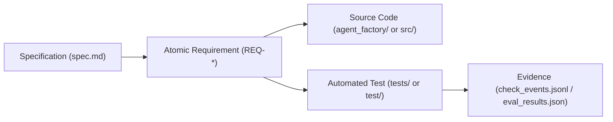

# Agent Development Factory Specification Portal

**Governing Methodology:** Official GitHub Spec Kit Methodology (`specify-cli 1.3.0`)  
**Status:** ACTIVE & ENFORCEABLE  
**Last Updated:** November 20, 2026  

---

## 1. Purpose of the Specification Directory

The `specs/` directory is the authoritative repository of engineering intent for the **Agent Development Factory**. It provides a single source of truth for:
* What the Factory and its generated agents are intended to do.
* What capabilities are currently implemented and verified by test evidence.
* What architectural principles and security boundaries govern future development.
* How requirements map to source code components and deterministic test cases.

---

## 2. Directory Organization

```
specs/
├── README.md               # Master navigation index and directory manifest (this document)
├── audit/                  # Static audit deliverables from SDD adoption
│   ├── 01-repository-discovery.md         # Baseline discovery & git divergence
│   ├── 02-specification-register.md      # Master specification inventory (33+ specs)
│   ├── 03-implementation-traceability.md # Requirements-to-code traceability matrix
│   ├── 04-specification-gaps.md          # Architectural gap & discrepancy report
│   ├── 05-quality-assessment.md          # Specification quality scorecard
│   └── 06-baseline-v1.0.0-delta.md       # ADF-001..040 baseline delta & remediation order
├── governance/             # Binding SDD governance policies & standards
│   ├── specification-management-policy.md# Authoring rules, reviews, change controls
│   ├── specification-lifecycle.md         # Lifecycle state definitions
│   ├── naming-conventions.md             # Syntax for filenames, folders, and REQ IDs
│   ├── traceability-policy.md            # Traceability chain & evidence invariants
│   ├── autonomy-policy.md                # 5-tier autonomy classification
│   ├── approval-policy.md                # Human approval record requirements
│   └── risk-management.md                # Master risk register & mitigations
├── architecture/           # System architecture blueprints & ADRs
│   ├── master-architecture.md            # Three-Plane separation model & state machine
│   ├── component-architecture.md         # 8 core subsystems blueprint
│   ├── data-architecture.md              # 4 conceptual data stores & classifications
│   ├── security-architecture.md          # 3-layer security & quarantine model
│   ├── integration-architecture.md       # Provider adapters & harness interfaces
│   ├── evaluation-framework.md           # Multi-metric scoring & Deep Evaluator
│   ├── deployment-architecture.md        # Local process, Hermes, Docker topologies
│   └── adrs/                             # Architecture Decision Records (ADR-001 to ADR-006)
├── contracts/              # Authoritative machine-readable JSON schemas
│   ├── README.md                         # Schemas index
│   ├── agent.schema.json                 # Universal Agent Spec standard
│   └── hermes-packets/                   # Critic, verifier, doc packet schemas
├── features/               # GitHub Spec Kit Living Feature Specifications
│   ├── 001-bounded-authoring-slice/      # Node.js zero-dependency authoring engine
│   ├── 002-autonomous-watcher-loop/      # Autonomous file watcher & packet bundler
│   ├── 003-control-plane-orchestrator/   # Python 11-stage FSM lifecycle engine
│   └── 004-evaluation-verification-harness/ # Deep Evaluator & LangSmith telemetry
└── archive/                # Preserved historical baselines (read-only)
    ├── README.md                         # Supersession map & archive provenance
    └── 2026-11-03-baseline/              # 33 original FACTORY_*.md baseline files
```

---

## 3. How to Locate a Feature Specification

All living, active feature specifications reside in `specs/features/` with sequential three-digit zero-padded prefixes:
* **Feature 001 (`specs/features/001-bounded-authoring-slice/`):** Zero-dependency Node.js CLI, containment checks, requirement triage (`CONFIRMED`, `PROPOSED`, `UNRESOLVED`), append-only check event streams.
* **Feature 002 (`specs/features/002-autonomous-watcher-loop/`):** Autonomous engineering file-watcher, pre-commit hook, and surgical packet bundling for Hermes agents.
* **Feature 003 (`specs/features/003-control-plane-orchestrator/`):** 11-stage FSM lifecycle orchestrator, atomic SQLite task ledger, and human approval verification.
* **Feature 004 (`specs/features/004-evaluation-verification-harness/`):** Multi-metric quality graders (ExitCode, JSONSchema, Markdown, AST), Deep Evaluator gates, and LangSmith telemetry adapter.

Each feature folder contains the official Spec Kit four-artifact structure:
1. `spec.md`: What and Why (Problem statement, prioritized user stories, acceptance criteria).
2. `plan.md`: How (Architecture, technology choices, data contracts, dependencies).
3. `tasks.md`: Sequential, verifiable task units with completion checkboxes.
4. `checklist.md`: Unit tests of requirement intent and clarity.

---

## 4. How to Create a New Specification

To propose a new feature or major capability:

1. Create a dedicated feature branch from `main`:
   ```bash
   git checkout -b feat/spec-<feature-name>
   ```
2. Run the Specify CLI command or use the PowerShell helper:
   ```powershell
   pwsh .specify/scripts/powershell/create-new-feature.ps1 -FeatureName "<feature-name>"
   ```
   *Or manually copy `.specify/templates/spec-template.md` to `specs/features/<NNN>-<feature-name>/spec.md`.*
3. Author `spec.md` focusing strictly on *What* and *Why*. Avoid implementation specifics.
4. Verify adherence to `.specify/memory/constitution.md`.
5. Run clarification and quality checks:
   - Create `checklist.md` from `.specify/templates/checklist-template.md`.
   - Verify every requirement has measurable acceptance criteria.
6. Create `plan.md` and `tasks.md` before writing implementation code.

---

## 5. How to Update an Existing Specification

1. When modifying an existing feature's behavior, check out a working branch.
2. Mark the specification status as `Evolving` in its header.
3. Apply changes with explicit delta rationale.
4. Update associated test cases in `test/` or `tests/`.
5. Submit for multidisciplinary peer review. Upon merge, status returns to `Baselined`.

---

## 6. How to Interpret Lifecycle Status

Every specification displays a lifecycle badge in its document header:
* `Draft`: Inception phase. Incomplete, exploratory. Cannot govern implementation.
* `In Review`: Submitted for architecture and QA review.
* `Baselined`: Approved authoritative intent. Binding on all code and tests.
* `Evolving`: Active modification in progress on a feature branch.
* `Superseded`: Replaced by a newer document. Points to successor in header.
* `Retired`: Deprecated and retained strictly for historical auditability.

---

## 7. How Specifications Relate to Implementation



The relationship is bi-directional and binding:
* **No Code without Spec:** Any code committed without a tracing requirement in `specs/` will be flagged by automated review as unauthorized scope expansion.
* **No Spec without Verification:** Any requirement marked as completed must trace to a passing test and cryptographic evidence digest.

---

## 8. How to Validate Documentation

Run the automated specification linting and consistency suites:

```bash
# Validate Node.js contracts, JSON schemas, and test suites
npm run lint
npm test

# Validate Python Pydantic specs and schema integrity
pytest tests/test_schema.py

# Preview live documentation portal
mkdocs serve
```

---

## 9. Historical Documentation

Historical baselines, initial bootstrap documents from 2026-11-03, and the original 52-page handbook extraction reside in:
* [`specs/archive/2026-11-03-baseline/`](archive/2026-11-03-baseline/): Exact 33 original `FACTORY_*.md` files.
* [`specs/archive/README.md`](archive/README.md): Historical supersession map linking every archived document to its modern successor.
* `extracted_handbook.txt`: The foundational 52-page full-lifecycle engineering handbook.
