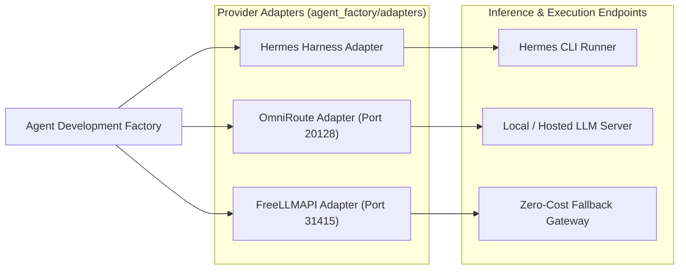

# Factory Integration Architecture

**Document Version:** 1.1.0  
**Date:** November 20, 2026  
**Status:** BASELINED & APPROVED  
**Provenance:** Promoted from historical baseline `FACTORY_INTEGRATION_ARCHITECTURE.md`  

---

## 1. Integration Topologies

The Factory integrates with external inference providers and agent harnesses via decoupled provider adapters:

---

## 2. Adapter Contracts

All adapters implement `agent_factory.adapters.base.BaseProviderAdapter`:
* `generate(prompt: str, model: str, **kwargs) -> str`: Synchronous text generation.
* `health_check() -> bool`: Verifies endpoint connectivity and model availability.
* `get_cost_estimate(tokens: int) -> float`: Computes estimated cost, enforcing the `$0.00` spend ceiling.
