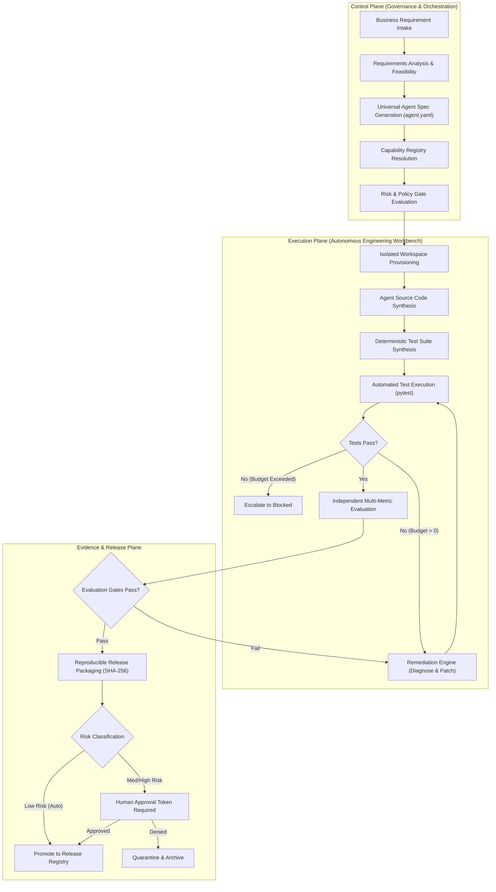

# Factory Master Architecture

**Document Version:** 1.1.0  
**Date:** November 20, 2026  
**Status:** BASELINED & APPROVED  
**Harness / Orchestrator:** Hermes Agent v0.22.6, Google Antigravity, and Standalone Local Process  
**Provenance:** Promoted from historical baseline `FACTORY_MASTER_ARCHITECTURE.md`  

---

## 1. Executive Architectural Blueprint

The **Autonomous Agent Development Factory** is a vendor-neutral, modular, quality-gated manufacturing line for artificial intelligence agents. It automates the progression from raw business objectives to fully tested, evaluated, packaged, and operated software agents, while maintaining human governance over critical risk boundaries.

Rather than treating agent creation as an unstructured conversational session, the factory operates as an industrial software production line governed by strict state transitions, cryptographic evidence ledgers, and deterministic acceptance gates.

---

## 2. Three-Plane Separation Model

The architecture strictly isolates execution state, control decisions, and evidence verification:

1. **Control Plane:** Maintains the definitive finite state machine (11 lifecycle stages). Evaluates risk, tracks resource ceilings, and records transitions in an atomic SQLite ledger (`data/factory_state.db`) and append-only JSON Lines stream (`data/task_events.jsonl`).
2. **Workbench Plane:** Ephemeral sandbox environments created in exclusive subdirectories. Synthesizes deterministic source code, generates pytest test fixtures, and packages immutable zip artifacts.
3. **Verification & Runtime Plane:** Executes synthesized agents in isolated processes. Graders compute objective metrics (exit code, output json schema, markdown formatting, AST security check) before release promotion.
