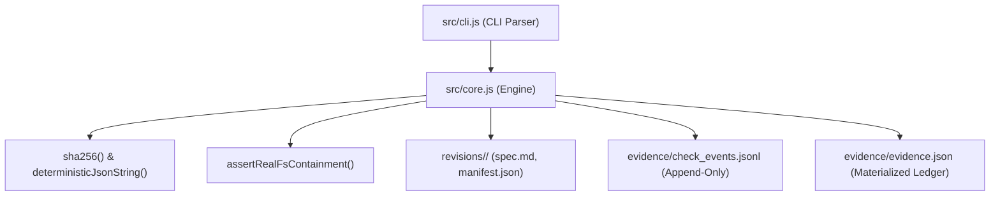

# Implementation Plan: Bounded Factory Authoring Slice

**Feature Branch:** `001-bounded-authoring-slice`  
**Feature ID:** FEAT-001  
**Created:** 2026-11-20  
**Status:** Baselined  

---

## 1. Technical Architecture

The authoring slice is implemented as a standalone, zero-dependency Node.js engine structured into two source modules:
1. `src/core.js`: Pure functional engine handling cryptographic operations, containment checking, revision persistence, check evaluation, and ledger auditing.
2. `src/cli.js`: Command-line interface parsing flags, validating arguments, and delegating to core functions with predictable exit codes (`0` for success, `1` for error).

---

## 2. Dependencies & Constraints

* **Node.js Built-ins Only:** `node:fs`, `node:path`, `node:crypto`. Zero npm package dependencies.
* **Storage Invariant:** All revisions are immutable once created. A child revision pointing to a parent (`--parent-rev`) establishes an invalidation link without altering the parent snapshot.
* **Failure Preservation:** Check execution failures are permanently recorded in `check_events.jsonl` before returning non-zero exit codes.
