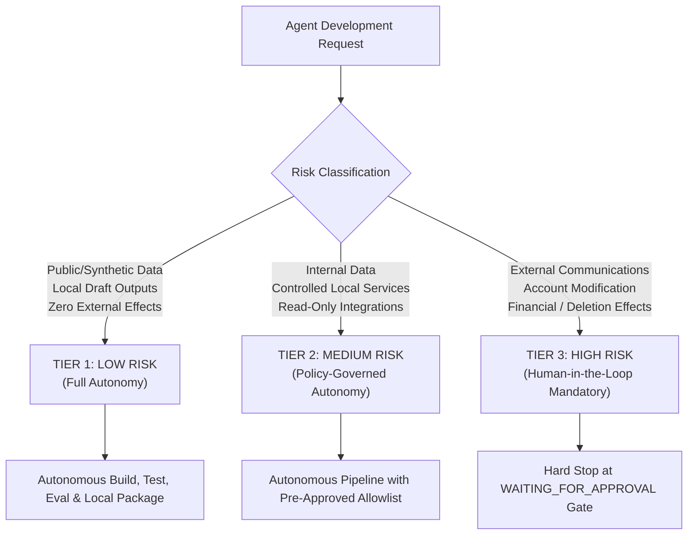

# Factory Autonomy Policy

**Policy ID:** POL-SPEC-05  
**Version:** 1.0.0  
**Effective Date:** November 20, 2026  
**Status:** MANDATORY & ENFORCEABLE  
**Provenance:** Promoted from historical baseline `FACTORY_AUTONOMY_POLICY.md`  

---

## 1. Principles of Governed Autonomy

Autonomous operation is a capability to be earned through verified quality and safety, not an unconstrained default. The Agent Development Factory enforces a **Risk-Based Autonomy Policy** designed to maximize engineering velocity for safe, low-risk workloads while ensuring ironclad human governance over high-risk or consequential operations.

---

## 2. Three-Tier Risk Classification

Every agent development request is classified at the `INTAKE` stage into one of three risk tiers based on its intended domain, data sensitivity, and operational side-effects:

### Tier 1: Low Risk (Full Autonomy)
* **Scope:** Read-only analysis of public or synthetic data, data transformation, local draft generation, internal anomaly detection, unit testing.
* **Permitted Effects:** `READ_PUBLIC`, `WRITE_LOCAL_DRAFT`.
* **Autonomy Level:** Fully automated from Intake to Release Promotion. No human intervention required if all automated evaluation gates pass.

### Tier 2: Medium Risk (Policy-Governed Autonomy)
* **Scope:** Internal business reporting, reading non-critical databases, interaction with local staging APIs, draft PR generation.
* **Permitted Effects:** `READ_INTERNAL`, `WRITE_LOCAL_DRAFT`, `CALL_INTERNAL_API`.
* **Autonomy Level:** Automated build, test, and evaluation. Requires automated policy check against allowlists before packaging.

### Tier 3: High Risk (Human-in-the-Loop Mandatory)
* **Scope:** Outbound email/publishing, changing account settings, financial transactions, database mutations, infrastructure deployment.
* **Permitted Effects:** `SEND_PUBLISH`, `CHANGE_ACCOUNT`, `SPEND_DELETE`, `EXECUTE_REMOTE`.
* **Autonomy Level:** Factory autonomously analyzes, drafts code, and executes sandbox tests, but **strictly halts** at `WAITING_FOR_APPROVAL` before release or live execution.
