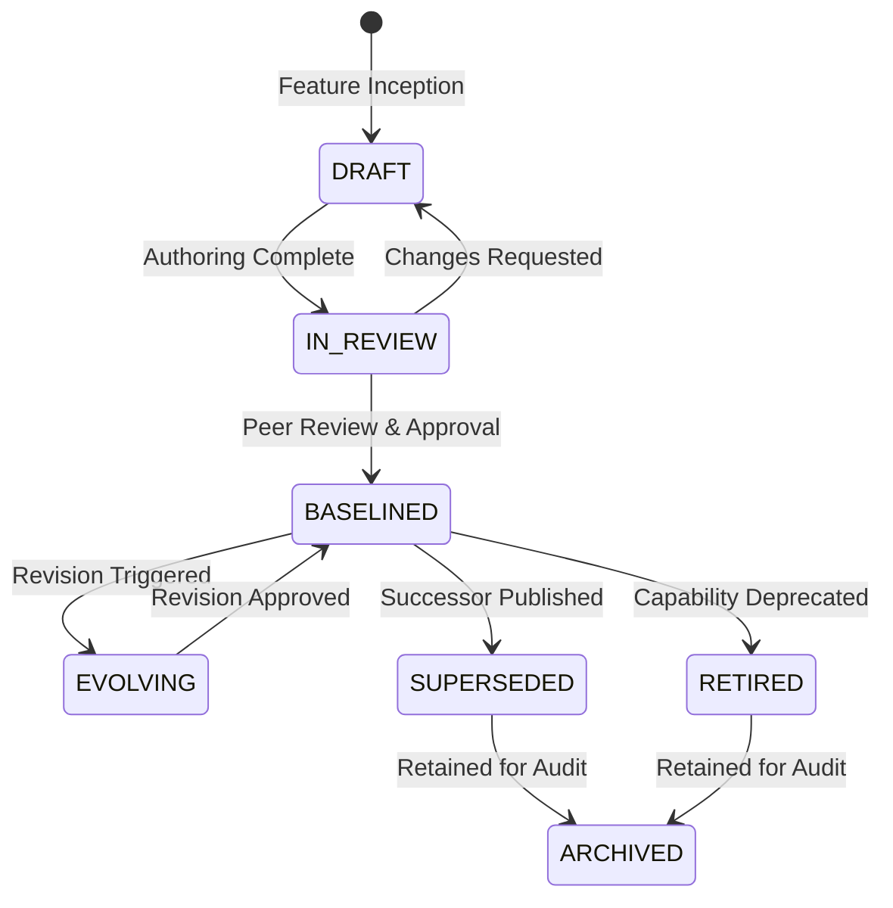

# Specification Lifecycle Framework

**Policy ID:** POL-SPEC-02  
**Version:** 1.0.0  
**Effective Date:** November 20, 2026  
**Governing Standard:** GitHub Spec Kit Lifecycle States  
**Status:** MANDATORY & ENFORCEABLE  

---

## 1. Specification Lifecycle States

Every specification and requirement within the Agent Development Factory exists in one of six formal lifecycle states:

| State | Definition | Permitted Operations | Verification Invariant |
| :--- | :--- | :--- | :--- |
| `DRAFT` | Initial authoring phase. Incomplete requirements, active exploration. | Frequent edits, prototyping, clarification queries. | Not permitted to govern production implementation. |
| `IN_REVIEW` | Authored and submitted for multidisciplinary review. | Read-only except for review comments and clarifications. | Must pass quality checklist (`checklist.md`) and schema validation. |
| `BASELINED` | Formally approved by stakeholders as active authoritative engineering intent. | Read-only. Modifications require formal revision initiation. | 100% of functional requirements must trace to automated tests. |
| `EVOLVING` | Existing baselined spec undergoing scoped modifications or extension. | Controlled edits with delta markers against prior baseline. | Prior baseline remains binding until new revision reaches `BASELINED`. |
| `SUPERSEDED` | Replaced by a newer specification or consolidated document. | Read-only. Must include explicit header link to successor document. | Cannot be deleted; archived in `specs/archive/`. |
| `RETIRED` | Capability or requirement officially deprecated and removed from production. | Read-only. Must record rationale, sunset date, and PR references. | Associated tests removed or marked deprecated. |

---

## 2. State Transition Controls

1. **Promotion to `BASELINED`:**
   - Requires approval from at least two technical roles (Lead Architect + PM or QA Lead).
   - All open clarification items in `spec.md` must be resolved (zero `TBD` or `TODO` items).
   - Acceptance criteria must be 100% verifiable.
2. **Triggering `EVOLVING`:**
   - Any proposed change altering functional behavior, security boundaries, or interface contracts triggers the `EVOLVING` state.
   - Minor non-normative fixes (typos, clarifications, link repairs) may be committed directly with peer review without triggering `EVOLVING`.
3. **Preservation Invariant (`SUPERSEDED` & `RETIRED`):**
   - No specification is ever deleted from git history.
   - Superseded specifications are relocated to `specs/archive/` with metadata indicating:
     - Superseded Date
     - Successor Document Link
     - Architectural Rationale for Supersession
