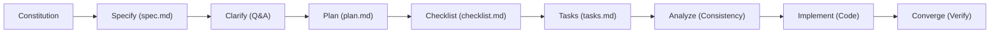

# Specification Management Policy

**Policy ID:** POL-SPEC-01  
**Version:** 1.0.0  
**Effective Date:** November 20, 2026  
**Governing Standard:** Official GitHub Spec Kit Methodology  
**Status:** MANDATORY & ENFORCEABLE  

---

## 1. Purpose and Principles

The **Agent Development Factory** treats specifications not as static documentation, but as executable, testable engineering contracts that govern every phase of the agent lifecycle.

This policy establishes the operational framework for creating, evolving, reviewing, validating, and retiring specifications, ensuring that:
1. Every specification serves an identifiable engineering or product-management objective.
2. Every significant requirement is testable against deterministic evidence.
3. Every architectural decision maintains clear rationale and historical provenance.
4. No code is modified without prior specification alignment.

---

## 2. Directory Architecture & Artifact Authority

The `specs/` directory is organized into discrete functional zones, each with distinct ownership and lifecycle rules:

```
specs/
├── README.md               # Master navigation index and directory manifest
├── audit/                  # Static audit reports, gap analyses, and discovery baselines
├── governance/             # Binding policies, lifecycle definitions, and standards
├── architecture/           # Master blueprints, subsystem designs, and ADRs
├── contracts/              # Authoritative machine-readable schemas and packet definitions
├── features/               # GitHub Spec Kit feature directories (living specifications)
└── archive/                # Preserved historical baselines (read-only)
```

### Artifact Authority Rules:
* **Normative Documents:** Specifications in `specs/governance/`, `specs/contracts/`, and `specs/features/` are binding. Any implementation diverging from them constitutes a defect.
* **Informative Documents:** Reports in `specs/audit/` and historical snapshots in `specs/archive/` are informative and provide context, provenance, and audit trails.
* **Single Authoritative Source:** No requirement or architectural decision may be maintained across competing documents. Where overlap occurs, the active document in `specs/` takes precedence.

---

## 3. Specification Authoring Lifecycle

All new capabilities or substantial modifications must follow the official GitHub Spec Kit workflow:



1. **Constitution Alignment:** Verify that proposed changes adhere to `.specify/memory/constitution.md`.
2. **Specification (`spec.md`):** Focus exclusively on *What* and *Why*. Define problem statement, business objective, user stories, functional requirements, and measurable acceptance criteria. Avoid implementation details.
3. **Clarification:** Resolve ambiguous requirements and unstated assumptions through structured clarification questions.
4. **Planning (`plan.md`):** Focus exclusively on *How*. Define technical approach, architecture, dependencies, data models, and verification strategy.
5. **Quality Checklist (`checklist.md`):** Formulate unit tests of requirement intent. Verify clarity, completeness, and edge-case coverage.
6. **Task Breakdown (`tasks.md`):** Deconstruct implementation into sequential, dependency-ordered, verifiable task units.
7. **Cross-Artifact Analysis:** Verify internal alignment across `spec.md`, `plan.md`, and `tasks.md` before writing implementation code.
8. **Implementation & Convergence:** Execute code changes strictly within the scope of approved tasks, followed by automated verification.

---

## 4. Change Management & Review Controls

* **Zero Direct Commits to Default Branch:** All specification modifications must be developed on a dedicated feature branch (e.g., `feat/spec-<feature-name>`).
* **Independent Review Gate:** Before merging, specifications must undergo review across Product Management, Software Architecture, Test Engineering, and DevSecOps.
* **Automated Linting & Schema Validation:** Pull requests must pass automated markdown linting and JSONSchema validation (`npm run lint` and `pytest tests/test_schema.py`).
* **Traceability Invariant:** Every merged requirement must link to at least one test case or evidence artifact before marking as completed.
