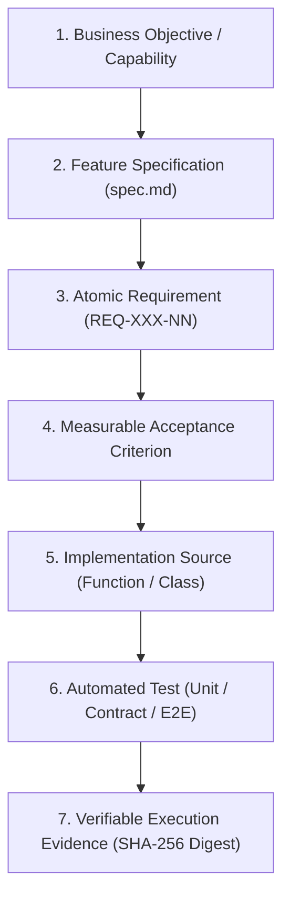

# Requirements Traceability Policy

**Policy ID:** POL-SPEC-04  
**Version:** 1.0.0  
**Effective Date:** November 20, 2026  
**Status:** MANDATORY & ENFORCEABLE  

---

## 1. Principles of Continuous Traceability

The Factory operates under the invariant that **untested code is technical debt, and untraced requirements are hallucinations**.

Traceability is not an afterthought or a manual spreadsheet exercise; it is an active engineering constraint enforced through:
1. Direct symbol references in specification documents.
2. Requirement-tagged test functions (`@pytest.mark.req("REQ-XXX-01")` or test comments).
3. Automated verification reports capturing SHA-256 digests of test inputs and outputs.
4. Bi-directional link integrity verified during CI/CD.

---

## 2. The Seven-Tier Traceability Chain

Every deployed agent capability must maintain verifiable links across all seven tiers:

---

## 3. Mandatory Evidence Governance

Per **Rule 4: Evidence-Based Completion (`REQ-GOV-04`)**, narrative claims of completion without supporting artifacts are strictly rejected by the factory:
* **Binary Test Passes:** Test suites must exit with return code `0`. Any skipped tests must be justified in test metadata.
* **Cryptographic Digests:** Artifacts emitted by the factory (agent specs, source zips, manifests) must record their full 64-character SHA-256 hex digest.
* **Append-Only Evidence Ledgers:** Test runs, static evaluations, and triage decisions must be permanently recorded to an append-only ledger (`check_events.jsonl` / `task_ledger.db`). Materialized state (`evidence.json`) must be mathematically verifiable against the event stream.
* **Zero Phantom Successes:** If an output file or verification check cannot be located on disk, the state machine must transition to `BLOCKED`, never `COMPLETED`.
